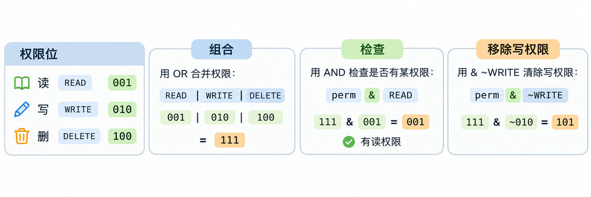

# 壹.2.11 位操作符与进制转换

为什么单独讲“位操作符”呢？因为我发现日常工作中，前端工程师朋友们经常使用**算术操作符、一元操作符、关系操作符、相等操作符**，就是很少有用到**位操作符**（\|，&，~，^，&lt;&lt;，&gt;&gt;）。但其实位操作符用好了又特别省事，一般的老手都会用它来实现一些特定功能，因此也会被经常问到来侧面考察一个前端工程师是否老到。所以，这里单独用一篇文章来系统性讲解位操作符。

## 基础讲解

### 按位与（&）

两个操作数中相对应的位都是1时，这位为1，否则都为零

```js-run
var a=3//011
var b=7//111
console.log(a&b)// 输出3 => 011
```

### 按位或（\|）

如果两个数对应的有一个为1时，这位就为1

```js-run
var a=3//011
var b=7//111
console.log(a|b)// 输出7 => 111
```

### 按位异或（^）

两个数对应位不同，这位才为1，否则为0

```js-run
var a=3//011
var b=7//111
console.log(a^b)// 输出4 => 100
```

### 按位非\(~\)

一元操作符。将操作数所有位取反。而根据js中带符号的整数的表示方法，对一个值使用~运算符相当于它的相反数减1。

```js-run
var b=-7
console.log(~b)//输出6
```

### 左移（&lt;&lt;）

将第一个操作数进行左移，移动的位数为第二个操作数\(0~31之间的一个整数\)，新的位由0补齐。

```js-run
var a=3
var b=7//000111
console.log(b<<a)//111000 => 输出56
```

### 有符号右移（&gt;&gt;）

将第一个操作数进行右移，移动的位数为第二个操作数\(0~31之间的一个整数\)，右边的溢出位被忽略，填补在左边的位由原操作数符号决定，以便保持结果的符号与原操作数一致。如果第一个操作数是正数，移位后用0填补最高位；如果为负，用1填补最高位。

```js-run
var a=2
var b=-7//1 111111001  
console.log(b>>a)//1 11111110 => -2
```

### 无符号右移

同样右移，最高位补0，忽略符号位

```js-run
var a=4
var b=-1// 1 11111111
console.log(b>>>a)//0 0000 1111 1111 1111 1111 1111 1111 1111 => 输出268435455
```

## 进制转换

位操作涉及与二进制的转换，这里顺带把JavaScript的进制转换也讲一下。

### **1.十进制转其他**

十进制转其他相对简单，直接使用 toString\(\) 方法。

```javascript
//十进制转其他  
var x=110;  
alert(x);  
alert(x.toString(2));//转二进制
alert(x.toString(8));//转八进制
alert(x.toString(16));//转十六进制
```

### **2.其他转十进制**

其他进制转十进制也比较简单，使用parseInt，传递第二个参数代表当前数字的进制。

```javascript
//其他转十进制  
var x='110';  
alert(parseInt(x,2)); //二进制转十进制
alert(parseInt(x,8)); //八进制转十进制
alert(parseInt(x,16));//十六进制转十进制
```

### **3.其他进制转其他进制**

这里需要转换两次，首先使用parseInt转换到十进制，然后使用toString转换到目标进制。

```javascript
//其他转其他  
//先用parseInt转成十进制再用toString转到目标进制  
alert(String.fromCharCode(parseInt(141,8)))  
alert(parseInt('ff',16).toString(2));
```

另外，可以参考这篇文章，[用笔和纸手算二进制与十进制转换](https://www.cnblogs.com/web-record/p/11132861.html)。

## 面试题

### 华为面试题：判断两个IP是否在同一子网

> 子网掩码是用来判断任意两台计算机的IP地址是否属于同一子网络的根据。  
> 子网掩码与IP地址结构相同，是32位二进制数，其中网络号部分全为“1”和主机号部分全为“0”。利用子网掩码可以判断两台主机是否中同一子网中。若两台主机的IP地址分别与它们的子网掩码相“与”后的结果相同，则说明这两台主机在同一子网中。
>
> #### 示例：
>
> **I P 地址 192.168.0.1  
> 子网掩码 255.255.255.0**
>
> 转化为二进制进行运算：
>
> I P 地址 11010000.10101000.00000000.00000001  
> 子网掩码 11111111.11111111.11111111.00000000
>
> AND运算 11000000.10101000.00000000.00000000
>
> 转化为十进制后为： 192.168.0.0
>
> **I P 地址 192.168.0.254  
> 子网掩码 255.255.255.0**
>
> 转化为二进制进行运算：
>
> I P 地址 11010000.10101000.00000000.11111110  
> 子网掩码 11111111.11111111.11111111.00000000
>
> AND运算 _\*\*_11000000.10101000.00000000.00000000
>
> 转化为十进制后为： 192.168.0.0
>
> 通过以上对两台计算机IP地址与子网掩码的AND运算后，我们可以看到它运算结果是一样的。均为192.168.0.0，所以这二台计算机可视为是同一子网络。

```js-run
function toUint32(ip) {
  const parts = ip.split('.').map(Number);
  if (parts.length !== 4 || parts.some(n => !Number.isInteger(n) || n < 0 || n > 255)) {
    throw new RangeError('不是有效的 IPv4 地址');
  }
  return parts.reduce((acc, octet) => ((acc << 8) | octet) >>> 0, 0);
}
function sameSubnet(ip1, ip2, mask) {
  const subnetMask = toUint32(mask);
  return (toUint32(ip1) & subnetMask) === (toUint32(ip2) & subnetMask);
}
console.log(sameSubnet('192.168.0.1', '192.168.0.200', '255.255.255.0')); // true
console.log(sameSubnet('192.168.0.1', '192.168.1.200', '255.255.255.0')); // false
```

## 实战补充：位运算在真实项目里有什么用？

前面讲完这些符号，我先提醒一句：别为了显得自己技术高，把明明能看懂的代码改成一串位运算。不过，表示多个开关时，它又确实特别合适。

下面拿“查看、编辑、删除”三个标志位举例，看看它怎样组合和判断。真实用户权限依然必须交给服务端校验。

一个常见场景是**用不同二进制位表示多个开关**。例如系统支持三种权限：查看、编辑、删除。每一项各占一个二进制位。



> **看图提示：** 001、010、100 分别表示读、写、删。位运算只是编码手段，真实权限仍须服务端校验。

```js-run
const READ = 1 << 0;   // 001 = 1
const WRITE = 1 << 1;  // 010 = 2
const DELETE = 1 << 2; // 100 = 4

const role = READ | WRITE; // 011 = 3
console.log((role & READ) !== 0);   // true
console.log((role & DELETE) !== 0); // false

const withDelete = role | DELETE;    // 111 = 7
const withoutWrite = withDelete & ~WRITE; // 101 = 5
console.log(withoutWrite); // 5
```

读起来像在操作开关：

- `|`：打开一个或多个权限位。
- `&`：检查某个权限位是否存在。
- `& ~FLAG`：关闭某个权限位。

注意：这是编码技巧，**不能用前端的数字标志决定真实访问权限**，服务器仍要检查用户身份和权限。

## 为什么JavaScript中的位运算有时会得到负数？

这里有个容易把人整糊涂的地方：JavaScript 平常的 Number 是双精度浮点数，但多数位运算会先转换为 **32 位整数**。不理解这一步，左移几下突然冒出负数，你可能以为程序出了鬼。

```js-run
console.log(1 << 30); // 1073741824
console.log(1 << 31); // -2147483648
console.log(-1 >>> 0); // 4294967295
```

`1 << 31` 涉及符号位，因此结果为负数。`>>>` 无符号右移能把结果当作无符号 32 位数处理。需要处理超出 32 位的掩码时，应考虑 BigInt 位运算或其他方案；BigInt 不支持 `>>>`。

## 网络子网的例子，再用代码验证一次

IPv4 子网判断可以拆成四段：把地址转成 32 位数，与子网掩码做按位与，比较网络地址是否相等。

```js-run
function ipv4ToNumber(ip) {
  const parts = ip.split('.');
  if (parts.length !== 4 || parts.some(x => !/^\d{1,3}$/.test(x) || Number(x) > 255)) {
    throw new Error('无效 IPv4 地址');
  }
  return parts.reduce((value, part) => (value << 8) | Number(part), 0) >>> 0;
}

function sameSubnet(a, b, mask) {
  const m = ipv4ToNumber(mask);
  return (ipv4ToNumber(a) & m) === (ipv4ToNumber(b) & m);
}

console.log(sameSubnet('192.168.0.2', '192.168.0.200', '255.255.255.0')); // true
console.log(sameSubnet('192.168.0.2', '192.168.1.2', '255.255.255.0'));   // false
```

该示例验证地址的格式与每段取值，但没有验证掩码是否为连续的 1 后接连续的 0；生产环境还应验证掩码有效性，也要区分 IPv4 与 IPv6。

面试时别只背结果，现场把两个地址最后一段写成二进制，再与 `255.255.255.0` 做按位与，理解会牢靠得多。

老手会用位运算，但更重要的是知道什么时候不用。让接手的人读得懂，比写得像密码有价值。

