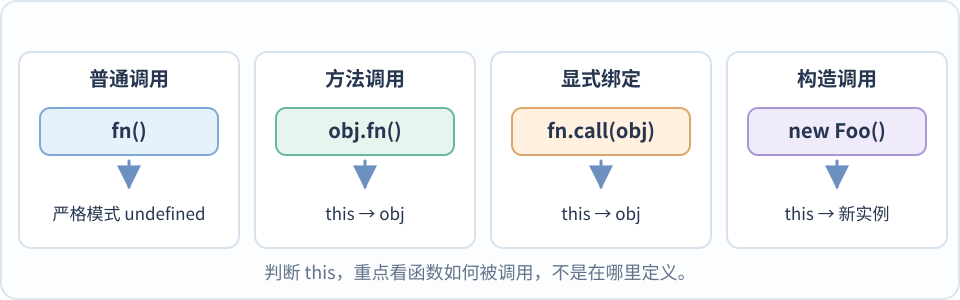

# 壹.2.3 彻底搞懂 this

`this`是JavaScript世界最让人迷惑的关键字之一，如果不明白`this`的本质，基本上会被一线互联网公司的面试官扣大量的分。[上一篇文章](1.2.2.md)我们知道了执行上下文的概念之后，就更方便理解本篇this的内容了。

## 壹.2.3.1 为什么要有this？

在 JavaScript 里，普通函数可以在不同对象上复用。可同一个函数被不同对象调用时，函数里的 `this` 到底该指向谁？这是很多人最容易搞混的地方。

```javascript
function func() {
  console.log(a);
}
```

上面这种直接读取变量 `a` 的写法，遵守的是**词法作用域**，跟谁调用函数没有直接关系。`this` 是另一回事：对于普通函数，它通常由**调用方式**决定。别把查找变量的作用域链和 `this` 的绑定规则混为一谈。

### 何谓”优雅地“？

```javascript
//假设有个对象名字很长，而且有可能会改名
var iAmALongLongLongNameObject={
    name:"coffe",
    func1(){
        return iAmALongLongLongNameObject.name;
    },
    func2(){
        return this.name;
    }
}
```

`iAmALongLongLongNameObject`的方法`func2`使用了`this`关键字，是不是优雅多了？然后即使以后对象名字变化，`func2`内部的代码也不用改变。`func1`这种确实也可以实现与`func2`同样的功能，但是就显得丑陋、不灵活了。

### 何谓“准确地”？

`this`可以准确地指向（某个对象）而不会产生歧义。

```javascript
//全局变量
var iAmALongLongLongNameObject = {
  name: "1891"
};

(function() {
  //局部变量
  var iAmALongLongLongNameObject = {
    name: "coffe",
    func1() {
      //如果光看代码，是不是容易看成调用了全局变量的name？
      return iAmALongLongLongNameObject.name;
    },
    func2() {
      //这里光看代码就很准确地知道是调用了局部变量的name！
      return this.name;
    }
  };

  console.log(iAmALongLongLongNameObject.func1());//>> coffe
})();
```

普通 JavaScript 函数的 `this` 可以指向对象，也可以是 `undefined` 或原始值，不能简单解释为“永远指向调用者对象”。方法调用、显式绑定、`new` 调用与独立调用各有规则；箭头函数则继承外层的 `this`。下面先用浏览器**非模块脚本**里的普通函数举例，再逐条说明例外。

```javascript
var a = "coffe";
function func() {
  console.log(this.a);
}
func();//>> coffe
```

上面的 `func()` 是独立调用。在**浏览器非模块脚本、且函数体不处于严格模式**时，默认 `this` 是 `window`，所以能读取 `window.a`。换成严格模式，独立调用时 `this` 是 `undefined`；换成 Node.js 或 ES Module，顶层变量与全局对象的关系也不一样。切记，这是一种有前提的运行结果，不是放之四海而皆准的规律。

## 壹.2.3.2 调用位置

调用位置就是函数在代码中被调用的位置，而不是声明的位置。研究调用位置，也即搞清“由谁在哪调用了这个函数”的问题。搞清楚了调用位置，才能准确地找到`this`的指向。

要找到调用位置，最重要的是要分析是**被谁、在哪**调用。

```javascript
var module = {
  x: "1891",
  getX: function() {
    return this.x;
  }
}

console.log(module.getX());//>> 1891
var getX = module.getX;//注意：getX和module.getX都是指向内存中函数的地址而已，它们并没有被“()”以便执行
                       //这里实际上是【间接引用】的模式，见文尾【壹.2.3.6】解释
console.log(getX()); //>> undefined
```

如上代码，要找到函数`getX`的调用位置，需要先看哪儿调用了它，很明显，有函数有两处位置调用了函数`getX()`，接下来分析是谁调用了它。

* 作为`module`对象的`getX`方法被调用。 这种情况被谁调用？很明显是被对象`module`调用，this是指向`module`。`module`对象里面有一个属性`x`，它的值是`1891`，因此`console.log(module.getX())`输出`1891`。
* 赋值给 `getX` 后再独立调用，已经失去了 `module` 这个接收对象。此例普通函数在非严格模式下会采用默认绑定，严格模式下则是 `undefined`。不应机械地解释成“它一定是 `window` 的方法”。

我们搞清楚了调用位置之后，接下来就会着手判断this的指向。

## 壹.2.3.3 先看看很多人对this指向的一些误解

`this` 既不指向函数自身也不指向函数的作用域，这之前是很多前端工程师容易误解的地方，现在澄清一下。

1. `this`的指向，**是在函数被调用的时候确定的**，也就是执行上下文被创建时确定的；
2. **普通函数**的 `this` 一般由调用方式决定；**箭头函数**则使用定义时外层的 `this`，不能套用普通函数那套规则；
3. 正因为在执行上下文的创建阶段`this`的指向就已经被确定了，在执行阶段`this`指向不可再被更改。

```javascript
var obj = {
    a: "1891"
}

function func() {
    this = obj; //报错，因为在执行阶段试图修改this的指向
    console.log(this.a);
}

func();
```

## 壹.2.3.4 this的指向规则

### **1. 默认指向**

独立调用普通函数时，**非严格模式下通常绑定到全局对象 `globalThis`，严格模式下是 `undefined`**。浏览器里的 `window` 只是全局对象的一种情况，不是所有 JavaScript 环境都叫 `window`。

```javascript
function func() {
    console.log( this.a ); // this指向全局对象
}
var a = 2;
func(); //>> 2
```

对于**默认指向**来说，决定`this`指向对象的并不是**调用位置**是否处于严格模式，而是函数体是否处于严格模式。如果函数体处于严格模式，`this`会指向`undefined`，否则`this`会指向全局对象。

```javascript
function func() {
  "use strict";//函数体处于严格模式下，this指向undefined
  console.log(this.a);
}

var a = "1891";
(function() {
  func(); //>> 报错
})();
```

```javascript
function func() {
  console.log(this.a);
}

var a = "1891";
(function() {
  "use strict";
  func(); //>> 1891
  //这里输出 1891 而不是报错，是因为严格模式下，this的指向与func的调用位置无关
})();
```

还有一处容易误解：把普通函数交给 `setTimeout` 或 `setInterval`，**不会自动继承外层对象的 `this`**。以浏览器的 `window.setTimeout` 为例，普通回调的 `this` 通常是 `window`；Node.js 的计时器回调可绑定为计时器对象，不能混着讲。

```javascript
class Obj {
  constructor(num) {
    this.num = num;
  }

  run() {
    setTimeout(function () {
      console.log("普通函数：", this === globalThis); // 浏览器中通常为 true
    }, 0);

    setTimeout(() => {
      console.log("箭头函数：", this.num); // >> 箭头函数： 1
    }, 0);
  }
}

new Obj(1).run();
```

所以，想在回调里保留实例的 `this`，可以使用箭头函数，或者给普通函数显式 `bind(this)`。参见 [MDN：setTimeout](https://developer.mozilla.org/en-US/docs/Web/API/Window/setTimeout)。

### **2. 隐式指向**

隐式指向是日常开发中最常见的指向。

函数体内`this`的指向由调用位置的调用者决定。**如果调用者调用的函数，为某以个对象的方法，那么该函数在被调用时，其内部的`this`指向该对象**。

```javascript
function func() {
  console.log(this.a);
}
var obj = {
  a: 2,
  func: func
};
obj.func(); //>> 2
// 找到调用位置，由 obj 对象来调用函数func，
// 此时可以说函数func被调用时，obj 对象“拥有”或者“包含”func函数，
// 所以此时的 this 指向调用 func 函数的 obj 对象。
```

**对象属性引用链中只有最顶层或者说最后一层会影响调用位置**，也就是说`this`指向最终调用函数的对象。这句话可能说得比较拗口，其实简单通俗地说，`this`指向最靠近被调用函数的对象，离得远的不是。举例来说：

```javascript
function func() {
  console.log(this.a);
}

var obj2 = {
  a: "1891",
  func: func
};

var obj1 = {
  a: "coffe",
  obj2: obj2
};

//此时的 this 指向 obj2 对象，因为obj2离得近！
obj1.obj2.func(); //>> 1891
```

再来看看**隐式丢失：**

```javascript
function func() {
    console.log( this.a );
}

var obj = {
    a: "coffe1891",
    func: func
};

var bar = obj.func; // 间接引用,见本文【壹.2.3.6】。此时bar和obj.func其实
                    // 都指向内存中的函数func本身。
var a = "oops, global"; // a 是全局对象window的属性，也是全局变量
bar(); //>> oops, global

// 虽然 bar 是 obj.func 的一个引用，但是实际上，它引用的是func函数本身，
// 因此此时的 bar() 其实是一个不带任何定语的独立函数调用，应用【默认指向】规则,
// 因此函数体内的this指向window，this.a指向window的属性a（全局变量a）
```

### 3. 显式指向

JavaScript内置对象`Function`的三个原型方法`call()`、`apply()`和`bind()`，它们的第一个参数是一个对象，它们会把这个对象绑定到`this`，接着在调用函数时让`this`指向这个对象。

```javascript
var a = "makai";

function func() {
    console.log( this.a );
}
var obj = {
    a:"coffe1891"
};

func.call(obj); //>> coffe1891
// 在调用 func 时强制把它的 this 绑定到 obj 上
```

另外，使用`bind`可以修正SetTimeout和SetInterval的this指向。还拿 _壹.2.3.4.1_ 的代码演示：

```javascript
var num = 0;
class Obj {
    constructor(num){
        this.num = num;
    }
    func(){
        console.log(this.num);
    }
    func1(){
        setTimeout(function () {
            console.log("setTimeout:"+this.num);
        }.bind(this), 1000);//bind
    }
    func2(){
        setInterval(function () {
            console.log(this.num);
        }.bind(this), 2000);//bind
    }
}
var obj = new Obj(1);
obj.func();//>> 1　             输出的是obj.num
obj.func1()//>> setTimeout:1　  输出的是obj.num
obj.func2()//>> 1 1 1 1 ……　    输出的是obj.num
```

关于call、apply、bind的详细用法参考[壹.2.4 深入理解call、apply、bind](1.2.4.md)。

### 4. “new”操作符指向

在JavaScript 中，**构造函数**只是一些**使用`new`操作符时被调用的函数**。它们并不会属于某个类，也不会实例化一个类。实际上，它们甚至都不能算是一种特殊的类型（class），它们**只是被`new`操作符调用的普通函数而已**。

使用`new` 来调用函数，或者说发生构造函数调用时，会自动执行下面的操作：

1. 创建（或者说构造）一个全新的对象；
2. 将构造函数的作用域赋给新对象（因此`this`就指向了这个新对象）；
3. 执行构造函数中的代码（为这个新对象添加属性、方法等）；
4. 如果函数没有返回其他对象，那么返回这个新对象。

```javascript
function func(a) {
    this.a = a;
}
var bar = new func("coffe1891");
console.log(bar.a); //>> coffe1891
// 使用new 来调用func(..)时，我们会构造一个新对象并把它绑定到func(..)调用中的this上
```




> **看图提示：** 普通函数在严格模式下 this 是 undefined；对象方法、显式绑定和 new 调用分别有各自规则，箭头函数另当别论。

## 壹.2.3.5 如何利用规则判断this的指向

`this`的指向判断，可以按照下面的优先级顺序来判断函数在某个调用位置应用的是哪条规则

### 1. 函数是否在`new` 中被调用（`new` 操作符指向）？

如果是的话，**`this` 绑定的是新创建的对象**。

```javascript
function func(name) {
  this.name = name;
  this.getName = function() {
    return this.name;
  };
}

var obj = new func("coffe"); //this会指向obj
console.log(obj.getName()); //>> coffe
```

### 2. 函数是否通过`call`、`apply`、`bind`显式指向？

如果是的话，**`this`指向的是call、apply、bind三个方法的第一个参数指定的对象**。

```javascript
var obj1 = {
  name: "coffe"
};
function func() {
  return this.name; //这里的this本来指向window
}
var str = func.call(obj1); //改变了func函数里面this的指向，指向obj1
console.log(str); //>> coffe
```

### 3. 函数是否被当做某个对象的方法而调用（隐式指向）？

如果是的话，`this`指向的是这个对象。

```javascript
var obj1 = {
  name: "coffe",
  func() {
    return this.name; //指向obj1
  }
};

//这里的obj1.func()，表明func函数被obj1调用，因此func中的this指向obj1
console.log(obj1.func()); //>> coffe
```

### 4. 若以上都不是的话，使用默认绑定。

如果在严格模式下，就绑定到`undefined`，否则绑定到**全局对象**。

```javascript
var a = "coffe"; //为全局对象window添加一个属性a
function func() {
  "use strict";//开启严格模式
  return this.a;
}

//严格模式下，this指向undefined
console.log(func()); //>> TypeError
```

## 壹.2.3.6 几个例外情况

### 1. 被忽略的this

把 `null` 或 `undefined` 作为 `thisArg` 传给 `call`、`apply` 或 `bind` 时，要区分函数是否为严格模式：**非严格模式普通函数**会将其替换为全局对象；**严格模式普通函数**则会原样保留 `null` 或 `undefined`。箭头函数的 `this` 不会因这些方法而改变。

```javascript
function func() {
  console.log(this.a);
}

var a = 2;
func.call(null); //>> 2
                 //this指向了window
```

### 2. 隐式指向之隐式丢失

**隐式丢失最容易在赋值时发生**；隐式丢失发生时，调用这个函数会应用**默认指向规则**。下面再举一段更具迷惑性的例子：

```javascript
function func() {
  console.log(this.a);
}
var a = 2;
var o = { a: 3, func: func };
var p = { a: 4 };
o.func(); //>> 3
(p.func = o.func)(); //>> 2
// 赋值表达式 p.func=o.func 的返回值是目标函数的引用，也就是 func 函数的引用
// 因此调用位置是 func() 而不是 p.func() 或者 o.func()
```

### 3. 箭头函数

箭头函数并不是使用`function`关键字定义的，而是使用被称为“胖箭头”的操作符 `=>` 定义的。

箭头函数不遵守`this`的四种指向规则，而是**根据函数定义时的作用域来决定 `this` 的指向**。何谓“定义时的作用域”？就是你定义这个箭头函数的时候，该箭头函数在哪个函数里，那么箭头函数体内的this就是它父函数的this。

看下面代码加深理解：

```javascript
function func() {
  // 返回一个箭头函数
  return a => {
    //this 继承自 func()
    console.log(this.a);
  };
}
var obj1 = {
  a: 2
};
var obj2 = {
  a: 3
};

var bar = func.call(obj1);
bar.call(obj2); //>> 2         不是 3 ！

// func() 内部创建的箭头函数会捕获调用时 func() 的 this。
// 由于 func() 的 this 绑定到 obj1， bar（引用箭头函数）的 this 也会绑定到 obj1，
// this一旦被确定，就不可更改，所以箭头函数的绑定无法被修改。（new 也不行！）
```

这个特性甚至被mozilla的MDN称作“[没有this](https://developer.mozilla.org/zh-CN/docs/Web/JavaScript/Reference/Functions/Arrow_functions)”，这句话容易被误读。更准确的说法是：箭头函数**没有自己的 `this` 绑定**，它使用外层作用域提供的 `this`。所以你对箭头函数使用 `call()`、`apply()` 或 `bind()`，也不会把它变成另一个对象的方法。

