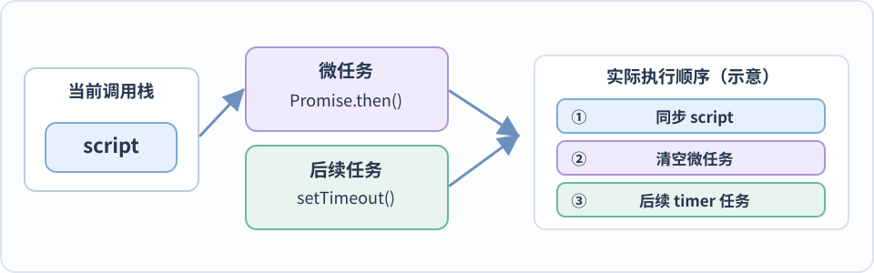
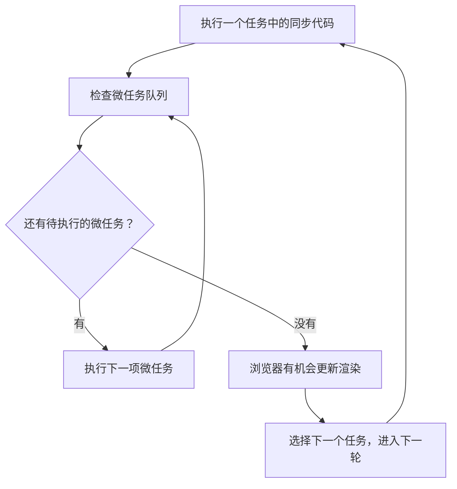

# 壹.2.8 Event Loop

我们平时写的页面脚本，通常是在主线程上依次执行的。有人一听“单线程”就犯嘀咕：既然一次只执行一段代码，网络请求、计时器、鼠标点击又是怎么同时照顾到的？这就要说到 Event Loop。浏览器本身还有其他线程与进程，也可以使用 Worker；千万别把“页面上的 JavaScript 通常在主线程执行”理解成“整个浏览器只有一条线程”。

真正让页面卡住的，往往不是“发了一个网络请求”，而是主线程一直忙着执行同步任务，没空处理点击、绘制和其他回调。异步网络请求通常不会让 JavaScript 主线程傻等响应；响应到来后，相关回调才会在合适的时机执行。

**Event Loop 负责安排任务什么时候执行，但它不是防卡顿神器。**

> **🧪 新增：Event Loop 动手实验室**
>
> 看懂文字只是第一步。我做了4道可以交互的练习：先预测输出，再单步观察调用栈、微任务、定时器任务，然后自己改代码并运行验证。最后还有一道嵌套 Promise 的面试挑战题。
>
> **[→ 打开实验室，亲手跑一遍](https://coffe1891.github.io/frontend-hard-mode-interview/labs/event-loop/)** | [实验说明与无法打开时的操作](../labs/event-loop.md)
>
> **别搞混：** 逐步图解是针对原题的教学模型，不是实时读取浏览器内部调用栈；自己修改的代码则会在浏览器 Web Worker 中实际执行。

> 为了尽量保持原意，本篇一些专有名词尽量使用英文，而不是采用中文翻译。

## 壹.2.8.1 **先了解一点基础知识**

### **1.** JavaScript的 Engine 和 Runtime

简单来说，为了让 JavaScript 运行起来，要完成两部分工作（当然实际比这复杂得多）：

第一部分是**Engine（JS引擎）**：编译并执行 JavaScript 代码，完成内存分配、垃圾回收等；  
第二部分是**Runtime（运行时）**：为 JavaScript 提供一些对象或机制，使它能够与外界交互。

举个例子：

Chrome浏览器 和 Node.js 都使用了 V8 Engine。V8 实现并提供了 ECMAScript 标准中的所有数据类型、操作符、对象和方法（注意并没有 DOM）。 但它们的 Runtime 并不一样：Chrome 提供了 window、DOM，而 Node.js 则是 require、process 等等。

### **2. 浏览器的线程**

JS引擎是单线程的，但是浏览器是多线程的。现代浏览器的一个 tab ，其中的线程包括但不局限于：

* GUI 渲染线程
* JS引擎线程
* 事件触发线程
* 定时器触发线程
* 异步http请求线程

JavaScript中的异步回调是通过 WebAPIs 去支持的，常见的有 `XMLHttpRequest`，`setTimeout`，事件回调（`onclik`, `onscroll`等）。而这几个 API 浏览器都提供了单独的线程去运行，所以才会有合适的地方去处理定时器的计时、各种请求的回调。即当代码中出现这几个定义的异步任务，**是由浏览器实现了它们与JS引擎的通信，与JS引擎不在同一个线程**。

另外，GUI 渲染和JavaScript执行是互斥的。虽然两者属于不同的线程，但是由于JavaScript执行结果可能会对页面产生影响，所以浏览器对此做了处理，大部分情况下JavaScript线程执行，执行渲染（render）的线程就会暂停，等JavaScript的同步代码执行完再去渲染。

## 壹.2.8.2 Event loop的定义

Event Loop（事件循环）负责协调任务、微任务、用户交互和页面渲染。你可以把它理解成一个调度员：当前任务执行完了，才有机会处理接下来的工作。**但是，一个任务如果一直不肯结束，调度员也没办法把主线程变出第二条来。**

举个一眼就能看懂的例子。在浏览器控制台运行：

```javascript
console.log("1：开始");
setTimeout(() => console.log("3：定时器回调"), 0);

// 故意让主线程忙约 150 毫秒；演示阻塞，不是推荐写法
const start = performance.now();
while (performance.now() - start < 150) {
  // 什么都不做，就是占着主线程
}

console.log("2：同步代码结束");
// >> 1：开始
// >> 2：同步代码结束
// >> 3：定时器回调
```

看到了吗？明明定时器设置的是 0 毫秒，回调还是得等同步循环结束。**`setTimeout(..., 0)` 只意味着尽早安排回调，不意味着立即执行，更不意味着不会阻塞。**

所以，耗时计算应该拆分成较短的任务，必要时放到 Worker；网络 I/O 则可以通过异步 API 等待结果。别把“异步”和“并行”混为一谈。

依据：[WHATWG HTML：Event loops](https://html.spec.whatwg.org/multipage/webappapis.html#event-loops)、[Node.js：Don't block the Event Loop](https://nodejs.org/learn/asynchronous-work/dont-block-the-event-loop)。

### 1.分两种

Event Loop 分为两种，一种存在于 Browsing Context 中，还有一种在 Worker 中。

1. **Browsing Context** 是指一种用来将 Document（文档）展现给用户的环境。例如浏览器中的 tab，window 或 iframe 等，通常都包含 Browsing Context。
2. **Worker** 是指一种独立于 UI 脚本，可在后台执行脚本的 API。常用来在后台处理一些计算密集型的任务。

本篇重点介绍的是 Browsing Context 中的 Event Loop，相比 Worker 中的 Event Loop，它也更加复杂一些。

> 另外，Event Loop 并不是在 ECMAScript 标准中定义的，而是在 HTML 标准中定义的。在 JS引擎中（以V8为例），只是实现了 ECMAScript 标准，而并不关心什么 Event Loop。也就是说 **Event Loop 是属于 JavaScript Runtime** 的，是由宿主环境（比如浏览器）提供的。所以千万不要理解错了，这也是前面介绍 JavaScript Engine 和 Runtime 的原因。

### 2.独立

每个”线程“都有自己的 Event Loop。所以，每个 web worker 拥有独立的 Event Loop，它们都可以独立运行；[同源的 windows](https://html.spec.whatwg.org/#similar-origin-window-agent) 共享一个 Event Loop，它们之间可以互相通信。

## 壹.2.8.3 内存模型

从 JavaScript 内存模型的角度，我们可以将内存划分为调用栈（Call Stack）、堆（Heap）以及任务队列（Queue）等几个部分：


### 1. 调用栈

调用栈会记录所有的函数调用信息，当我们调用某个函数时，会将其参数与局部变量等以栈帧的形式压入栈中（入栈）；在执行完毕后，会弹出栈顶的帧。让我们来看一看下面的例子：

```javascript
function multiply(x, y) {
  return x * y;
}
function printSquare(x) {
  var s = multiply(x, x);
  console.log(s);
}
printSquare(5);
```

当程序开始执行的时候，调用栈是空的，然后，步骤如下：


### 2. 堆

堆则则存放了大量的非结构化数据，譬如程序分配的变量与对象。

### 3. 任务队列

任务队列包含了一系列待处理的信息与相关联的回调函数。任务队列又分为 **MacroTask Queue** 和 **MicroTask Queue** 两种。

## 壹.2.8.4 MacroTask 和 MicroTask

### 1. MacroTask Queue（宏任务队列）

Event Loop 会有一个或多个 MacroTask Queue，这是一个先进先出（FIFO）的有序列表，存放着来自不同 **Task Source**（任务源）的 Task（也即MacroTask）。

> 关于 Task，常有人通俗地称它为 MarcoTask，但其实 HTML 标准中并没有这种说法。然而，为了方便理解，本书仍沿用通俗的称谓MacroTask。

在 HTML 标准中，定义了几种常见的 Task Source：

* DOM manipulation（DOM 操作）；
* User interaction（用户交互）；
* Networking（网络请求）；
* History traversal（History API 操作）。

MacroTask Source 的定义非常的宽泛，常见的鼠标、键盘事件，AJAX，数据库操作（例如 IndexedDB），以及定时器相关的 setTimeout、setInterval 等等都属于 Task Source，所有来自这些 MacroTask Source 的 MacroTask 都会被放到对应的 MacroTask Queue 中等待处理。

对于 MacroTask、MacroTask Queue 和 Task Source，有如下规定：

1. 来自相同 Task Source 的 MacroTask，必须放在同一个 MacroTask Queue 中；
2. 来自不同 Task Source 的 MacroTask，可以放在不同的 MacroTask Queue 中；
3. 同一个 MacroTask Queue 内的 MacroTask 是按顺序执行的；
4. 但对于不同的 MacroTask Queue（Task Source），浏览器会进行调度，允许优先执行来自特定 Task Source 的 MacroTask。

> 例如，鼠标、键盘事件和网络请求都有各自的 MacroTask Queue，当两者同时存时，浏览器可以优先从用户交互相关的 MacroTask Queue 中挑选 MacroTask 并执行，比如这里的鼠标、键盘事件，从而保证流畅的用户体验。

### 2. MicroTask Queue（微任务队列）

MicroTask Queue 与 MacroTask Queue 类似，也是一个有序列表。不同之处在于，**一个 Event Loop 只有一个 MicroTask Queue**。

在 HTML 标准中，并没有明确规定 MicroTask Source，通常认为有以下几种：

* Promise

> **注意：** 浏览器中的 Promise reaction jobs 与微任务调度已经有明确的规范衔接，不是“各浏览器随便决定，先后顺序可能完全不同”。Promises/A+ 是历史上很重要的约定，但讲现代浏览器行为，还得看 ECMAScript 的 Promise Jobs 和 HTML 标准怎样把它们安排到微任务队列。

* MutationObserver
* Object.observe \(已废弃\)

这里要特别提一下：网上有很多文章把 Node.js 的 `process.nextTick` 和 Microtask 混为一谈，事实上虽然两者层级（运行时机）非常接近，但并不是同一个东西。`process.nextTick` 是 Node.js 自身定义实现的一种机制，有自己的 nextTickQueue，与 HTML 标准中的 MicroTask 不是一回事。在 Node.js 常见的 CommonJS 执行情境，`process.nextTick` 队列优先级高于 Promise 微任务；**但别把它当成所有模块环境都固定成立的输出题答案**。例如 ES Module 的加载与执行本身涉及微任务，具体场景要看 Node.js 官方说明和实际版本。

### 3. 二者关系图例

Event Loop中，每一次循环称为tick，每一次tick的任务细节如下：

* 调用栈选择最先进入队列的MacroTask（通常是script整体代码），如果有则执行；
* 检查是否存在 MicroTask，如果存在则不停的执行，直至清空 MicroTask Queue；
* 浏览器更新渲染（render），每一次事件循环，浏览器都可能会去更新渲染；
* 重复以上步骤。

MacroTask Queue和MicroTask Queue二者的关系如下图：



如图所示，二者互相穿插：MacroTask --&gt; MicroTask Queue --&gt; MacroTask。

**一个Event Loop会有一个或多个 MacroTask Queue，而 Event Loop 仅有一个 MicroTask Queue。**

这句话可能比较令人费解，因为上图中似乎有2 个MicroTask Queue！怎么回事呢？

其实是这样的，每个 MacroTask Queue 都保证按照回调函数（callback）入队列的顺序依次执行MacroTask，在 MacroTask 或者 MicroTask 中产生的新 MicroTask 会被压入到 MicroTask Queue中并执行。而在 执行两个MacroTask之间，也即在执行下一个MacroTask之前，**会优先执行完所有MicroTask，也即会优先清空已有的 MicroTask Queue**。因此，图中第二个MicroTask Queue产生的时候，第一个MicroTask Queue其实已经被清空了。所以Event Loop实际上仅有一个MicroTask Queue。

## 壹.2.8.5 JavaScript Runtime 的运行机制

了解了 Event Loop 和任务队列的基本概念后，就可以从相对宏观的角度先了解一下 JavaScript Runtime 的运行机制了，简化后的步骤如下：

1. 主线程不断循环；
2. 对于**同步任务**，创建执行上下文（Execution Context），按顺序进入调用栈；
3. 对于**异步任务**：
   * 与步骤 2 相同，同步执行这段代码；
   * 将相应的 MacroTask（或 Microtask）添加到任务队列；
   * 由其他线程来执行具体的异步操作。

> 其他线程是指：尽管 JavaScript 是单线程的，但浏览器内核是多线程的，它会将 GUI 渲染、定时器触发、HTTP 请求等工作交给专门的线程来处理。另外，在 Node.js 中，异步操作会优先由 OS 或第三方系统提供的**异步接口**来执行，然后才由线程池处理。

1. 当主线程执行完当前调用栈中的所有任务，就会去读取 Event Loop 的任务队列，取出并执行任务；
2. 重复以上步骤。

用一张简图来表示一下这种运行机制：



> **看图提示：** 同步任务不结束，微任务就没机会执行；微任务也可能继续添加微任务。实际浏览器是否在这一轮渲染，要看具体时机与调度条件。

还是拿 setTimeout 举例：

1. 主线程同步执行这个 setTimeout 函数本身。
2. 将负责执行这个 setTimeout 的回调函数的 MacroTask 添加到 MacroTask Queue。
3. 定时器开始工作（实际上是靠 Event Loop 不断循环检查系统时间来判断是否已经到达指定的时间点）。
4. 主线程继续执行其他任务。
5. 当调用栈为空，且定时器触发时，主线程取出 MacroTask 并执行相应的回调函数。

很明显，执行 setTimeout 不会导致阻塞。当然，如果主线程很忙的话（调用栈一直非空），就会出现明明时间已经到了，却也不执行回调的现象，所以类似 setTimeout 这样的回调函数都是没法保证执行时机的。

> setTimeout和setInterval取的时间是不准确的，因为当调用栈若不为空，它们的回调函数永远不会被执行。所以，我们会经常碰到setTimeout和setInterval用来做动画的时候，很不流畅或者卡顿。

## 壹.2.8.6 面试题解析

在面试中我们常常会碰到如下类似的代码题，面试官要你写出输出结果，其要目的是考察对JavaScript不同任务的执行先后顺序的理解：

```javascript
// 执行顺序问题，考察频率挺高
setTimeout(function() {
  console.log(1);
});
new Promise(function(resolve, reject) {
  console.log(2);
  resolve(3);
}).then(function(val) {
  console.log(val);
});
console.log(4);
```

**文章内运行代码 · 试验版（只测试这一处）**

下面是同一道题的可编辑运行区。正常情况下，可以直接在这里修改代码，点击「运行代码」，不必离开本文。**原来的静态代码和后面的讲解都保留。**




> **试验说明：** 如果这里没有出现带「运行代码」按钮的编辑器，而只是显示链接，就说明 GitBook 没有把该网站识别为可嵌入内容。这时需要走官方的自定义集成方案，不能假装已经内嵌成功。也可以[单独打开精简示例](https://coffe1891.github.io/frontend-hard-mode-interview/labs/event-loop/inline/)检查代码本身能否运行。

根据本文的解析，我们可以得到：

1. 先执行同步代码
   * 首先，执行`new Promise`中的`console.log(2)`，then后面的属于MicroTask所以跳过；
   * 然后，执行`console.log(4)`。
2. 执行完script这个MacroTask后，执行MicroTask（也即`Promise.then`） 中的`console.log(val)`，此时`val`的值由`resolve(3)`传递过来，值为`3`。后面无其他微任务。
3. 执行另一个MacroTask也即定时器`setTimeout`中的`console.log(1)`。 根据本文的内容，可以很轻松，且有理有据的猜出写出正确答案：2，4，3，1。


**补充规范：** [WHATWG HTML：Event loops 与 microtask checkpoint](https://html.spec.whatwg.org/multipage/webappapis.html#event-loops)、[WHATWG：HostEnqueuePromiseJob](https://html.spec.whatwg.org/multipage/webappapis.html#hostenqueuepromisejob)、[Node.js：Event Loop 与 nextTick](https://nodejs.org/learn/asynchronous-work/event-loop-timers-and-nexttick)。
