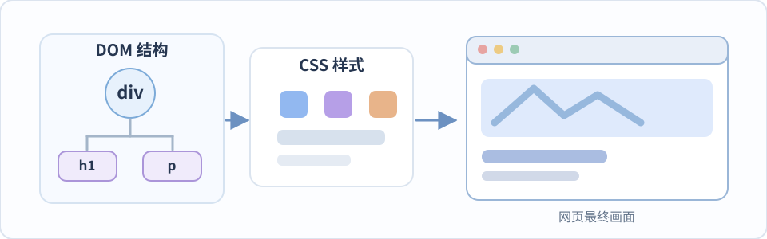

# 壹.4.1 网页被浏览器绘制出来的过程是怎样的？

打开一个购物网站，有的页面文字先出来、图片慢半拍，有的干脆白屏两秒钟。服务器不是都把 HTML 发过来了吗，为什么差这么远？

我觉得做前端的朋友最好把这事搞懂。HTML 到了浏览器，只能算开工，离真正把内容画到屏幕上，还有一大堆活要干。下面就顺着一次页面加载，把这些活捋清楚。

## 01. 输入网址后，浏览器先做什么？

先别把浏览器想成一个人从头忙到尾。真实浏览器内部有不同进程和线程，很多步骤会交错进行。为了好理解，我们先按下面几步看看大致发生了什么：

1. **找地址。** 浏览器解析 URL，判断缓存是否可用；需要联网时，通常要做 DNS 解析，找到服务器地址。
2. **建立通信。** 根据协议和已有连接决定如何发请求。HTTP/1.1、HTTP/2 通常基于 TCP；HTTP/3 则基于 QUIC，不能把所有请求都写成“TCP三次握手”。
3. **拿到数据。** 服务器返回响应头、HTML，也可能通过缓存、压缩与流式方式传输。
4. **解析资源。** 浏览器边读 HTML 边建 DOM，同时发现样式表、图片和脚本等依赖。
5. **布局和绘制。** 计算元素大小、位置，再绘制和合成画面。

这只是简化流程。真实浏览器内部有多个进程和线程，网络、解析、渲染等工作可能并行推进，不能把它理解为一条完全同步的流水线。




> **看图提示：** DOM 决定页面有什么，CSS 决定它长什么样；布局和绘制才形成屏幕画面。

## 02. HTML和CSS到底各做了什么？

```html
<!doctype html>
<html lang="zh-CN">
<head>
  <style>
    .card { width: 200px; padding: 20px; background: #eee; }
  </style>
</head>
<body>
  <article class="card">
    <h1>咖啡</h1>
    <p>每杯 20 元</p>
  </article>
</body>
</html>
```

浏览器解析 HTML 得到 DOM，解析 CSS 得到样式规则，并计算出元素实际采用的样式。随后布局阶段决定“这张卡片占多宽、多高、摆在哪里”。

**DOM不是最终像素。** DOM 更像建筑设计图中的构件清单，CSS 提供装修与尺寸规则，布局确定位置，绘制才形成实际画面。

## 03. 改一个颜色和改一个宽度，代价一样吗？

```javascript
const card = document.querySelector('.card');
card.style.backgroundColor = 'lightblue'; // 通常主要涉及重新绘制
card.style.width = '300px';               // 可能影响布局，连带重绘
```

改变颜色通常不需要重新安排元素的位置；改变宽度则可能影响旁边、下面的元素，要重新计算布局。这就是重绘与重排的区别。

但不要把“只改颜色”理解成绝对没有其他工作。浏览器可能还涉及样式计算、合成等阶段；具体开销与页面结构和实现有关。

如果你不断交替修改宽度并读取布局数据：

```javascript
for (let i = 0; i < 10; i++) {
  card.style.width = (200 + i) + 'px';
  console.log(card.getBoundingClientRect().width);
}
```

每次读取都可能迫使浏览器提前完成布局工作，这就是常说的布局抖动。优化方法之一是把读取、写入分开，减少反复强制布局。

## 04. 为什么改了DOM，画面没立刻显示？

```javascript
const button = document.querySelector('#buy');
button.textContent = '处理中...';

const start = Date.now();
while (Date.now() - start < 3000) {
  // 故意占用主线程3秒
}
```

理论上 DOM 已经改了，但用户可能要等这段同步任务结束才能看到按钮文字变化。因为浏览器要在合适时机进行渲染，主线程被长任务占住，会阻碍画面更新。

想让界面持续响应，就应避免主线程长时间运行同步计算。拆分任务、使用 Web Worker 或推迟非关键工作，取决于具体业务。

## 05. script、defer、async有什么区别？

```html
<script src="a.js"></script>
<script defer src="b.js"></script>
<script async src="c.js"></script>
```

对于普通外部经典脚本：

- 没有特殊属性的脚本，HTML 解析通常会在执行它时暂停。
- `defer` 下载可以并行进行，通常等 HTML 解析完成后按文档顺序执行。
- `async` 下载完成后可尽快执行，不能保证与其他异步脚本的先后顺序。

这也是为什么随便把第三方大脚本塞进页面头部，可能严重影响首屏体验。模块脚本有不同的默认行为，需要另外考虑。

## 06. DOMContentLoaded和load是同一回事吗？

不是。`DOMContentLoaded` 关注 HTML 已被解析以及有关的延迟脚本执行条件；`load` 通常还要等一些依赖资源加载完成。图片没加载完，页面仍可能已经有文字、有 DOM，也可能已经能交互。

因此衡量用户体验不能只看一个 `load` 时间。实际还要关注首屏内容、最大内容绘制（LCP）、交互响应（INP）与布局偏移（CLS）等指标。

## 07. 打开开发者工具，亲自看

1. 打开 Chrome DevTools 的 **Network**，关闭缓存并刷新，观察 HTML、CSS、JS、图片的请求开始与结束时间。
2. 打开 **Performance** 录制一次页面加载，找出长任务、布局、绘制与合成相关工作。
3. 人为给图片设置宽高，观察页面是否减少布局跳动；再把一段同步死循环加入代码，观察按钮何时更新。
4. 把上面的 `width` 循环改为只写不读，对比是否出现更少的强制布局。

能拿着工具解释“哪一步慢，为什么慢”，比在面试时画一张漂亮流程图有用得多。

我建议你打开一次 DevTools，亲手看看哪里在等网络、哪里在跑脚本、哪里又在忙布局。眼睛看见过一次，比背一页“关键渲染路径”牢靠。

## 参考资料

- [MDN：关键渲染路径](https://developer.mozilla.org/zh-CN/docs/Web/Performance/Guides/Critical_rendering_path)
- [web.dev：渲染性能](https://web.dev/articles/rendering-performance)
