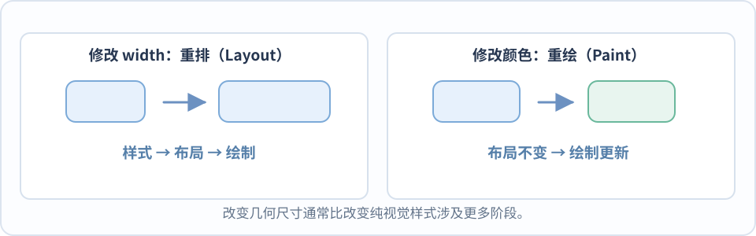

# 壹.4.2 页面重排与重绘：到底是谁把页面卡住了？

前端性能优化有两句话特别吓人：“改一次 style，就重排一次”“读一次 getComputedStyle，就强制重排”。

说得这么绝对，浏览器自己恐怕都得喊冤。**样式变化、重新布局、重新绘制是不同阶段，不能一股脑叫作重排。**

## 01. 浏览器把页面画出来，要做哪些事？

简化来看，一个页面的视觉更新，可能涉及下面这些工作：

1. **样式计算（Style）**：判断元素最终应该使用哪些 CSS 规则。
2. **布局（Layout，也常叫 Reflow）**：计算元素的位置和尺寸。
3. **绘制（Paint）**：把文字、背景、边框等画出来。
4. **合成（Composite）**：把不同图层组织成最终画面。

注意，我说的是“可能涉及”。**一次视觉变化不一定把四个阶段全部走一遍。** 浏览器会缓存、合批、跳过不必要的工作，实际效果跟属性、DOM结构和实现方式都有关系。



例如，改变元素宽度通常影响布局；只改背景色一般不需要重新布局；某些 `transform`、`opacity` 动画在适当条件下可以通过合成处理。**但能否真的只走合成，仍需要 DevTools 证实。**

## 02. 不是所有的 style 修改都会立即触发布局

```javascript
const card = document.querySelector(".product-card");
card.style.width = "300px";
card.style.backgroundColor = "tomato";
```

这两行代码都修改了样式，但不要由此断定浏览器“立刻重排两次”。

很多时候，浏览器先记录哪些样式失效，再选择合适时机统一处理。宽度变化可能让布局结果失效，背景色变化通常只影响绘制。

你真正该警惕的，是**写完之后马上又要一个准确的布局结果**。

## 03. 强制同步布局：问题通常出在读写交错

看个例子。先写入一个会影响布局的属性，再读取元素尺寸：

```javascript
const box = document.querySelector(".box");
box.style.width = "300px";               // 写：使布局可能失效
const width = box.getBoundingClientRect().width; // 读：此刻要求准确尺寸
console.log(width);
```

如果此前布局已经失效，读取几何信息可能迫使浏览器提前完成样式计算和布局，这叫 **Forced Synchronous Layout（强制同步布局）**。

它最容易出现在循环里：

```javascript
const boxes = [...document.querySelectorAll(".box")];

// 不推荐：反复交叉读写，可能造成 layout thrashing
for (const box of boxes) {
  box.style.width = box.offsetWidth + 10 + "px";
}
```

比较稳妥的写法是先读取，再集中修改：

```javascript
const boxes = [...document.querySelectorAll(".box")];
const widths = boxes.map(box => box.offsetWidth); // 集中读
boxes.forEach((box, i) => {
  box.style.width = widths[i] + 10 + "px";         // 集中写
});
```

这里的目的是减少读写交错，**不是保证“第一种必定重排N次，第二种必定只重排1次”**。具体次数、耗时得在目标浏览器和页面里测。

## 04. getComputedStyle() 一定触发重排吗？

不一定。

读取计算样式可能需要刷新样式信息，但**刷新样式不等于必然执行布局**。某些属性和页面状态下，它可能进一步要求布局；有些情况下则不需要。

同理，查询 `offsetWidth`、`getBoundingClientRect()` 等几何信息**可能**触发强制布局，关键要看当前布局是否已经失效。不能仅凭方法名就断定“只要调用，必定重排”。

## 05. 动画为什么卡？怎么查？

我建议按这个顺序排查：

1. 打开 Chrome DevTools 的 **Performance** 面板，录制一次实际卡顿操作。
2. 看主线程是不是被耗时 JavaScript、Style、Layout、Paint 占住。
3. 找 **Forced Reflow** 等提示，定位究竟哪个调用触发了代价较高的布局。
4. 一次只改一个问题，再用同样的操作条件重新录制对比。

比如动画中反复修改 `left`，可能引发更多布局；改用 `transform: translateX(...)` 可能减少布局成本，但前提是页面视觉需求允许，而且依然需要实测。

**别为了“减少重排”到处塞 `will-change`。** 图层也要占内存，优化过头，一样可能把性能搞坏。

## 06. 我的建议

讲重排重绘，最重要的是掌握一个判断：

**哪一类修改会让哪个阶段的结果失效？这个修改会不会迫使浏览器在我读数据时提前做布局？**

这个问题想明白了，遇到一个页面输入卡顿、滚动不顺、动画掉帧，才知道从哪里排查。

**参考资料：**

- [Chrome Developers：Forced reflow](https://developer.chrome.com/docs/performance/insights/forced-reflow)
- [web.dev：Avoid large, complex layouts and layout thrashing](https://web.dev/articles/avoid-large-complex-layouts-and-layout-thrashing)
- [MDN：CSS rendering performance](https://developer.mozilla.org/en-US/docs/Web/Performance/Guides/CSS_JavaScript_animation_performance)
