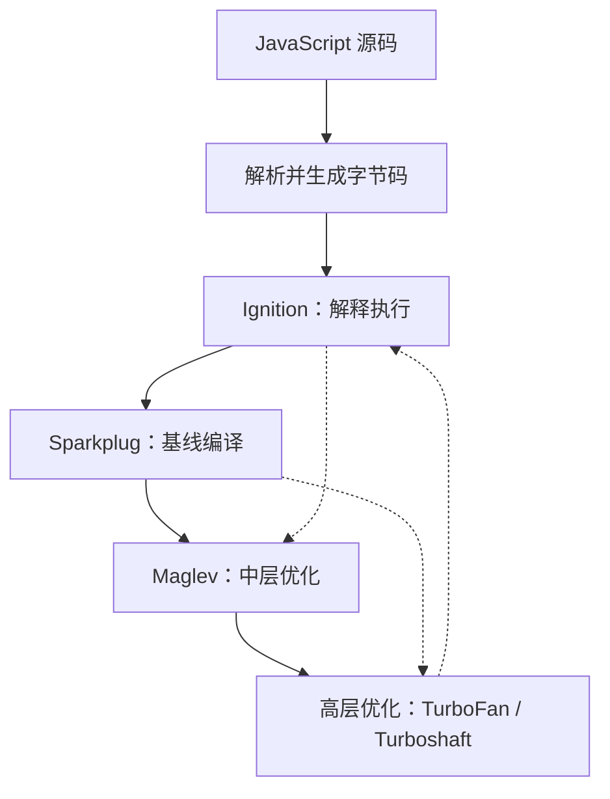
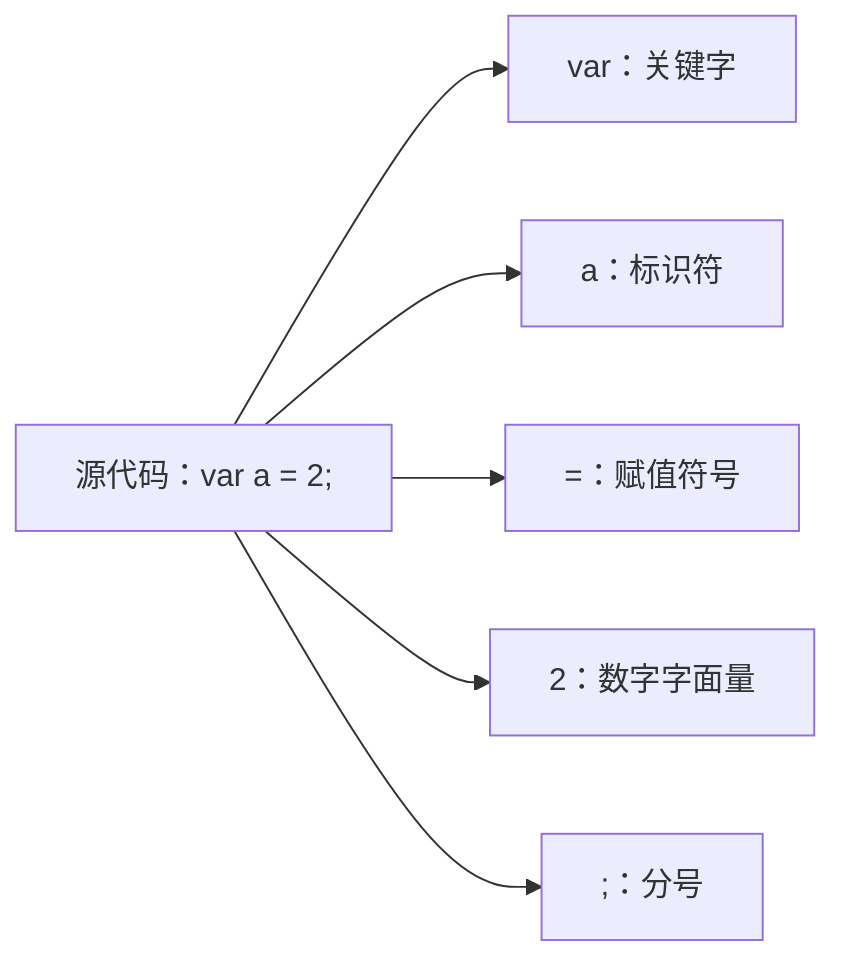
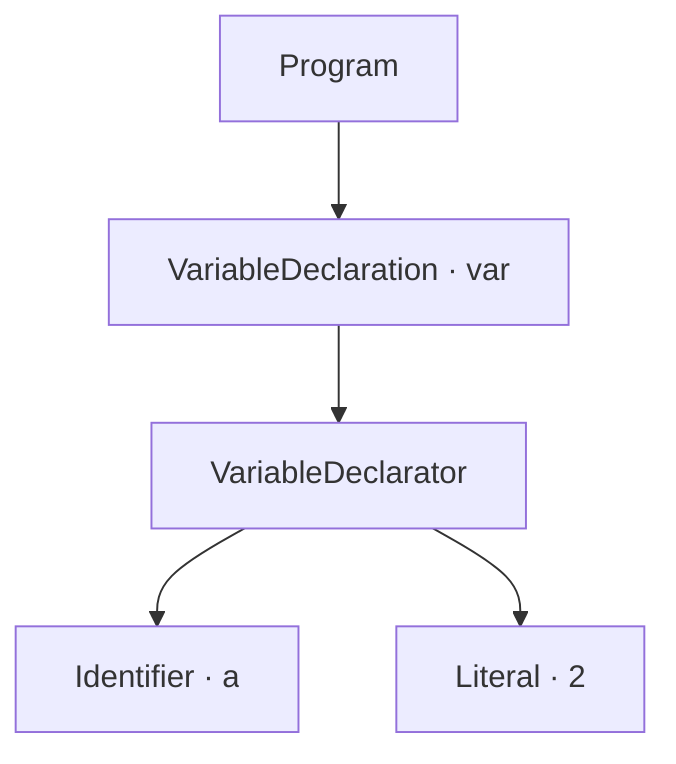
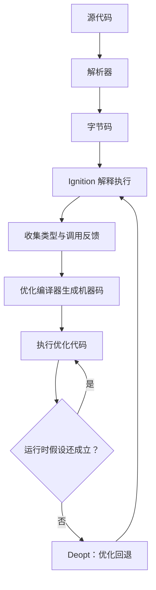
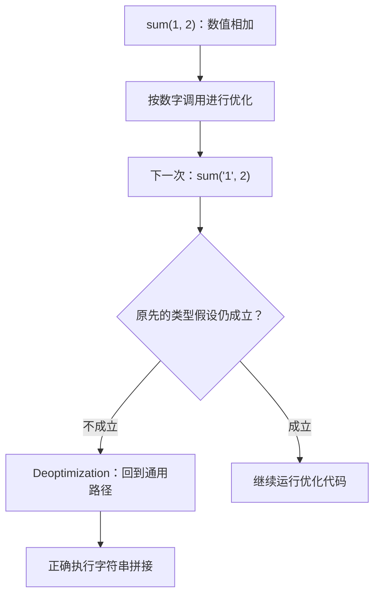

# 壹.4.4  V8引擎是如何工作的

## 01. 什么是 V8引擎

[V8](https://v8.dev/) 是 Google 发布的开源的高性能 JavaScript 和 WebAssembly 引擎，采用 C++ 编写。它被使用在 Chrome 浏览器，Node.js 等环境中。V8 可以独立运行，也可以嵌入在任何 C++ 应用中运行。

V8 不是只有“解释器 Ignition + 优化编译器 TurboFan”两层。现代 V8 还引入了 Sparkplug、Maglev 等执行层级，新的优化编译管线也在持续演进。

先记住这些名字各管什么：

- **Parser / Pre-Parser：** 负责语法分析与延迟解析的一部分工作。
- **Ignition：** 生成并解释执行字节码。
- **Sparkplug：** 基线编译器，帮助代码较快进入机器码执行。
- **Maglev：** 中间层优化编译器，兼顾编译速度与执行性能。
- **TurboFan / Turboshaft 等优化管线：** 处理更高层级的优化。
- **Orinoco：** 与垃圾回收相关的技术体系。

现代 V8 的执行层级可以这样理解（示意图并不表示所有函数都会依次经过每一级）：



## 词法分析

词法分析把源码拆成 token，例如标识符、关键字、运算符和字面量。看 `var a = 2;`：



> Tokens 在线查看网站：[Esprima 在线解析器](https://esprima.org/demo/parse.html)

## 语法分析

### Parser

Parser 是 V8 的解析器，负责根据生成的 Tokens 进行语法分析。Parser 的主要工作包括：

- **分析语法错误**：遇到错误的语法会抛出异常；
- **输出 AST**：将词法分析输出的词法单元流（数组）转换为一个由元素逐级嵌套所组成的代表了程序语法结构的树——抽象语法树（Abstract Syntax Tree, AST）；
- **识别词法作用域**；但不会在解析时创建所有函数的执行上下文。

AST（抽象语法树）描述代码的结构。仍以 `var a = 2;` 为例：



```javascript
// 用简化版 ESTree 结构表示：var a = 2;
// 真实解析器输出通常还有 start、end、loc 等位置信息。
const ast = {
  type: "Program",
  body: [{
    type: "VariableDeclaration",
    kind: "var",
    declarations: [{
      type: "VariableDeclarator",
      id: { type: "Identifier", name: "a" },
      init: { type: "Literal", value: 2 }
    }]
  }]
};
console.log(ast.body[0].type); // >> VariableDeclaration
```

> AST 在线查看网站：[AST Explorer](https://astexplorer.net/)

> AST 不只拿来考试。Babel、ESLint 等工具都需要分析代码结构，才能做语法转换、规则检查等工作。但要注意：**Babel 能转换部分新语法，不等于能让所有新 API 在所有旧浏览器里自动可用。** 缺少的运行时 API 可能仍需要 polyfill，有些能力根本无法靠语法转换补出来。以后看到“支持 ES6”这种老说法，记得分清语法转换与 API 兼容性。

### Pre-Parser

看一个没有调用的函数：

```js
function foo () {
    console.log('function foo')
}

function bar () {
    console.log('function bar')
}

foo()
```

上面这段代码中，如果使用 Parser 解析后，会生成 foo 函数 和 bar 函数的 AST。而 bar 函数没有被调用，就不一定需要马上为它完成全部解析、编译工作。引擎因此可以选择延迟处理部分函数。这不是说 bar 的代码“毫无意义”，更不是说浏览器能完全跳过语法检查。

V8 有完整解析与预解析等机制，帮助它在启动速度和后续执行之间取舍。**某段函数是否惰性解析，是引擎的实现策略，不能简单等同于“调用了就 Parser，没调用就 Pre-Parser”。**

Pre-Parser 可以用较低成本处理一部分语法和作用域信息，避免一开始就为每个函数建立完整的 AST。至于是否需要重复分析内部函数，也随着 V8 的实现改进而变化。

早年的 V8 曾遇到深层函数重复预解析带来的开销，后来做过专门优化。不能仅凭函数嵌套层数判断性能，具体以运行环境中的分析结果为准。

参考：[V8 官方：Lazy Parsing](https://v8.dev/blog/preparser)。

## Ignition

Ignition 是 V8 的解释器，它负责的工作包括：

- 将 AST 转换为中间代码（字节码 Bytecode）
- 逐行解释执行字节码：在该阶段，就已经可以开始执行 JavaScript 代码了。

字节码是比机器码更抽象、通常也更紧凑的中间表示。V8 引入字节码，是为了兼顾启动速度和内存占用，并不意味着所有代码只靠解释执行。

## TurboFan

TurboFan 是 V8 的优化编译器，负责将字节码和一些分析数据作为输入并生成优化的机器代码。

Ignition 能解释执行字节码；优化编译器则根据运行反馈，把值得优化的路径编译成更高效的机器码。



V8 会收集函数的调用与类型反馈，根据实际运行情况选择是否优化。优化后的代码依赖某些假设；假设失效时，可能发生 deoptimization（优化回退），返回正确的通用执行路径。



比如 `sum(a, b) { return a + b; }`，多数时候收到数字，优化器可能针对数字运算优化；某次传入字符串，就需要保证结果仍符合 JavaScript 的字符串拼接语义。上面的图展示了这个过程。

## Orinoco

Orinoco 是 V8 垃圾回收体系中的重要项目。不能只记“标记清除”四个字：现代 V8 会结合分代、并行、并发和增量等机制管理内存，以尽量减少长时间停顿。**别把垃圾回收描述成单一算法，更别保证它永远不会卡顿。**

## 参考资料

[JavaScript 引擎 V8 执行流程概述](https://mp.weixin.qq.com/s/t__Jqzg1rbTlsCHXKMwh6A )

[视野前端（二）V8引擎是如何工作的](https://mp.weixin.qq.com/s?__biz=MzI4NjE3MzQzNg==&amp;mid=2649865842&amp;idx=1&amp;sn=b595dbd13328ce65aa265eb21ba4ea85&amp;chksm=f3e5efe1c49266f7f86bf899cd5f80d4864e21bbedc3f03170762c3f44f573d0c33eb44399de&amp;mpshare=1&amp;scene=24&amp;srcid=&amp;sharer_sharetime=1583838316032&amp;sharer_shareid=3ebcb61ec5c32d188c9235d1a89dcfbf#rd  )

[What is V8?](https://v8.dev/)

[JavaScript 引擎（V8）是如何工作的](https://juejin.cn/post/6844904096260947981 )

- [V8：Maglev](https://v8.dev/blog/maglev)
- [V8：Orinoco](https://v8.dev/blog/trash-talk)
