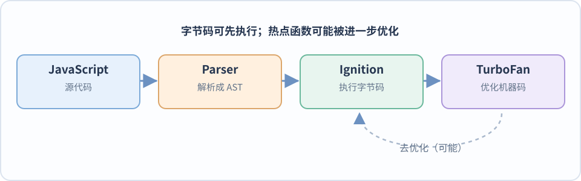
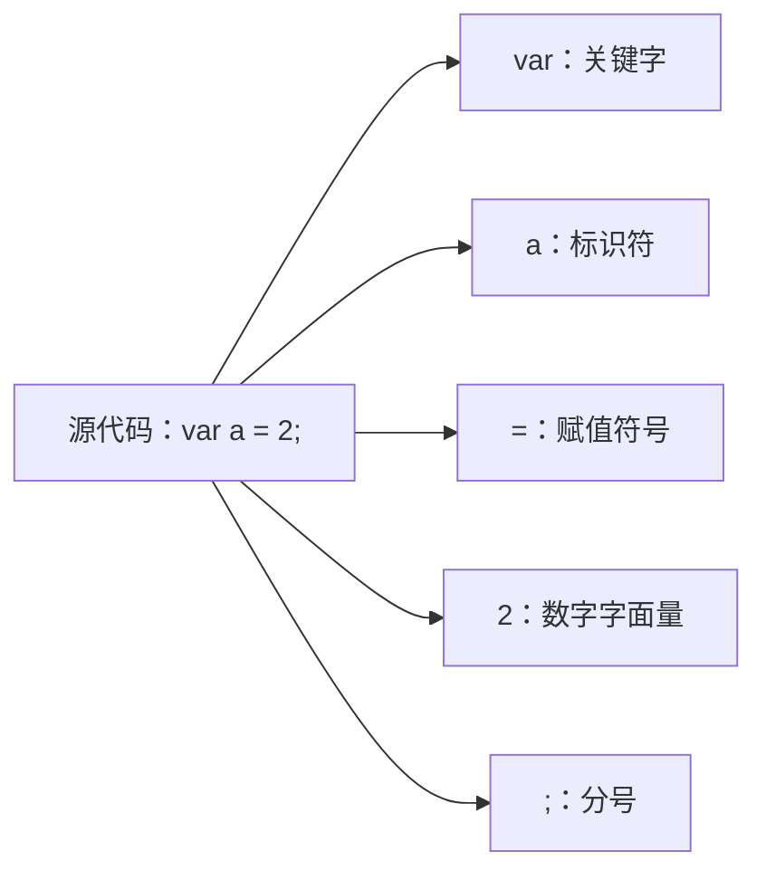
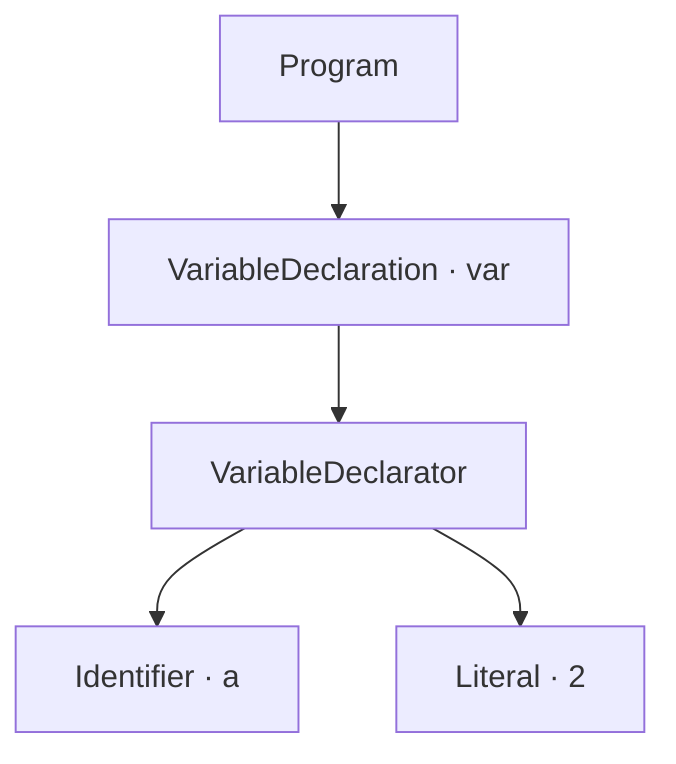
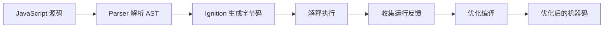
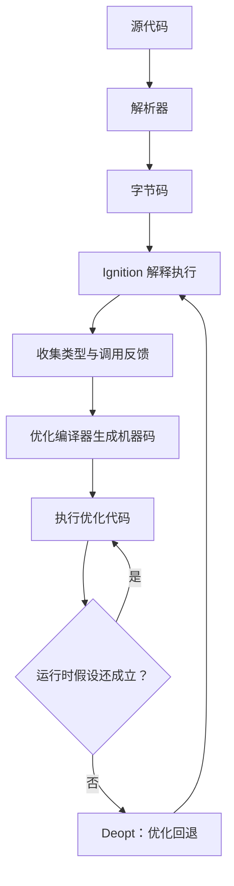
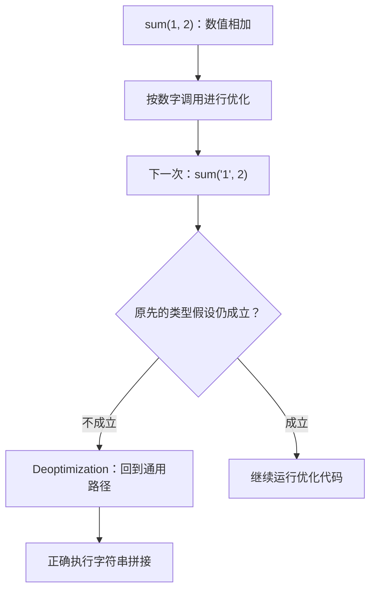
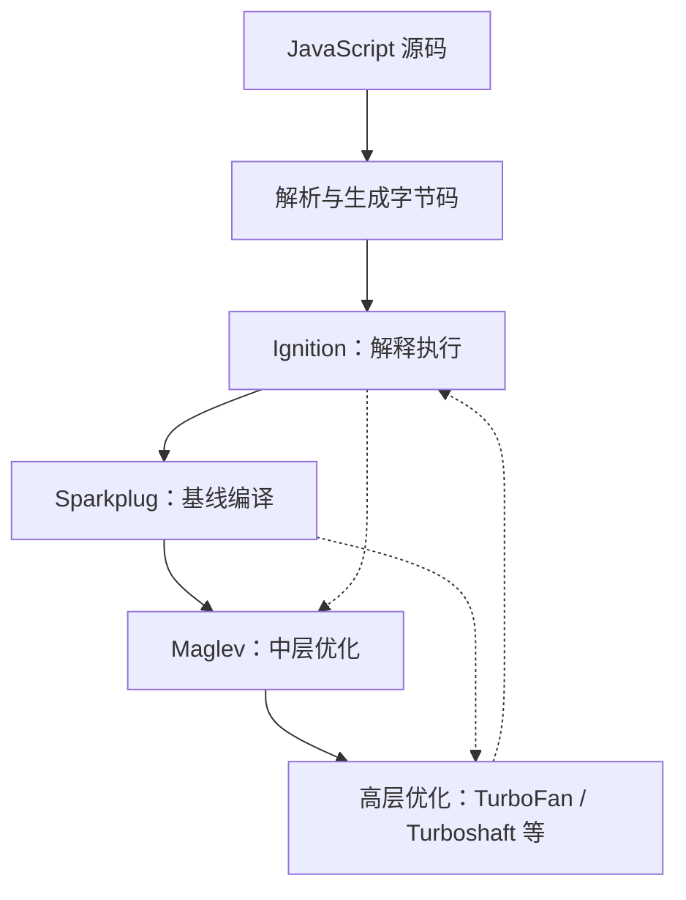

# 壹.4.4  V8引擎是如何工作的

## 01. 什么是 V8引擎

[V8](https://v8.dev/) 是 Google 发布的开源的高性能 JavaScript 和 WebAssembly 引擎，采用 C++ 编写。它被使用在 Chrome 浏览器，Node.js 等环境中。V8 可以独立运行，也可以嵌入在任何 C++ 应用中运行。

V8 不是只有“解释器 Ignition + 优化编译器 TurboFan”两层。现代 V8 还引入了 Sparkplug、Maglev 等执行层级，新的优化编译管线也在持续演进。

先记住这些名字各管什么：

- **Parser / Pre-Parser：** 负责语法分析与延迟解析的一部分工作。
- **Ignition：** 生成并解释执行字节码。
- **Sparkplug：** 基线编译器，帮助代码较快进入机器码执行。
- **Maglev：** 中间层优化编译器，兼顾编译速度与执行性能。
- **TurboFan / Turboshaft 等优化管线：** 处理更高层级的优化。
- **Orinoco：** 与垃圾回收相关的技术体系。

**记住：下面部分老图展示的是便于入门的简化路径，不代表所有 V8 版本、所有函数都严格按照这条线依次运行。**

下图展示了 V8 引擎工作的基本流程：



- 词法与语法分析帮助引擎理解源码；
- Ignition 生成并执行字节码；
- 运行时根据反馈和执行情况，可能采用 Sparkplug、Maglev 或更高层级的编译方案；
- 具体何时升级、何时退回、走哪条优化路径，由引擎版本与实际负载决定。

## 词法分析

**什么是词法分析？**

词法分析（Tokenizing/Lexing）其作用是将一行行的源码拆解成一个个 token。所谓**词法单元 token**，指的是语法上不可能再分的、最小的单个字符或字符串。

ECMAScript 中明确定义了 Token 包含的内容。

##### CommonToken:

- IdentifierName

- Punctuator

- NunericLiteral

- StringLiteral

- Template

  

我们来看下`var a = 2;` 这句代码经过词法分析后会被分解出哪些 tokens ?



从图里看得很清楚，这行代码可以拆成五个词法单元：

- `var` 关键字
- `a` 标识符
- `=` 运算符(符号)
- `2` 数值
- `;` 分号（标点符号）

> Tokens 在线查看网站：[Esprima 在线解析器](https://esprima.org/demo/parse.html)

## 语法分析

### Parser

Parser 是 V8 的解析器，负责根据生成的 Tokens 进行语法分析。Parser 的主要工作包括：

- **分析语法错误**：遇到错误的语法会抛出异常；
- **输出 AST**：将词法分析输出的词法单元流（数组）转换为一个由元素逐级嵌套所组成的代表了程序语法结构的树——抽象语法树（Abstract Syntax Tree, AST）；
- **确定词法作用域**；

- **识别词法作用域等信息**；执行上下文的建立与代码执行有关，别误当成“解析 AST 时就创建完所有函数执行上下文”。

**什么是抽象语法树（Abstract Syntax Tree, AST）？**

还是上面的例子，我们来看下 `var a = 2;` 经过语法分析后生成的 AST 是什么样子的：



```javascript
// 用简化版 ESTree 结构表示：var a = 2;
// 真实解析器输出通常还有 start、end、loc 等位置信息。
const ast = {
  type: "Program",
  body: [{
    type: "VariableDeclaration",
    kind: "var",
    declarations: [{
      type: "VariableDeclarator",
      id: { type: "Identifier", name: "a" },
      init: { type: "Literal", value: 2 }
    }]
  }]
};
console.log(ast.body[0].type); // >> VariableDeclaration
```

可以看到这段程序的类型是 VariableDeclaration，也就是说这段代码是用来声明变量的。

> AST 在线查看网站：[AST Explorer](https://astexplorer.net/)

AST 的结构和代码的结构非常相似，其实你也可以把 AST 看成代码的结构化表示，编译器或者解释器后续的工作都需要依赖于 AST，而不是源代码。

> AST 不只拿来考试。Babel、ESLint 等工具都需要分析代码结构，才能做语法转换、规则检查等工作。但要注意：**Babel 能转换部分新语法，不等于能让所有新 API 在所有旧浏览器里自动可用。** 缺少的运行时 API 可能仍需要 polyfill，有些能力根本无法靠语法转换补出来。以后看到“支持 ES6”这种老说法，记得分清语法转换与 API 兼容性。

### Pre-Parser

**什么是预解析 Pre-Parser？**

我们先来看看下面这段代码：

```js
function foo () {
    console.log('function foo')
}

function bar () {
    console.log('function bar')
}

foo()
```

上面这段代码中，如果使用 Parser 解析后，会生成 foo 函数 和 bar 函数的 AST。而 bar 函数没有被调用，就不一定需要马上为它完成全部解析、编译工作。引擎因此可以选择延迟处理部分函数。这不是说 bar 的代码“毫无意义”，更不是说浏览器能完全跳过语法检查。

V8 有完整解析与预解析等机制，帮助它在启动速度和后续执行之间取舍。**某段函数是否惰性解析，是引擎的实现策略，不能简单等同于“调用了就 Parser，没调用就 Pre-Parser”。**

Pre-Parser 可以用较低成本处理一部分语法和作用域信息，避免一开始就为每个函数建立完整的 AST。至于是否需要重复分析内部函数，也随着 V8 的实现改进而变化。

我们还是以示例来说明：

```js
function foo() {
    console.log('a');
    function inline() {
        console.log('b')
    }
}

(function bar() {
    console.log('c')
})();

foo();
```

这段代码包含一个会被调用的 `foo`、一个嵌套函数 `inline`，以及一个立即执行的 `bar`。**它适合帮助你理解“有些函数可以延迟处理”，却不能凭这段源码断言现代 V8 一定发生了几次预解析。**

早年的确存在深层嵌套函数重复预解析造成开销的问题，但 V8 团队已经专门优化过。别从一篇老文章得出“函数嵌套一多就必然慢”的结论。真碰到启动性能问题，应该用目标环境的分析工具测。

参考：[V8 官方：Lazy Parsing](https://v8.dev/blog/preparser)。

## Ignition

Ignition 是 V8 的解释器，它负责的工作包括：

- 将 AST 转换为中间代码（字节码 Bytecode）
- 逐行解释执行字节码：在该阶段，就已经可以开始执行 JavaScript 代码了。

**什么是字节码？**

字节码（Bytecode）是介于 AST 和机器码之间的一种中间码，它比机器码更抽象，也更轻量，需要直译器转译后才能成为机器码。

> 早期版本的 V8 ，并没有生成中间字节码的过程，而是直接将 AST 转换为机器码，由于执行机器码的效率是非常高效的，所以这种方式在发布后的一段时间内运行效果是非常好的。但是随着 Chrome 在手机上的广泛普及，特别是运行在 512M 内存的手机上，内存占用问题也暴露出来了，因为 V8 需要消耗大量的内存来存放转换后的机器码。为了解决内存占用问题，V8 团队大幅重构了引擎架构，引入字节码，并且抛弃了之前的编译器，最终花了将进四年的时间，实现了现在的这套架构。



> **图解提示：** 字节码一般比为同一段逻辑生成的大量机器码更紧凑，适合快速启动和节约内存。但“到底省多少”，必须针对特定 V8 版本和程序测量。别把某张旧图里的大小比例当成所有程序的固定数字。

机器码与字节码的空间开销并没有一条适用于所有程序的固定比例。通常，引入较紧凑的字节码有助于缩短启动路径、减轻部分内存压力，但实际效果还是得看引擎版本与工作负载。

## TurboFan

TurboFan 是 V8 的优化编译器，负责将字节码和一些分析数据作为输入并生成优化的机器代码。

上面我们说到，当 Ignition 将 JavaScript 代码转换为字节码后，程序就可以执行了，那么 TurboFan 还有什么用呢？

我们换一张可以直接在 GitBook 中查看、也方便修改的流程图：



我们主要关注 Ignition 和 TurboFan 的交互：


当 Ignition 开始执行 JavaScript 代码后，V8 会一直观察 JavaScript 代码的执行情况，并记录执行信息，如每个函数的执行次数、每次调用函数时，传递的参数类型等。

如果一个函数被调用的次数超过了内设的阈值，监视器就会将当前函数标记为热点函数（Hot Function），并将该函数的字节码以及执行的相关信息发送给 TurboFan。TurboFan 会根据执行信息做出一些进一步优化此代码的假设，在假设的基础上将字节码编译为优化的机器代码。如果假设成立，那么当下一次调用该函数时，就会执行优化编译后的机器代码，以提高代码的执行性能。

> V8 的解释器和编译器的取名也很有意思。解释器 Ignition 是点火器的意思，编译 TurboFan 是涡轮增压的意思，寓意着代码启动时通过点火器慢慢发动，一旦启动，涡轮增压介入，其执行效率随着执行时间越来越高效率，因为热点代码都被编译器 TurboFan 转换了机器码，直接执行机器码就省去了字节码“翻译”为机器码的过程。我们把这种技术称为即时编译（JIT）



那如果假设不成立呢？图里的回退路径就是 **deoptimization（反优化/优化回退）**。它不是把机器码简单“还原成字节码”，而是放弃当前不再适用的优化执行路径，让程序回到语义正确的执行状态。

读到这里，你可能有些疑惑：这个假设是什么假设呢？以及为什么要优化回退？我们来看下面的例子。

```js
function sum (a, b) {
    return a + b;
}
```

我们都知道 JavaScript 是基于动态类型的，a 和 b 可以是任意类型数据，当执行 sum 函数时，Ignition 解释器会检查 a 和 b 的数据类型，并相应地执行加法或者连接字符串的操作。

如果 sum 函数被调用多次，每次执行时都要检查参数的数据类型是很浪费时间的。此时 TurboFan 就出场了。它会分析监视器收集的信息，如果以前每次调用 sum 函数时传递的参数类型都是数字，那么 TurboFan 就预设 sum 的参数类型是数字类型，然后将其编译为机器指令。

但是当某一次的调用传入的参数不再是数字时，表示 TurboFan 的假设是错误的，此时优化编译生成的机器代码就不能再使用了，于是就需要进行优化回退。

## Orinoco

Orinoco 是 V8 垃圾回收体系中的重要项目。不能只记“标记清除”四个字：现代 V8 会结合分代、并行、并发和增量等机制管理内存，以尽量减少长时间停顿。**别把垃圾回收描述成单一算法，更别保证它永远不会卡顿。**

## 2026 年补课：V8 为什么要有这么多层编译器？

以前介绍 V8，经常画一条线：“Ignition 解释执行，热点代码交给 TurboFan”。这个图有助于入门，但如今少了两个重要角色：**Sparkplug 和 Maglev**。



**这是一张教学示意图，不是保证每个函数都会依次走过所有层级的流程图。** 有的函数很快结束，有的反复运行，有的因为运行时假设变化而退出某种优化路径。

打个比方：Ignition 先让车开起来，Sparkplug 尽快换上更合适的发动机，Maglev 在效率和投入之间找平衡，更高层编译器则愿意花更大代价优化足够值得优化的代码。真正怎么调度，不能靠比喻决定。

我建议你抓住两个重点就够了：**解释执行有利于快速启动，优化编译能让值得优化的路径跑得更快；但优化也有成本，假设失效就可能回退。** 到了这一步，才算理解了 V8 为什么越做越复杂。

官方资料：[V8：Maglev](https://v8.dev/blog/maglev)、[V8：执行层级与调度](https://chromium.googlesource.com/v8/v8/+/main/docs/runtime/tiering.md)、[V8：Orinoco](https://v8.dev/blog/trash-talk)。


# 参考

[JavaScript 引擎 V8 执行流程概述](https://mp.weixin.qq.com/s/t__Jqzg1rbTlsCHXKMwh6A )

[视野前端（二）V8引擎是如何工作的](https://mp.weixin.qq.com/s?__biz=MzI4NjE3MzQzNg==&amp;mid=2649865842&amp;idx=1&amp;sn=b595dbd13328ce65aa265eb21ba4ea85&amp;chksm=f3e5efe1c49266f7f86bf899cd5f80d4864e21bbedc3f03170762c3f44f573d0c33eb44399de&amp;mpshare=1&amp;scene=24&amp;srcid=&amp;sharer_sharetime=1583838316032&amp;sharer_shareid=3ebcb61ec5c32d188c9235d1a89dcfbf#rd  )

[What is V8?](https://v8.dev/)

[JavaScript 引擎（V8）是如何工作的](https://juejin.cn/post/6844904096260947981 )


> **配图维护说明（2026-11）：** 本篇原有8张图片引用了第三方图床。为避免图床失效影响阅读，已根据正文重新绘制为 GitBook 原生 Mermaid 图、简化 AST 代码示例和文字说明。**这些不是原图的无损备份**，而是便于日后核对、修改的示意图。复杂引擎细节以 [V8 官方博客](https://v8.dev/blog) 为准。
