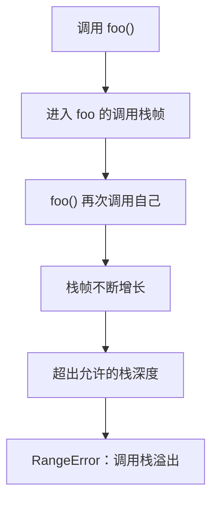
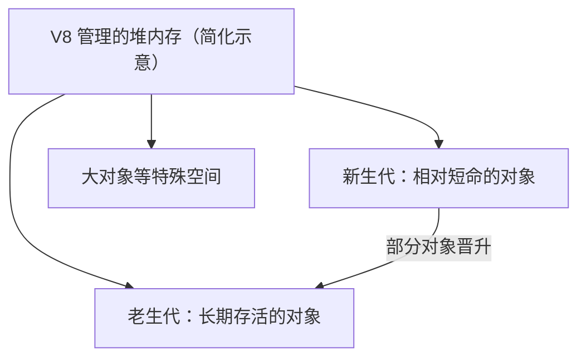
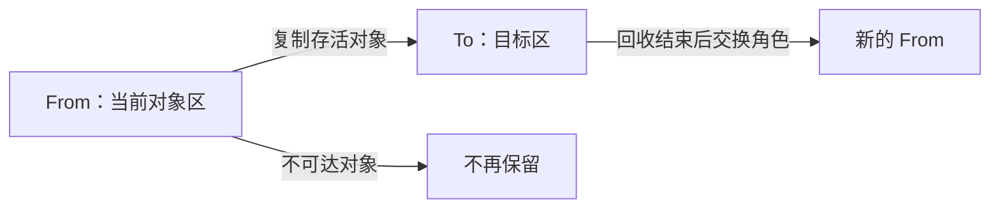
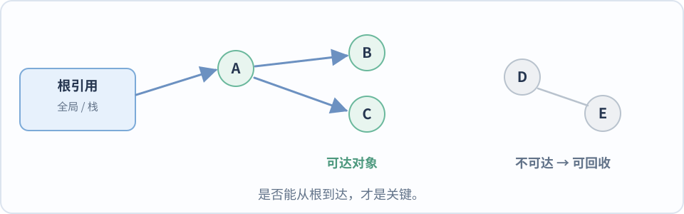
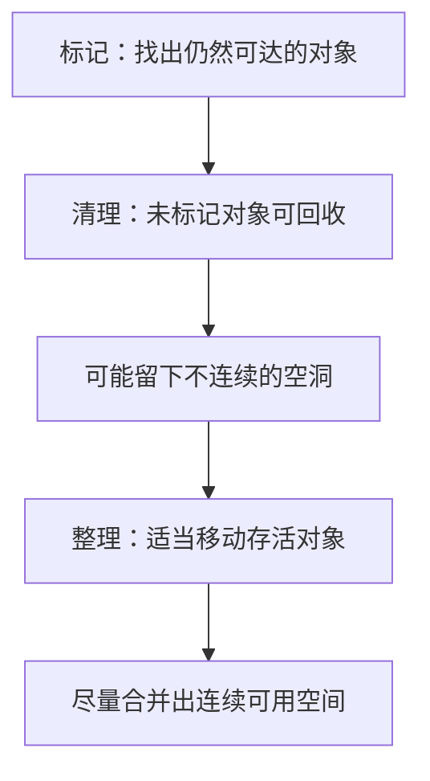
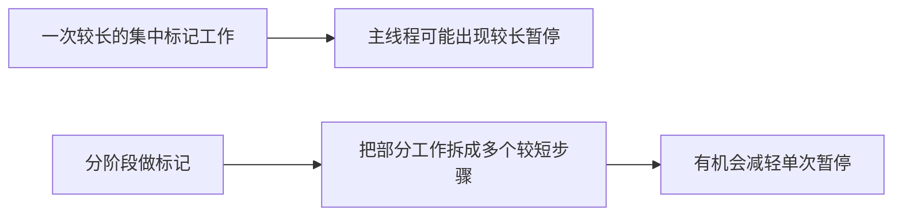
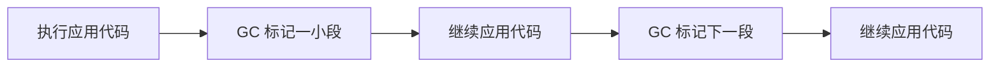

# 壹.4.5  V8引擎内存管理和垃圾回收机制

## v8引擎内存结构

- 内存分配：栈空间，堆空间
- 栈空间：代码运行的环境（逻辑运行的环境）
- 堆空间：所有函数和引用类型数据存放的具体地址

## 栈

栈是临时存储空间，主要存储局部变量和函数调用。

很多入门文章会说“基本类型都在栈上，对象都在堆上”。**这只是帮助理解的简化说法，不是 V8 必须遵守的内存布局规定。** 实际值存放在栈、寄存器还是堆里，受编译优化、对象是否逃逸等因素影响。你需要先搞清楚的是：对象的多个引用可以指向同一份数据，函数调用通常由调用栈组织。

> **别死记存储位置。** JavaScript 基本类型赋值复制的是值；对象赋值复制的是引用。因此 `const b = a` 不会自动把 `a` 指向的对象再复制一份。

对于函数，解释器创建了”调用栈“来记录函数的调用过程。每调用一个函数，解释器就可以把该函数添加进调用栈，解释器会为被添加进来的函数创建一个栈帧（用来保存函数的局部变量以及执行语句）并立即执行。如果正在执行的函数还调用了其他函数，新函数会继续被添加进入调用栈。函数执行完成，对应的栈帧立即被销毁。

两种查看调用栈的方法

1. 使用 [console.trace()](https://link.juejin.cn?target=https%3A%2F%2Fdeveloper.mozilla.org%2Fzh-CN%2Fdocs%2FWeb%2FAPI%2FConsole%2Ftrace) 向Web控制台输出一个堆栈跟踪.
2. 浏览器开发者工具进行断点调试

栈虽然很轻量，在使用时创建，使用结束后销毁，但是不是可以无限增长的，被分配的调用栈空间被占满时，就会引起”栈溢出“的错误。

```js
(function foo() {
    foo()
})()
```



为什么基本数据类型存储在栈中，引用数据类型存储在堆中？

JavaScript引擎需要用栈来维护程序执行期间的上下文的状态，如果栈空间大了的话，所有数据都存放在栈空间里面，会影响到上下文切换的效率，进而影响整个程序的执行效率。

## 堆

V8 会根据用途管理不同的堆内存空间，例如新生代、老生代、大对象空间，以及代码、元数据等相关空间。**这些空间的具体划分会随 V8 版本调整，不是一成不变的“五个格子”。** 本篇重点介绍新生代与老生代回收的基本思路。

一般来说，新生代主要面向较短命的对象，经历回收仍存活的对象有机会晋升到老生代。但“老生代”不等于“永远不释放”，不可达对象照样会回收。



### 新生代内存回收

下面用传统的 **Scavenge 半空间复制模型**说明思路：把用于复制回收的空间理解成 From 和 To 两个区域。注意，这是帮助理解的教学模型；现代 V8 的新生代回收实现比“永远严格对半分”复杂。

新的对象会首先被分配到 from 空间，当进行垃圾回收的时候，会先将 from 空间中的 存活的对象复制到 to 空间进行保存，对未存活的对象的空间进行回收。 复制完成后， from 空间和 to 空间进行调换，to 空间会变成新的 from 空间，原来的 from 空间则变成 to 空间。这种算法称之为 ”Scavenge“。



新生代内存回收频率很高，速度也很快，但是空间利用率很低，因为有一半的内存空间处于"闲置"状态。

### 老生代内存回收

新生代中多次进行回收仍然存活的对象会被转移到空间较大的老生代内存中，这种现象称为**晋升**。以下两种情况

具体晋升策略会随 V8 版本、对象存活次数以及空间压力等条件而变化。不能拿某个旧版本的“25%”经验值当成今天所有环境的固定规则。

因为老生代空间较大，如果仍然用 Scavenge 算法来频繁复制对象，那么性能开销就太大了。

#### 标记-清除（Mark-Sweep）

老生代采用的是”标记清除“来回收未存活的对象。

分为标记和清除两个阶段。标记阶段会遍历堆中所有的对象，并对存活的对象进行标记，清除阶段则是对未标记的对象进行清除。



#### 标记-整理（Mark-Compact）

标记清除不会对内存一分为二，所以不会浪费空间。但是经过标记清除之后的内存空间会生产很多不连续的碎片空间，这种不连续的碎片空间中，在遇到较大的对象时可能会由于空间不足而导致无法存储。 为了解决内存碎片的问题，需要使用另外一种算法 - **标记-整理（Mark-Compact）**。标记整理对待未存活对象不是立即回收，而是将存活对象移动到一边，然后直接清掉端边界以外的内存。



#### 增量标记

某些垃圾回收阶段需要暂停 JavaScript 执行，也就是常说的“Stop-the-world”。但不要误解成**所有 GC 工作都必须一直霸占主线程**：现代 V8 还使用增量、并行、并发等技术，尽量降低主线程停顿对用户交互的影响。



为了避免垃圾回收时间过长影响其他程序的执行，V8将标记过程分成一个个小的子标记过程，同时让垃圾回收和JavaScript应用逻辑代码交替执行，直到标记阶段完成。我们称这个过程为**增量标记**算法。



通俗理解，就是把一部分标记工作分段完成，减少一次性长时间停顿的风险。**注意，这只是解释“分段执行”的类比，不代表 GC 和 React Fiber 使用同一套调度机制。**


## 参考

- [V8 引擎垃圾内存回收原理解析](https://juejin.im/post/6844903993420840967)
- [JavaScript中V8引擎内存问题](https://link.juejin.cn?target=https%3A%2F%2Fwww.cnblogs.com%2Fcangqinglang%2Fp%2F12668374.html)
- [浅谈V8引擎中的垃圾回收机制](https://link.juejin.cn?target=https%3A%2F%2Fsegmentfault.com%2Fa%2F1190000000440270)


> **配图维护说明（2026-11）：** 旧文中6张 GC 配图来自第三方图床。这里改为 GitBook 原生 Mermaid 示意图，保留“调用栈、内存分区、复制回收、整理、增量标记”的教学顺序，**不是原图的无损复制**。如需研究某个 V8 版本的真实实现，优先阅读 [V8 官方博客](https://v8.dev/blog/trash-talk)、[V8 并发标记技术](https://v8.dev/blog/concurrent-marking)。
