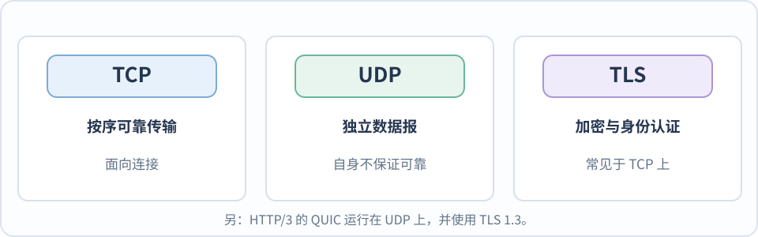
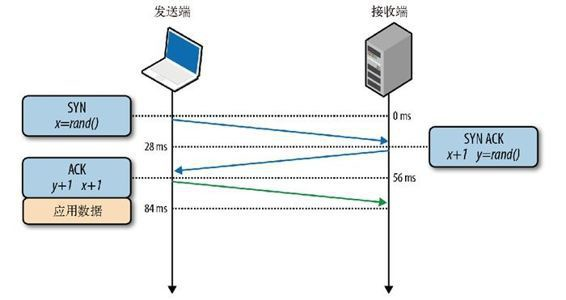
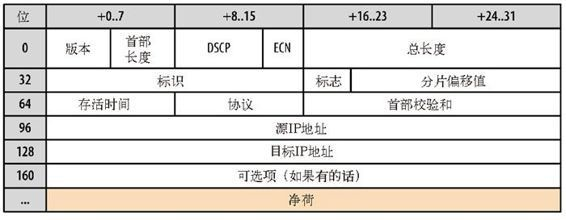
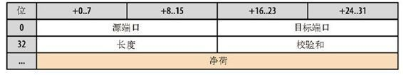

# 壹.5.2 了解TCP、UDP、TLS

> **看图提示：** TCP 提供面向连接的可靠字节流；UDP 提供数据报；TLS 用于安全通信。常见 TLS over TCP，QUIC 则在 UDP 上使用 TLS 1.3。

了解一点底层网络通信原理，对日常工作有很大的帮助，减少与后端工程师的“日常沟通摩擦”，增强共鸣和互信与理解。而在面试过程中，很多公司会考察前端工程师的知识广度，TCP/IP、TCP、UDP、TLS是被高频问到的。

 TCP/IP协议是一个协议集，里面包括很多协议的，TCP、UDP、TLS等只是其中的协议。

TCP/IP协议集包括**应用层**，**传输层**，**网络层**，**网络访问层**。

 应用层包括：

* 超文本传输协议\(HTTP\)：万维网的基本协议；
* 文件传输\(TFTP简单文件传输协议\)；
* 远程登录\(Telnet\)，提供远程访问其它主机功能，它允许用户登录；
* internet主机，并在这台主机上执行命令；
* 网络管理\(SNMP简单网络管理协议\)，该协议提供了监控网络设备的方法，以及配置管理,统计信息收集，性能管理及安全管理等；
* 域名系统\(DNS\)，该系统用于在internet中将域名及其公共广播的网络节点转换成IP地址。

传输层包括：

* TLS，也即SSL\(Secure Sockets Layer，安全套接字层\)协议，后来IETF在标准化SSL协议时，将其改名为Transport Layer Security（TLS，传输层安全）。

 网络层包括：

* Internet协议\(IP\)
* Internet控制信息协议\(ICMP\) 
* 地址解析协议\(ARP\) 
* 反向地址解析协议\(RARP\)  ****

网络访问层：

* 网络访问层又称作主机到网络层\(host-to-network\)。网络访问层的功能包括IP地址与物理地址硬件的映射，以及将IP封装成帧。基于不同硬件类型的网络接口，网络访问层定义了和物理介质的连接。

## 壹.5.2.1 TCP

| 术语 | 含义 |
| :--- | :--- |
| SYN | 请求建立连接，并在其序列号的字段进行序列号的初始值设定。建立连接，设置为1。 |
| ACK | 确认号是否有效，一般置为1。 |
| FIN | 希望断开连接。 |
| URG | 紧急指针是否有效。为1，表示某一位需要被优先处理。 |
| PSH | 提示接收端应用程序立即从TCP缓冲区把数据读走。 |
| RST | 对方要求重新建立连接，复位。 |

### 三次握手

如上图，三次握手分别是：

1. **SYN** 客户端选择一个随机序列号x，并发送一个SYN数据包，其中可能还包括其他TCP标志和选项。 
2. **SYN ACK** 服务器给x加1，并选择自己的一个随机序列号y，追加自己的标志和选项，然后返回响应。 
3. **ACK** 客户端给x和y加1并发送握手期间的最后一个ACK数据包。 

### 握手对延迟的影响

三次握手完成后，客户端与服务器之间就可以通信了。客户端可以在发送ACK分组之后立即发送数据，而服务器必须等接收到ACK分组之后才能发送数据。这个启动通信的过程适用于所有TCP连接，因此对所有使用TCP的应用具有非常大的性能影响，因为每次传输应用数据之前，都必须经历一次完整的往返。

举个例子，如果客户端在纽约，服务器在伦敦，要通过光纤启动一次新的TCP连接，光握手至少就要花56 ms：向伦敦发送分组需要28 ms，响应发回纽约又要28 ms。在此，连接的带宽对时间没有影响，延迟完全取决于客户端和服务器之间的往返时间，这其中主要是纽约到伦敦之间的传输时间。 三次握手带来的延迟使得每创建一个新TCP连接都要付出很大代价。而这也决定了提高TCP应用性能的关键，在于想办法重用连接。

重用TCP连接有一个方案叫“TCP Fast Open”（TFO），Linux 3.7及之后的内核已经在客户端和服务器中支持TFO，具体内容可以查阅[IETF规范](https://tools.ietf.org/html/rfc7413)。

### 四次挥手


[跟着动画来学习TCP三次握手和四次挥手](https://juejin.im/post/6844903625513238541)


### 常见面试题 

#### 1.为什么连接的时候是三次握手，关闭的时候却是四次握手？

答：因为当Server端收到Client端的SYN连接请求报文后，可以直接发送SYN+ACK报文。其中ACK报文是用来应答的，SYN报文是用来同步的。但是关闭连接时，当Server端收到FIN报文时，很可能并不会立即关闭SOCKET，所以只能先回复一个ACK报文，告诉Client端，"你发的FIN报文我收到了"。只有等到我Server端所有的报文都发送完了，我才能发送FIN报文，因此不能一起发送。故需要四步握手。

#### 2.为什么TIME\_WAIT状态需要经过2MSL\(最大报文段生存时间\)才能返回到CLOSE状态？

答：虽然按道理，四个报文都发送完毕，我们可以直接进入CLOSE状态了，但是我们必须假象网络是不可靠的，有可以最后一个ACK丢失。所以TIME\_WAIT状态就是用来重发可能丢失的ACK报文。在Client发送出最后的ACK回复，但该ACK可能丢失。Server如果没有收到ACK，将不断重复发送FIN片段。所以Client不能立即关闭，它必须确认Server接收到了该ACK。Client会在发送出ACK之后进入到TIME\_WAIT状态。Client会设置一个计时器，等待2MSL的时间。如果在该时间内再次收到FIN，那么Client会重发ACK并再次等待2MSL。所谓的2MSL是两倍的MSL\(Maximum Segment Lifetime\)。MSL指一个片段在网络中最大的存活时间，2MSL就是一个发送和一个回复所需的最大时间。如果直到2MSL，Client都没有再次收到FIN，那么Client推断ACK已经被成功接收，则结束TCP连接。

#### 3.为什么不能用两次握手进行连接？

答：3次握手完成两个重要的功能，既要双方做好发送数据的准备工作\(双方都知道彼此已准备好\)，也要允许双方就初始序列号进行协商，这个序列号在握手过程中被发送和确认。现在把三次握手改成仅需要两次握手，死锁是可能发生的。作为例子，考虑计算机S和C之间的通信，假定C给S发送一个连接请求分组，S收到了这个分组，并发 送了确认应答分组。按照两次握手的协定，S认为连接已经成功地建立了，可以开始发送数据分组。可是，C在S的应答分组在传输中被丢失的情况下，将不知道S 是否已准备好，不知道S建立什么样的序列号，C甚至怀疑S是否收到自己的连接请求分组。在这种情况下，C认为连接还未建立成功，将忽略S发来的任何数据分 组，只等待连接确认应答分组。而S在发出的分组超时后，重复发送同样的分组。这样就形成了死锁。

#### 4.如果已经建立了连接，但是客户端突然出现故障了怎么办？

TCP还设有一个保活计时器，显然，客户端如果出现故障，服务器不能一直等下去，白白浪费资源。服务器每收到一次客户端的请求后都会重新复位这个计时器，时间通常是设置为2小时，若两小时还没有收到客户端的任何数据，服务器就会发送一个探测报文段，以后每隔75秒钟发送一次。若一连发送10个探测报文仍然没反应，服务器就认为客户端出了故障，接着就关闭连接。

## 壹.5.2.2 UDP

1980年8月，**UDP（User Datagram Protocol，用户数据报协议）**被John Postel加入了核心网络协议套件。UDP的主要功能和亮点并不在于它引入了什么特性，而在于它忽略的那些特性。UDP经常被称为无（Null）协议，RFC 768描述了其运作机制，全文完全可以写在一张餐巾纸上。

### 数据报

数据报（Datagram）为一个完整、独立的数据实体，携带着从源节点到目的地节点的足够信息，对这些节点间之前的数据交换和传输网络没有任何依赖。 数据报（datagram）和数据包（packet）是两个经常被人混用的词，实际上它们还是有区别的。数据包可以用来指代任何格式化的数据块，而数据报则通常只用来描述那些通过不可靠的服务传输的数据包，既不保证送达，也不发送失败通知。正因为如此，很多场合下人们都把UDP中User（用户）的U，改成Unreliable（不可靠）的U，于是UDP就成了“不可靠数据报协议”（Unreliable Datagram Protocol）。这也是为什么把UDP数据包称为数据报更为恰当的原因。

### UDP的“无协议”是怎么回事呢？

要理解为什么UDP被人称作“无协议”，必须从作为TCP和UDP下一层的IP协议说起。

IP层的主要任务就是按照地址从源主机向目标主机发送数据报（Datagram）。为此，消息会被封装在一个IP分组内（如下图），其中载明了源地址和目标地址，以及其他一些路由参数。

> 注意，数据报这个词暗示了一个重要的信息：IP层不保证消息可靠的交付，也不发送失败通知，实际上是把底层网络的不可靠性直接暴露给了上一层。

如果某个路由节点因为网络拥塞、负载过高或其他原因而删除了IP分组，那么在必要的情况下，IP的上一层协议要负责检测、恢复和重发数据。

而UDP协议会用自己的分组结构（如下图）封装用户消息，它只增加了4个字段：源端口、目标端口、分组长度和校验和。这样，当IP把分组送达目标主机时，该主机能够拆开UDP分组，根据目标端口找到目标应用程序，然后再把消息发送过去。

UDP 的首部只有四个字段：源端口、目标端口、长度和校验和。源端口在特定条件下可以填 0，但**校验和绝不能笼统地说成“可选”**，这里 IPv4 和 IPv6 的要求不一样：

* **UDP over IPv4：** 协议允许把校验和设为 0，表示不使用 UDP 校验和；但一般不推荐随便关闭。
* **UDP over IPv6：** 通常必须计算校验和。只有符合特定规范的隧道等特殊场景，才可能使用零校验和模式，不能把这个例外当成通用规则。

还有一个坑：**IPv4 首部有校验和，IPv6 基本首部没有。** 而且校验和主要用来**检测**传输差错，并不会替应用程序自动纠错、自动重传。以为“IP 已经检查了，所以 UDP 可以不管”，这就把两层协议的职责搞混了。

UDP 不提供 TCP 那样的可靠交付、重排和连接状态管理，因此常被用来承载能自行处理丢包与时延的应用协议。它主要具有以下特点：

1. **不保证消息交付** 协议本身不做可靠交付的确认与重传。
2. **不保证交付顺序** 不设置包序号，不重排，不会发生队首阻塞。
3. **不跟踪连接状态** 不必建立连接或重启状态机。
4. **不需要拥塞控制** 不内置客户端或网络反馈机制。

### 应用场合

TCP 向应用程序提供可靠的字节流，应用层消息边界需要自己约定；UDP 保留**数据报的消息边界**，一次发送对应一条数据报，但**不保证它一定送到**。

这里千万别把“UDP 按数据报交付”和“IP 不能分片”混为一谈。一个较大的 UDP 数据报在 IP 层**可能被分片**：IPv4 在允许的情况下可由源主机或中间路由器分片；IPv6 只能由源节点执行分片，中间路由器不能分片。接收端需要先完成 IP 层重组，再将完整的数据报交给 UDP。实际开发要留意 MTU 和路径 MTU，尽量避免依赖 IP 分片，因为丢掉其中一片就可能使整个数据报无法交付。

UDP是一个简单、无状态的协议，适合作为其他上层应用协议的辅助。实际上，这个协议的所有决定都需要由上层的应用程序作出。

有些应用程序可能并不需要可靠的交付或者不需要按顺序交付。比如，每个分组都是独立的消息，那么按顺序交付就没有任何必要。而且，如果每个消息都会覆盖之前的消息，那么可靠交付同样也没有必要了。可惜的是，TCP不支持这种情况，所有分组必须按顺序交付。 

无需按序交付数据或能够处理分组丢失的应用程序，以及对延迟或抖动要求很高的应用程序，最好选择UDP等协议。

### UDP部分参考资料

* [RFC 768：User Datagram Protocol](https://www.rfc-editor.org/rfc/rfc768.html)
* [RFC 8085：UDP Usage Guidelines](https://www.rfc-editor.org/rfc/rfc8085.html)
* [RFC 8200：IPv6 Specification](https://www.rfc-editor.org/rfc/rfc8200.html)
* [RFC 6936：IPv6 UDP 零校验和的特殊适用条件](https://www.rfc-editor.org/rfc/rfc6936.html)
* [RFC 8900：IP Fragmentation Considered Fragile](https://www.rfc-editor.org/rfc/rfc8900.html)

## 壹.5.2.3 TLS 1.2、TLS 1.3：别再拿2018年的过渡期教人

前端朋友一看到 HTTPS，常会背一句：“HTTP 加上 TLS 就安全了。”

这句话方向没错，可如果你想弄清楚浏览器怎样跟服务器安全通信，至少得回答三个问题：**我连的是谁？别人能不能偷看？数据在路上有没有被改？**

TLS 就是围绕这些问题设计的。它负责协商安全参数、验证身份、建立加密通信。不是简单地给 HTTP 数据“套一层密码”。

### 1. 先把版本年份说准确

* **TLS 1.2**：规范发表于2008年（RFC 5246），今天仍在一些兼容场景使用。
* **TLS 1.3**：最初标准发表于2018年（RFC 8446），2026年已有更新的规范 [RFC 9846](https://www.rfc-editor.org/rfc/rfc9846.html)，取代了 RFC 8446。
* **TLS 1.0 和 1.1**：已由 [RFC 8996](https://www.rfc-editor.org/rfc/rfc8996.html) 正式弃用，不应作为新系统的安全选项。

所以，原先那句“现在正处于 TLS 1.2 取代 TLS 1.0/1.1 的过渡时期”，放在2026年显然不合适。

### 2. 握手为什么重要？

浏览器第一次访问 `https://example.com`，会通过 TLS 握手协商版本和加密算法，验证服务器证书，并建立双方用来保护数据的密钥材料。

TLS 1.2 和 TLS 1.3 的握手流程**并不完全一样**。尤其是 TLS 1.3，设计目标之一就是减少握手开销、淘汰不够安全的旧机制。

因此，别再一口咬定“TLS永远是四次握手”。具体消息数量、网络往返次数，还和首次连接、会话恢复、网络环境有关。

### 3. TLS 1.3 的 0-RTT 是不是越快越好？

0-RTT 允许符合条件的恢复连接提前发送应用数据，能减少等待。

可它有一个很重要的代价：**早期数据存在重放风险**。例如创建订单、转账、修改余额这类会改变服务器状态的请求，不能因为“可以省一次往返”就随便用 0-RTT。

安全和性能都要考虑，别只记一个“更快”。

### 4. HTTP/3 用的还是 TLS 吗？

会用，但不是传统“TCP 连接上再套一层 TLS”的方式。HTTP/3 基于 QUIC，QUIC 把 TLS 1.3 的握手和密钥协商集成进自己的连接建立机制。相关细节见 [RFC 9001](https://www.rfc-editor.org/rfc/rfc9001.html)。

### 5. 开发时如何核实？

打开浏览器安全信息或抓包分析，用受控测试环境核实连接最终协商了什么 TLS 版本、密码套件、证书链；不要只看到浏览器地址栏有个锁，就认为服务器所有配置都合理。

如果你要负责生产环境的 TLS 配置，还需要结合当前 Mozilla 配置建议、安全扫描及服务端日志复核，不要直接复制多年前教程中的 OpenSSL 配置。

**参考规范：** [RFC 9846：TLS 1.3](https://www.rfc-editor.org/rfc/rfc9846.html)、[RFC 8996：弃用 TLS 1.0/1.1](https://www.rfc-editor.org/rfc/rfc8996.html)、[RFC 9001：QUIC 与 TLS](https://www.rfc-editor.org/rfc/rfc9001.html)、[MDN：TLS](https://developer.mozilla.org/en-US/docs/Web/Security/Defenses/Transport_Layer_Security)。
