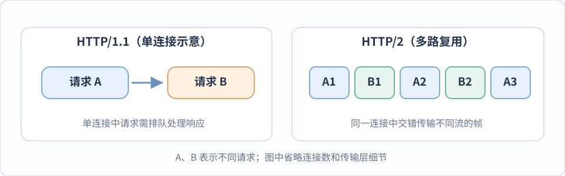

# 壹.5.3 HTTP/1.1、HTTP/2、HTTP/3 到底差在哪？

HTTP 版本这道面试题，很多人能背出“1.1 长连接、2 多路复用、3 QUIC”。背得倒挺顺，可真遇到网站慢了，你知道该查什么吗？

我觉得应该先搞清楚：**这三个版本想解决的，究竟是哪种等待？**

## 01. 先认识三个版本

| 版本 | 核心区别 | 不能解决的问题 |
| --- | --- | --- |
| HTTP/1.1 | 持久连接、请求响应语义；并行请求常使用多条连接 | 单条连接上的请求处理仍有限制 |
| HTTP/2 | 二进制帧、流的多路复用、HPACK 头部压缩 | 仍跑在 TCP 上，丢包会影响同一连接里的多个流 |
| HTTP/3 | HTTP 语义仍在，传输改用基于 UDP 的 QUIC，使用 QPACK | 丢包、拥塞和网络延迟不会凭空消失 |

这里的“并行”要特别注意：HTTP/2 在**同一条 TCP 连接内交错传输不同流的帧**；HTTP/3 则在 QUIC 上使用独立流。

## 02. HTTP/1.1：为什么一个页面要开好几条连接？

HTTP/1.1 支持持久连接，多个请求可以复用连接，不代表浏览器就会在同一连接上同时随意交错传输所有响应。

实际浏览器为了并行获取资源，往往会对同一来源使用多条连接。HTTP/1.1 有 pipelining 的历史机制，但并没有成为现代浏览器普遍依赖的解决方案。

所以，看到一个页面请求多、加载慢，别急着说“换 HTTP/2 就肯定快”。还得看资源大小、缓存、服务器响应、网络质量等。

## 03. HTTP/2：多路复用，究竟省了什么？

HTTP/2 把逻辑消息拆成帧，交错放进多条流里，在连接上运输。你可以理解为一辆货车可以同时给多个订单运货，不必“一单送完才轮到下一单”。

它的价值在于减少应用层排队和多连接成本，支持二进制帧、头部压缩、流量控制等机制。

但有一个经常被讲错的地方：**HTTP/2 解决了 HTTP/1.1 典型的应用层队首阻塞，不等于消灭所有队首阻塞。**

HTTP/2 通常跑在 TCP 上。TCP 按序交付字节流，如果同一连接的一部分数据丢了，后面的字节可能需要等待重传。于是，不同 HTTP/2 流仍会受到影响。这就是传输层的队首阻塞。

## 04. 优先级：别继续拿旧的“31位树”当最新规则

早期 HTTP/2（RFC 7540）使用依赖树、权重等优先级信息。你在老文章里看到的“31 位优先级数值决定哪个流先走”，既容易讲错，也已经不适合拿来概括今天的标准。

2022 年修订的 [RFC 9113](https://www.rfc-editor.org/rfc/rfc9113.html) 废弃了旧版优先级信令机制；[RFC 9218](https://www.rfc-editor.org/rfc/rfc9218.html) 定义了可扩展的优先级方案，包括 `Priority` 头字段、`urgency` 和 `incremental` 等参数，可用于 HTTP/2 和 HTTP/3。

要注意：**规范给出了机制，不代表每台服务器、每个浏览器、每个 CDN 都采用同样的调度策略。** 想研究具体网站的加载优先级，还得看它的响应和实际网络记录。

## 05. HTTP/2 Server Push：能用，不代表还值得教人这么优化

HTTP/2 标准保留了 Server Push 这种可选机制：服务器可以主动推送客户端尚未请求的资源。

问题在于，实际收益没大家想得那么美。Chrome 从 106 版本起默认禁用了 HTTP/2 Server Push。**因此今天不应把它当成面向主流浏览器的推荐优化手段。**

想更早告诉浏览器“这个资源马上要用”，可以评估 `preload` 或 HTTP 103 Early Hints，但是否有效同样要看资源依赖、缓存和真实测量。

来源：[Chrome：Removing HTTP/2 Server Push](https://developer.chrome.com/blog/removing-push)、[RFC 9113](https://www.rfc-editor.org/rfc/rfc9113.html)。

## 06. HTTP/3：为什么要绕过 TCP，改用 QUIC？

HTTP/3 把 HTTP 映射到 QUIC。QUIC 使用 UDP 承载，但它**不是简单把 TCP 换成一个“更快的UDP包”**，而是在其上实现了安全通信、可靠传输、拥塞控制和多条独立流等能力。

为什么说多条独立流重要？

HTTP/2 的多条流共享同一个 TCP 字节流；一旦某些 TCP 数据丢失，别的流也可能跟着等。QUIC 的不同流可以分别进行重组，一个流里的数据丢失通常不会因为**传输层必须按序交付**而卡住其他流。

但网络要是真丢包严重，连接拥塞控制、带宽、服务器负载仍会影响整体速度。**HTTP/3 是更好的传输机制，不是免费的性能外挂。**

官方规范：[RFC 9114：HTTP/3](https://www.rfc-editor.org/rfc/rfc9114.html)、[RFC 9000：QUIC](https://www.rfc-editor.org/rfc/rfc9000.html)。

## 07. 怎么验证网站究竟在用哪个版本？

在浏览器 DevTools 的 Network 面板显示 `Protocol` 列，实际刷新页面，查看资源走的是 `http/1.1`、`h2` 还是 `h3`。

然后看看请求的排队、等待响应、传输时间。**看到 `h3` 不等于性能已经最好**，改协议前后最好在相近网络条件下多次比较。

如果你只记住一句话，就记这句：**HTTP/1.1、HTTP/2、HTTP/3 主要是在重新安排“数据怎样更有效地到达”，并没有替你解决所有服务器、代码和资源的问题。**

**参考资料：** [HTTP/1.1 RFC 9112](https://www.rfc-editor.org/rfc/rfc9112.html)、[HTTP/2 RFC 9113](https://www.rfc-editor.org/rfc/rfc9113.html)、[HTTP/3 RFC 9114](https://www.rfc-editor.org/rfc/rfc9114.html)、[HTTP 优先级 RFC 9218](https://www.rfc-editor.org/rfc/rfc9218.html)。
