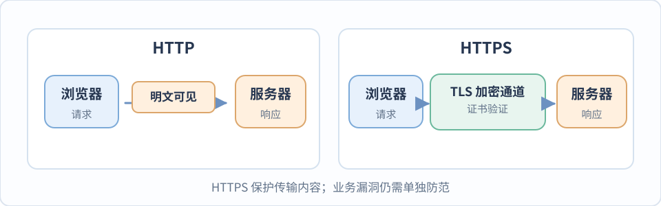

# 壹.5.4 HTTP 和 HTTPS 到底有什么区别？

**HTTPS 是现代网站的基本配置。** 它到底比 HTTP 多了什么，能保护什么，又保护不了什么？

## 壹.5.4.1 先搞清楚：HTTPS 到底多了什么？

HTTP 定义请求和响应，包括 `GET`、`POST`、状态码等。**HTTPS 在 HTTP 通信中加入 TLS 安全保护。** HTTP/1.1、HTTP/2 通常基于 TCP 和 TLS；HTTP/3 使用 QUIC，集成 TLS 1.3 的安全机制。

TLS 主要解决三件事：

1. **防偷看：** 传输内容被加密，路上截获数据的人不能直接读懂。
2. **防篡改：** 数据在传输途中被人改过，通信双方通常能够检测出来。
3. **确认服务器身份：** 浏览器用证书等机制验证自己连接的服务器是不是目标域名对应的服务器。



> HTTPS 保护传输过程，不能保证网站代码安全。现代 HTTPS 使用 TLS，旧文中的 SSL 说法应更新。

## 壹.5.4.2 这四个老说法，别再拿去面试了

**老说法一：HTTPS 证书很贵，小网站没必要。**

不对。Let's Encrypt 可免费签发受浏览器信任的证书，许多托管服务也支持自动续期。

**老说法二：一个 IP 只能绑定一张证书、一个域名。**

不对。借助 SNI，同一个 IP 可以服务多个 HTTPS 域名和证书。

**老说法三：HTTPS 会让页面加载慢 50%，耗电增加 20%。**

没有通用的固定比例。实际耗时受 TLS 握手、连接复用、HTTP 版本和网络环境影响，应该实测。

**老说法四：HTTPS 会让 HTTP 的缓存失效。**

不对。HTTPS 响应仍可使用 `Cache-Control`、`ETag` 等缓存机制。

## 壹.5.4.3 HTTPS 是不是就万无一失了？

钓鱼网站也可能使用 HTTPS。加密连接不代表网站可信，还要防这些问题：

- **混合内容：** HTTPS 页面加载 HTTP 脚本等不安全资源，浏览器可能直接拦截。页面打不开、脚本不执行，先看 Console 的 Mixed Content 报错。
- **业务漏洞：** XSS、CSRF、越权、弱密码，不会因为装上证书就自动消失。
- **终端和服务器：** 如果用户设备或服务器本身遭入侵，HTTPS 也不能替你修好它们。

有些浏览器功能要求安全上下文。例如 Service Worker 等能力通常需要 HTTPS；本地 `localhost` 在开发场景下可能被当作可信来源，不等于生产网站可以长期使用 HTTP。

在浏览器控制台执行：

```javascript
console.log('当前是否为安全上下文：', window.isSecureContext);
console.log('当前协议：', window.location.protocol);
```

`isSecureContext` 反映浏览器对安全上下文的判定，**不代表网站绝对安全**。

## 壹.5.4.4 真做项目，应该怎么上 HTTPS？

上线时按这五步检查：

1. 为域名配置有效证书，设置**自动续期**。
2. 把 HTTP 请求重定向到 HTTPS，检查站内图片、脚本、接口地址有没有混合内容。
3. 配置 TLS；启用 HSTS（特别是 `includeSubDomains`）前，确认相关域名都可稳定使用 HTTPS。
4. 打开浏览器 DevTools 的 **Security、Network、Console**，确认连接、证书、资源加载都正常。
5. 单独治理业务安全：输入校验、权限控制、Cookie 属性、CSP。

补充一句：80 和 443 是常见默认端口，**不是本质区别**。加上 TLS 不会改变 HTTP 的无状态语义。

## 壹.5.4.5 面试怎么答？

**HTTP 定义请求和响应如何通信，HTTPS 在这个基础上使用 TLS 保护传输，并通过证书等机制验证服务端身份。HTTPS 可以提高通信的保密性与完整性，但不保证业务代码没漏洞，也不证明网站一定值得信任。**

追问时可结合 TLS 握手、证书验证、SNI 和浏览器调试工具举例。

## 参考资料

- [MDN：Transport Layer Security](https://developer.mozilla.org/en-US/docs/Web/Security/Defenses/Transport_Layer_Security)
- [MDN：Secure contexts](https://developer.mozilla.org/en-US/docs/Web/Security/Defenses/Secure_Contexts)
- [MDN：Mixed content](https://developer.mozilla.org/en-US/docs/Web/Security/Defenses/Mixed_content)
- [Let's Encrypt：FAQ](https://letsencrypt.org/docs/faq/)
- [Let's Encrypt：Integration Guide（SNI 与多域名）](https://letsencrypt.org/docs/integration-guide/)
