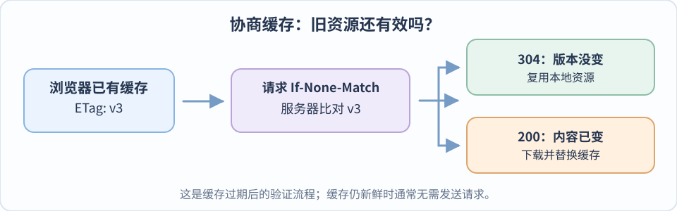

# 壹.5.6 HTTP 缓存：为什么有的请求不发网络，有的返回 304？

同一个图片打开两次，第二次为什么特别快？你在开发者工具里又为什么经常看到 `304 Not Modified`？弄懂这两个现象，就抓住了 HTTP 缓存的核心。

HTTP 缓存不是简单地“浏览器里存一份文件”。它实际要回答两个问题：**手上的副本还算新吗？如果已经过期，服务器上的版本变了没有？**

## 01. 强缓存：副本足够新，就直接用

假设浏览器第一次请求 `/assets/app.abc123.js`，服务器返回：

```http
HTTP/1.1 200 OK
Cache-Control: public, max-age=31536000, immutable
Content-Type: text/javascript
```

`max-age` 表示从响应生成时起的**新鲜期**（以秒计）。只要缓存匹配且仍处于新鲜期，浏览器通常可以直接复用它，而不用再访问服务器。

这就是通常所说的**强缓存**。但要记住：缓存策略还受请求方式、`Vary`、用户的重新加载操作等因素影响，不是看到 `max-age` 就保证永远不发请求。

上面的文件名包含内容哈希 `abc123`。内容一变，构建工具生成的新文件名也会改变，所以才适合长期缓存。**不要给文件名长期不变、内容却经常修改的文件随便设置一年缓存。**

## 02. 协商缓存：副本过期了，先问服务器变了没

如果缓存已经不新鲜，但浏览器还保留着旧文件，就不一定需要重新下载整份内容。

它可以带着之前存下的 `ETag` 发起一个**条件请求**：

```http
GET /api/news HTTP/1.1
If-None-Match: "news-v3"
```

服务器比较文件版本，通常有两种结果：

- **没变化：** 返回 `304 Not Modified`，通常不附带响应体。浏览器继续使用本地资源，同时更新有关缓存的元数据。
- **有变化：** 返回 `200 OK` 和新内容，浏览器用新响应更新缓存。



> **看图提示：** 图只画了缓存已经变旧时的**条件请求**。如果缓存还新鲜，通常直接复用，不会先走这一步。

除了 `ETag` / `If-None-Match`，还可以用 `Last-Modified` / `If-Modified-Since` 按时间验证。`ETag` 通常更适合表示具体资源版本；两个条件头同时出现时，服务器会优先处理 `If-None-Match`。

## 03. no-cache 和 no-store 不是一回事

名字最容易坑人的两个响应指令：

| 指令 | 真正含义 |
| --- | --- |
| `Cache-Control: no-cache` | **可以存储，但重用前必须向服务器验证。** |
| `Cache-Control: no-store` | **不应存储这个响应。** |
| `Cache-Control: private` | **可供私人缓存存储，但共享缓存不能存储。** |
| `Cache-Control: max-age=60` | 一般允许缓存把响应视为新鲜的时间为 60 秒。 |

注意 `private` 不等于加密；`no-store` 也不能代替权限校验和敏感数据保护。

## 04. 用一段 Node.js 代码观察 304

保存为 `server.mjs`，用 `node server.mjs` 启动：

```javascript
import { createServer } from 'node:http';

const body = JSON.stringify({ version: 3, message: 'hello' });
const etag = '"news-v3"'; // 内容变了，这个值也必须更新

createServer((req, res) => {
  if (req.url !== '/api/news') {
    res.writeHead(404);
    res.end();
    return;
  }

  res.setHeader('Cache-Control', 'private, no-cache');
  res.setHeader('ETag', etag);

  if (req.headers['if-none-match'] === etag) {
    res.writeHead(304);
    res.end();
    return;
  }

  res.setHeader('Content-Type', 'application/json; charset=utf-8');
  res.writeHead(200);
  res.end(body);
}).listen(3000, () => {
  console.log('http://localhost:3000/api/news');
});
```

另开终端测试：

```bash
curl -i http://localhost:3000/api/news
curl -i -H 'If-None-Match: "news-v3"' http://localhost:3000/api/news
```

第一次应该返回 `200` 和 JSON，第二次应该返回 `304`、没有响应体。

真实项目不应该给不断变化的内容硬编码一个永远不变的 `ETag`；通常需要由服务器框架按资源版本或内容生成。

## 05. 实战中怎么选择

**带内容哈希的静态资源：** 通常使用长时间 `max-age`，更新时靠新 URL 让客户端拿到新文件。

**HTML 首页：** 往往需要更及时地检查更新，可以选择需要验证的缓存策略。否则可能首页一直引用旧的资源清单。

**实时接口：** 是否允许存储、缓存多久，要根据数据新鲜度和安全需求决定；不要所有 API 一律禁用缓存。

**用户敏感数据：** 严格评估 `private`、`no-store` 和身份权限校验，不要把缓存策略当作安全边界。

## 06. 面试时容易问错的三个问题

**返回 304 是不是没有发生网络请求？** 不是。304 正是服务器对条件请求的响应；没发请求通常是仍然新鲜的缓存命中。

**no-cache 是不是不允许缓存？** 不是。它允许存储，但要求重用前验证。

**ETag 是不是一定是文件 MD5？** 不是。它是资源版本标识，生成规则由服务器决定，可以是内容哈希、版本号等。

## 参考资料

- [MDN：HTTP 缓存](https://developer.mozilla.org/en-US/docs/Web/HTTP/Guides/Caching)
- [MDN：Cache-Control](https://developer.mozilla.org/en-US/docs/Web/HTTP/Reference/Headers/Cache-Control)
- [MDN：304 Not Modified](https://developer.mozilla.org/en-US/docs/Web/HTTP/Reference/Status/304)
- [RFC 9111：HTTP Caching](https://www.rfc-editor.org/rfc/rfc9111)
