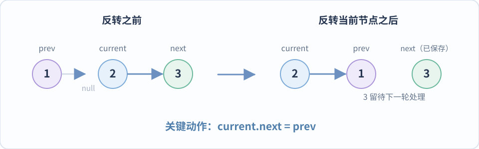

# 贰.1.2 链表

链表在面试里出现得特别多。我见过一种很常见的学法：先把反转链表的代码背下来，面试官换个问法，就不会了。

其实没那么玄。你听歌时点“下一首”，假如每首歌只记着下一首是谁，一首接一首，就很像一条单链表。真正要弄懂的是，每个节点手里到底握着哪一个引用。

数组可以按下标快速找元素，链表通常得顺着 `next` 一步步找。这就是两者特别重要的区别。

## 01. 先画一条链表

```text
head
 ↓
[1 | next] → [2 | next] → [3 | null]
```

用 JavaScript 表示：

```js-run
class ListNode {
  constructor(val, next = null) {
    this.val = val;
    this.next = next;
  }
}

const head = new ListNode(
  1,
  new ListNode(2, new ListNode(3))
);

console.log(head.next.val); // 2
console.log(head.next.next.val); // 3
```

每个节点有 `val` 和 `next` 两部分。`next` 保存下一节点的引用，不是数组下标。

## 02. 插入一个节点，为什么可以很快？

假设已知节点 `node2` 指向值为 2 的节点，要在它后面插入 99：

```javascript
const node2 = head.next;
const inserted = new ListNode(99);
inserted.next = node2.next;
node2.next = inserted;
// 现在是 1 → 2 → 99 → 3
```

这里改了两条指向关系，不需要像数组中间插入那样移动后续元素。**已知位置前驱节点时，插入可以是 O(1)。**

但如果只给你“请插到第 100 个元素前”，单链表仍要从头找到那个位置，查找通常需要 O(n)。别把“链表插入 O(1)”理解成“任意位置插入永远 O(1)”。




> **看图提示：** 先保存后继，再调转当前节点的箭头，否则会丢失尚未处理的链表。

## 03. 高频题：反转链表

原本：`1 → 2 → 3 → null`

要求：`3 → 2 → 1 → null`

难点不是把值倒过来，而是把每一条 `next` 的方向倒过来。我们要同时记住三个节点：前一个、当前、下一个。

```javascript
function reverseList(head) {
  let prev = null;
  let current = head;

  while (current !== null) {
    const next = current.next; // 先记下后面是谁
    current.next = prev;       // 再把箭头掉头
    prev = current;            // 前一个向前挪
    current = next;            // 当前向前挪
  }
  return prev;
}

const reversed = reverseList(head);
console.log(reversed.val); // 3
```

注意：上节插入过 99，本例实际从 `1→2→99→3` 反转，所以返回的头结点还是 3。反转时如果省略 `const next = current.next`，箭头改完就找不到原本的下一个节点了。

时间复杂度 `O(n)`，额外空间 `O(1)`。如果面试官要求递归，递归法同样可写，但会占用调用栈。

## 04. 快慢指针：判断链表是否有环

假设列表里的第 5 个节点指回第 2 个节点，形成闭环。普通 `while(node)` 遍历永远走不到 `null`。

快慢指针的办法很有画面感：操场上两个跑步的人，慢的人每次走一步，快的人每次走两步。如果跑道是环形，快的人迟早会追上慢的人。

```javascript
function hasCycle(head) {
  let slow = head;
  let fast = head;

  while (fast && fast.next) {
    slow = slow.next;
    fast = fast.next.next;
    if (slow === fast) return true;
  }
  return false;
}

const a = new ListNode('A');
const b = new ListNode('B');
const c = new ListNode('C');
a.next = b; b.next = c; c.next = b;
console.log(hasCycle(a)); // true
```

为什么要判断 `fast && fast.next`？因为快指针每次跨两个节点，必须先确认后面有路可走，否则会访问不存在的节点。

## 05. 再来一题：找到链表中点

```javascript
function middleNode(head) {
  let slow = head;
  let fast = head;
  while (fast && fast.next) {
    slow = slow.next;
    fast = fast.next.next;
  }
  return slow;
}

const list = new ListNode(1, new ListNode(2,
  new ListNode(3, new ListNode(4, new ListNode(5)))));
console.log(middleNode(list).val); // 3
```

如果节点数量是偶数，这种写法会返回两个中间节点中的**第二个**。面试时应先确认题目要求。

## 06. 数组和链表到底怎么选？

讲到这里，可能有朋友要问：既然链表插入删除方便，以后是不是尽量用链表？先别急。

数组适合按位置访问和连续遍历；链表是**已经找到节点**之后改连接比较方便。要是连节点在哪儿都不知道，还得从头找。何况 JavaScript 原生数组经过大量优化，自己用对象拼链表，未必更快。

面试时能解释“为什么数组在下标访问上有优势、为什么链表在已知节点位置的连接修改上有优势”，比只背 `O(1)`、`O(n)` 更重要。

## 07. 动手练习

1. 删除链表倒数第 N 个节点：考虑双指针和虚拟头节点。
2. 合并两个有序链表：两边各走一个指针。
3. 找到环的入口：快慢指针相遇后，让一个指针从头走，两个同步前进。

三个练习都围绕同一个思想：别把链表当数组，先想清楚**每个指针究竟指向谁**。

我希望你做完这些题后，脑子里留下的是“谁指向谁”，不是某段必须原封不动背下来的反转代码。

