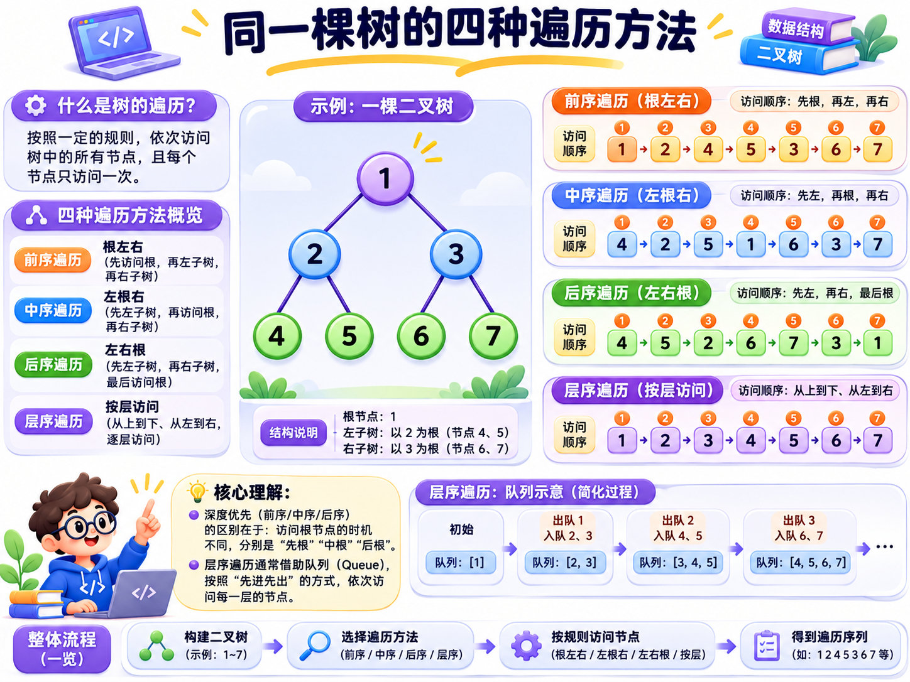

# 贰.1.4 二叉树的遍历

你打开电脑上的文件夹，发现里面还有文件夹，文件夹里又嵌套文件夹。这种结构可以用一棵树来理解。

二叉树更简单：**每个节点最多只有左、右两个孩子。** 面试官问“怎么遍历二叉树”，其实是在问：面对一层层嵌套的节点，你打算按什么顺序把它们都访问一次？

先约定一棵树，后面所有例子都用它。

```text
       1
      / \
     2   3
    / \
   4   5
```

```javascript
const tree = {
  val: 1,
  left: {
    val: 2,
    left: { val: 4, left: null, right: null },
    right: { val: 5, left: null, right: null }
  },
  right: { val: 3, left: null, right: null }
};
```




> **配图补充：** 插图用的是 **1～7 共七个节点的满二叉树**，本章随后运行的代码用的是 **1～5 共五个节点的树**。两处示例的节点数不同，所以遍历结果也不同。

> **看图提示：** 前序：1、2、4、5、3；中序：4、2、5、1、3；后序：4、5、2、3、1；层序：1、2、3、4、5。

## 01. 递归为什么适合树？

如果把“遍历一棵树”拆开，它只是三件事：访问当前节点、遍历左子树、遍历右子树。而左子树本身也是一棵树。这种“子问题和原问题长得一样”的结构，非常适合递归。

决定访问当前节点的时机，就有了三种顺序。

### 前序遍历：根 → 左 → 右

```javascript
function preorder(node, result = []) {
  if (node === null) return result;
  result.push(node.val);    // 先访问自己
  preorder(node.left, result);
  preorder(node.right, result);
  return result;
}
console.log(preorder(tree)); // [1, 2, 4, 5, 3]
```

类比现实：先记下这个文件夹叫什么，再进入它的子文件夹。

### 中序遍历：左 → 根 → 右

```javascript
function inorder(node, result = []) {
  if (!node) return result;
  inorder(node.left, result);
  result.push(node.val);
  inorder(node.right, result);
  return result;
}
console.log(inorder(tree)); // [4, 2, 5, 1, 3]
```

对于二叉搜索树，满足左侧较小、右侧较大等有序条件时，中序遍历可以得到有序结果。普通二叉树不保证这一点。

### 后序遍历：左 → 右 → 根

```javascript
function postorder(node, result = []) {
  if (!node) return result;
  postorder(node.left, result);
  postorder(node.right, result);
  result.push(node.val);
  return result;
}
console.log(postorder(tree)); // [4, 5, 2, 3, 1]
```

类比删除文件夹：要先清空子文件夹，最后才删除外层文件夹。后序遍历很适合这种“先处理孩子，再处理父亲”的需求。

## 02. 层序遍历：为什么要用队列？

如果想按楼层读：第一层是 1，第二层是 2、3，第三层是 4、5。这就叫层序遍历或广度优先遍历。

队列的规则是**先进去的先出来**。先把根放进去，取出根后把左右孩子放进去，就能按层向下走。

```javascript
function levelOrder(root) {
  if (!root) return [];
  const result = [];
  const queue = [root];
  let front = 0;

  while (front < queue.length) {
    const count = queue.length - front;
    const level = [];

    for (let i = 0; i < count; i++) {
      const node = queue[front++];
      level.push(node.val);
      if (node.left) queue.push(node.left);
      if (node.right) queue.push(node.right);
    }

    result.push(level);
  }
  return result;
}

console.log(levelOrder(tree));
// [[1], [2, 3], [4, 5]]
```

为什么不用 `queue.shift()`？对普通 JavaScript 数组，频繁从头删除元素可能需要移动后面的项。用 `front` 下标推进，通常更稳定。

## 03. 不允许递归怎么办？

面试官可能接着问：“不用递归写前序遍历。”这时可以使用**栈**模拟函数调用的先后顺序。

```javascript
function preorderWithStack(root) {
  if (!root) return [];
  const stack = [root];
  const result = [];

  while (stack.length) {
    const node = stack.pop();
    result.push(node.val);
    // 栈是后进先出：先放右边，再放左边
    if (node.right) stack.push(node.right);
    if (node.left) stack.push(node.left);
  }

  return result;
}
console.log(preorderWithStack(tree)); // [1, 2, 4, 5, 3]
```

记住这一个画面：**栈像一摞盘子，最后放上去的先拿走**。所以虽然我们希望先访问左节点，压栈时却要先压右节点。

## 04. 实战：求一棵树最大深度

这题很适合检验你是否真正理解递归：

```javascript
function maxDepth(node) {
  if (!node) return 0;
  return Math.max(maxDepth(node.left), maxDepth(node.right)) + 1;
}
console.log(maxDepth(tree)); // 3
```

为什么是左右最大深度加一？因为当前节点占一层；它下面哪边更深，整棵树就由哪边决定。

## 05. 再来一题：判断两棵树是否相同

```javascript
function sameTree(a, b) {
  if (!a && !b) return true;
  if (!a || !b) return false;
  return a.val === b.val &&
    sameTree(a.left, b.left) &&
    sameTree(a.right, b.right);
}
console.log(sameTree(tree, tree)); // true
```

判断结构和每个对应节点的值是否一致，而不是仅比较根节点，或仅比较两个对象的引用是否相同。

## 06. 时间复杂度和两个重要边界

上述访问全部节点的遍历通常是 `O(n)` 时间；递归调用栈通常占 `O(h)`，`h` 是树高。平衡树高度较小，退化成一条链的树可能高度为 n。

如果树很深，递归可能造成调用栈溢出，要考虑显式栈或队列。空树应该有明确输出：前中后序返回 `[]`、层序也返回 `[]`、最大深度为 0。

## 07. 面试时该怎样解释？

先画出树，再手工模拟访问顺序，最后才写代码。很多人背得出“根左右”，一旦树换了形状就错，原因是没有真正理解**节点什么时候入栈、什么时候出栈、什么时候被访问**。
