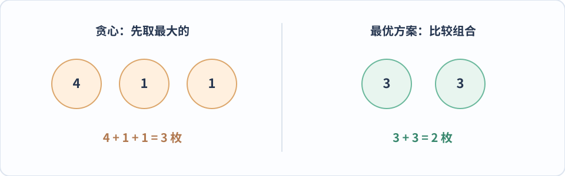

# 贰.1.6 分治法、动态规划与贪心算法的区别

分治法，动态规划、贪心算法三者之间有类似之处，比如都需要将问题划分为一个个子问题，然后通过求解子问题来得到最终解，但其实这三者之间的区别还是很大的。

## **01.分治法**

分治法\(Divide-and-Conquer\) : 将原问题划分成n个规模较小而结构、且与原问题相似的子问题，递归地解决这些子问题，然后再合并其结果，就得到原问题的解。

分治模式在每一层递归上都有三个步骤：

* 分解\(Divide\)：将原问题分解成一系列子问题；
* 解决\(Conquer\)：递归地解决各个子问题。若子问题足够小，则直接求解。
* 合并\(Combine\)：将子问题的结果合并成原问题的解。

[快速排序](2.1.1.md#kuai-su-pai-xu)是一个典型分治法的例子。

## **02.动态规划**

动态规划算法的设计可以分为如下4个步骤：

* 描述最优解的结构
* 递归定义最优解的值
* 按自底向上的方式计算最优解的值
* 由计算出的结果构造一个最优解

分治法是指将问题划分成一些独立的子问题，递归的求解各子问题，然后合并子问题的解而得到原问题的解。与此不同，动态规划适用于子问题独立且**重叠**的情况，也就是各子问题包含公共的子子问题。在这种情况下，若用分治法则会做许多不必要的工作，即重复地求解公共的子问题。动态规划算法对每个子子问题只求解一次，将其结果保存在一张表中，从而避免每次遇到各个子问题时重新计算答案。

适合采用动态规划方法的最优化问题中的两个要素：最优子机构和重叠子问题。

**最优子机构：**如果问题的一个最优解中包含了子问题的最优解，则该问题具有最优子机构。

**重叠子问题：**子问题的空间要很小，也就是用来求解原问题的递归算法反复地解同样的子问题，而不是总是在产生新的子问题。对两个子问题来说，如果它们确实是相同的子问题，只是作为不同问题的子问题出现的话，则它们是重叠的。

**一句话总结分治法与动态规划的区别： 分治法 —— 各子问题独立；动态规划 —— 各子问题重叠。**

引自《算法导论》：

> 动态规划要求其子问题既要独立又要重叠，这看上去似乎有些奇怪。虽然这两点要求听起来可能矛盾的，但它们描述了两种不同的概念，而不是同一个问题的两个方面。如果同一个问题的两个子问题不共享资源，则它们就是独立的。对两个子问题来说，如果它们确实是相同的子问题，只是作为不同问题的子问题出现的话，是重叠的，则它们是重叠。

### 延伸阅读（建议必读）


1\) [司徒正美讲动态规划：Javascript背包问题详解](https://segmentfault.com/a/1190000012829866)

2\)[【动态规划】三种背包问题（01背包、完全背包、多重背包）](https://blog.csdn.net/sinat_30973431/article/details/85119871)


### **华为实战题**

> **有一座独木桥，长度为L，青蛙每跳一次的最大距离为M，最小距离为S，桥上有N个石墩，石墩不会落在两端只在桥中间，桥墩位置数组为Postions，青蛙很不喜欢站在石墩上。问：青蛙最少要几步能过桥，而且满足落在石墩上的次数最少。**
>
> 举例输入：L=10,S=1,M=3,N=5,Positions=\[2,4,5,7,9\]  
> 按题目字面条件，最少 4 跳，而且可以 0 次落在石墩上（0→3→6→8→10）。原示例的“输出 2”与条件不一致

如果把“跳跃次数最少”作为第一目标，把“落石墩次数最少”作为第二目标，可以用动态规划按字典序比较两个指标：

```javascript
function frogCross(L, S, M, positions) {
  if (!Number.isInteger(L) || L < 0 || !Number.isInteger(S) || !Number.isInteger(M) || S < 1 || M < S) {
    throw new RangeError('无效的桥长或跳跃距离');
  }
  const stones = new Set(positions);
  const best = Array(L + 1).fill(null);
  best[0] = { jumps: 0, stones: 0 };
  for (let position = 0; position < L; position++) {
    if (!best[position]) continue;
    for (let step = S; step <= M; step++) {
      const next = Math.min(L, position + step);
      const candidate = {
        jumps: best[position].jumps + 1,
        stones: best[position].stones + Number(next < L && stones.has(next))
      };
      const old = best[next];
      if (!old || candidate.jumps < old.jumps ||
          (candidate.jumps === old.jumps && candidate.stones < old.stones)) {
        best[next] = candidate;
      }
    }
  }
  return best[L];
}
console.log(frogCross(10, 1, 3, [2, 4, 5, 7, 9]));
// { jumps: 4, stones: 0 }
```

该实现的时间复杂度约为 **O(L × (M−S+1))**，空间复杂度 O(L)。如果题目允许的跳数、落点或桥长范围很大，需要进一步优化，不能仅靠这段简单 DP。

## **03.贪心算法**

对许多最优化问题来说，采用动态规划方法来决定最佳选择有点“杀鸡用牛刀”了，只要采用另一些更简单有效的算法就行了。贪心算法是使所做的选择**看起来都是当前最佳的**，期望通过所做的局部最优选择来产生出一个全局最优解。贪心算法对大多数优化问题来说能产生最优解，但也不一定总是这样的。

贪心算法只需考虑一个选择（亦即，贪心的选择）；在做贪心选择时，子问题之一必须是空的，因此只留下一个非空子问题。

贪心算法与动态规划与很多相似之处。特别地，贪心算法适用的问题也是最优子结构。贪心算法与动态规划有一个显著的区别，就是贪心算法中，是以自顶向下的方式使用最优子结构的。贪心算法会先做选择，这个选择在当时看起来是最优的，然后再求解一个结果子问题；而不是先寻找子问题的最优解，然后再做选择。

贪心算法是通过做一系列的选择来给出某一问题的最优解。对算法中的每一个决策点，做一个当时看起来是最佳的选择。这一点是贪心算法不同于动态规划之处。在动态规划中，每一步都要做出选择，但是这些选择依赖于子问题的解。因此，解动态规划问题一般是自底向上，从小子问题处理至大子问题。贪心算法所做的当前选择可能要依赖于已经做出的所有选择，但不依赖于有待于做出的选择或子问题的解。

**因此，贪心算法通常是自顶向下地做出贪心选择，不断地将给定的问题实例归约为更小的问题。贪心算法划分子问题的结果，通常是仅存在一个非空的子问题。**

## 04. 把三种算法放进同一个生活问题里

前面定义比较多，初学者容易绕晕。我们换一个问题：**从家走到公司，沿途有多个站点，怎样花最少的钱到达？**

- **分治：** 把大范围拆成相对独立的小范围，分别解决后合并，例如归并排序。难点是拆得是否自然、合并是否容易。
- **动态规划：** 到同一个站点可以走不同路线，这些路线的后续计算会重复。我们记下“到每个站点的最低花费”，以后就不用再算一遍。
- **贪心：** 每一步只选当下看起来最划算的路。它省事，但“眼前最便宜”可能绕远路，最后总价反而更高。

判断动态规划的核心，不是背“有重叠子问题”这几个字，而是亲手列出**状态是什么、上一个状态怎么转移到下一个、边界值是什么**。

## 05. 用台阶题一步步推导动态规划

假设楼梯共有 n 级，每次能走 1 级或 2 级，问有多少种走法。

走到第 n 级，最后一步不是从 n−1 来，就是从 n−2 来。因此：

- `dp[0] = 1`，什么都不走，算一种完成空路程的方式；
- `dp[1] = 1`；
- `dp[n] = dp[n−1] + dp[n−2]`。

```javascript
function climbStairs(n) {
  if (!Number.isInteger(n) || n < 0) throw new RangeError('台阶数必须为非负整数');
  let before = 1;
  let current = 1;
  for (let step = 2; step <= n; step++) {
    const next = before + current;
    before = current;
    current = next;
  }
  return current;
}
console.log(climbStairs(4)); // 5
```

这个实现把两个前置状态存在变量里，空间只需 `O(1)`。数字很大时，普通 Number 会失去整数精度，可以按需求改用 BigInt。




> **看图提示：** 面额只有 1、3、4 时，先拿最大面额会错过 3+3 的最优解。

## 06. 为什么贪心不一定正确？

硬币面额为 `[1, 3, 4]`，找零 6 元。

贪心优先拿最大面额：4 + 1 + 1，共 3 枚；最优解却是 3 + 3，只要 2 枚。

```javascript
function coinChange(coins, amount) {
  const dp = Array(amount + 1).fill(Infinity);
  dp[0] = 0;
  for (let value = 1; value <= amount; value++) {
    for (const coin of coins) {
      if (coin <= value) dp[value] = Math.min(dp[value], dp[value - coin] + 1);
    }
  }
  return Number.isFinite(dp[amount]) ? dp[amount] : -1;
}
console.log(coinChange([1, 3, 4], 6)); // 2
```

这个反例解释了**局部最优不一定是全局最优**。碰见贪心题要问：有没有交换论证或其他证明，能说明“每一步选当下最好”不会让最终结果更差？不能证明，就要谨慎。

## 07. 青蛙题为什么不能只看样例答案？

前面的青蛙题有两个目标：“跳数最少”和“落在石墩次数最少”。如果没有明确是先最小跳数、还是先最小落石次数、还是二者加权求和，算法就不可能有唯一的定义。

本章代码采用**字典序最优化**：先比较跳数，再在跳数相同时比较落石次数。这个假设需要在面试时向面试官确认，而不是猜一个神秘的“标准答案”。

青蛙题以及硬币题都说明一个原则：写代码前先说清输入、输出、约束与最优目标。题意不清时，代码写得再快也可能答错问题。
