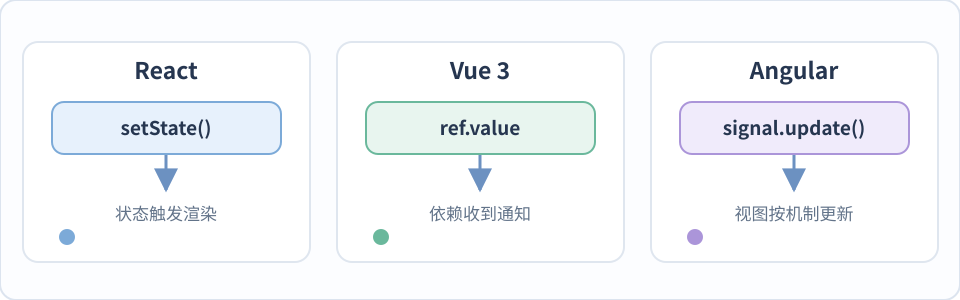

# 叁.1.2 React、Vue 和 Angular 对比：到底该怎么选？

我经常看到前端工程师争论：React 更灵活、Vue 更容易上手、Angular 更适合大项目。争到最后，大家往往还是什么也没说清楚。

为什么？因为这三句话没有统一的比较标准。你拿 React 的函数组件跟 Vue 2 的 Options API 比，再拿十年前的 AngularJS 当作今天的 Angular，结论怎么可能靠谱？

**要比较三个框架，最好的办法不是背它们各自的口号，而是让它们完成同一个需求。** 看谁负责保存数据，谁负责更新页面，业务变复杂以后又要付出什么代价。

先说明：这篇主要讨论使用函数组件与 Hooks 的现代 React、使用 Composition API 的 Vue 3，以及使用组件与 Signals 的现代 Angular。项目如果还停留在 React 类组件、Vue 2、AngularJS 1.x，不能直接套用下面的所有结论。

## 01. 三个框架，到底在解决什么问题？

假设网页上有一个购物车，用户勾选商品，总价就要跟着变化。

十多年前，我们可能这样写：

```html
<label><input type="checkbox" id="coffee" /> 咖啡 20 元</label>
<p id="total">总价：0 元</p>

<script>
const checkbox = document.querySelector('#coffee');
const total = document.querySelector('#total');

checkbox.addEventListener('change', () => {
  total.textContent = '总价：' + (checkbox.checked ? 20 : 0) + ' 元';
});
</script>
```

这段原生 JavaScript 完全能跑。问题是：购物车如果有几十件商品，还有优惠券、会员折扣、库存提示、跨页面购物车，会发生什么？

你得自己操心：

1. 哪些数据变化了？
2. 哪些页面元素应该更新？
3. 同一份数据被多个组件使用时，谁负责同步？
4. 更新时如何避免重复操作或界面状态互相打架？

React、Vue 和 Angular 都是在帮你管理这些问题。**它们最重要的共同点，是让你主要描述“数据是什么、界面应该长什么样”，而不是亲手把每一次 DOM 更新安排好。**

但它们提供的工具范围不同：

| 对比项目 | React | Vue 3 | 现代 Angular |
| --- | --- | --- | --- |
| 基本定位 | 构建 UI 的库，完整应用通常搭配框架或其他工具 | 渐进式框架，可按项目需要组合能力 | 覆盖较完整应用开发需求的框架 |
| 常见组件写法 | 函数组件 + JSX + Hooks | 单文件组件 + `<script setup>` + 模板 | TypeScript 类 + `@Component` + 模板 |
| 主要状态机制 | `useState` 等，状态更新触发渲染 | `ref`、`reactive`、`computed` 等 | `signal`、`computed` 等，与变化检测配合 |
| 模板表达方式 | JSX，本质上是 JavaScript 表达式体系 | HTML 风格模板和 `v-if`、`v-for` 等指令 | Angular 模板，`@if`、`@for` 等语法 |
| 路由、工程组织 | 根据应用框架或技术栈选择 | 官方生态提供 Vue Router、Pinia 等 | 官方框架提供 Router、DI、表单等体系 |
| 主要学习成本 | JS 状态模型、组件组合、生态选择 | 模板语法、响应式机制、组合式函数 | TS、依赖注入、模板、表单和完整框架约定 |

这里说的“常见”不是“只能这样写”。React 也能结合不同构建和路由工具，Vue 也支持 JSX，Angular 的状态管理也不只有 Signal。

另外请记住一个历史问题：**AngularJS 1.x 和现代 Angular 不是同一个框架的两个皮肤。** AngularJS 的 `$scope`、`$digest` 与现代 Angular 的组件、Signals、变化检测不能混成一套来讲。

## 02. 同一个购物车，三种写法

不要在三个完全不同的项目之间做“代码行数比赛”。我们固定业务规则，只换技术实现。

商品只有两件：

- 咖啡：20 元。
- 面包：12 元。

默认勾选咖啡，总价 20 元；再勾选面包，总价变成 32 元；取消咖啡，总价变成 12 元。

**这个例子的关键，不是算术有多难，而是数据变化之后，界面怎样得到正确结果。**

### 1. React：把当前状态交给组件，重新描述界面

```jsx
import { useState } from 'react';

const goods = [
  { id: 1, name: '咖啡', price: 20 },
  { id: 2, name: '面包', price: 12 }
];

export default function Cart() {
  const [selected, setSelected] = useState([1]);

  const total = goods
    .filter(item => selected.includes(item.id))
    .reduce((sum, item) => sum + item.price, 0);

  function toggle(id) {
    setSelected(ids =>
      ids.includes(id)
        ? ids.filter(x => x !== id)
        : [...ids, id]
    );
  }

  return (
    <section>
      <h2>购物车</h2>
      <ul>
        {goods.map(item => (
          <li key={item.id}>
            <label>
              <input
                type="checkbox"
                checked={selected.includes(item.id)}
                onChange={() => toggle(item.id)}
              />
              {item.name}：{item.price} 元
            </label>
          </li>
        ))}
      </ul>
      <strong>总价：{total} 元</strong>
    </section>
  );
}
```

如果你熟悉原生 JavaScript，应该能看懂大部分代码。`filter` 筛选商品，`reduce` 求和，三元表达式决定要添加还是删除商品 ID。

关键只有两个地方。

**第一个是 `useState`。** 它让 React 在组件多次执行之间保存状态。`selected` 表示当前渲染读到的选择结果，`setSelected` 用来安排下一次状态更新。

**第二个是 `setSelected(ids => ...)`。** 这里没有直接执行 `selected.push(id)`。React 的状态应当视为不可直接修改的数据；我们返回一个新数组，告诉 React“下一轮应该使用这份选择结果”。

为什么把 `total` 直接计算出来，而不是再定义一个 `useState(20)`？

因为总价完全由商品列表与选中 ID 决定。如果把它也保存成独立状态，就必须保证每次切换商品时同时修改两个值，容易漏掉。**能够由已有状态算出来的数据，通常不要重复存一份。**

### 2. Vue 3：把依赖关系交给响应式系统

同样的需求，Vue 单文件组件可以这么写：

```vue
<script setup>
import { ref, computed } from 'vue';

const goods = [
  { id: 1, name: '咖啡', price: 20 },
  { id: 2, name: '面包', price: 12 }
];

const selected = ref([1]);

const total = computed(() =>
  goods
    .filter(item => selected.value.includes(item.id))
    .reduce((sum, item) => sum + item.price, 0)
);
</script>

<template>
  <section>
    <h2>购物车</h2>
    <ul>
      <li v-for="item in goods" :key="item.id">
        <label>
          <input
            v-model="selected"
            type="checkbox"
            :value="item.id"
          />
          {{ item.name }}：{{ item.price }} 元
        </label>
      </li>
    </ul>
    <strong>总价：{{ total }} 元</strong>
  </section>
</template>
```

这段代码有两个很舒服的地方。

**第一个是 `v-model`。** 当多个复选框通过 `v-model` 绑定同一个数组时，Vue 会根据勾选状态添加或移除对应的 `value`。我们不用再手写 `toggle` 函数。

**第二个是 `computed`。** Vue 会追踪计算总价时读取的响应式依赖。`selected` 变化时，`total` 会失效并在下次需要它时重新计算；依赖没变化时，计算结果可以复用。

代码中 `selected.value` 是在 JavaScript 里读取 `ref` 的值。模板中写 `selected`、`total`，Vue 会进行相应的自动解包。这不是 JavaScript 原生规则，是 Vue 的模板机制。

有些人看到这里就说：“Vue 太强了，React 太麻烦了。”先别急。框架帮你少写代码，也意味着你必须理解 `v-model`、模板指令、`ref` 和自动解包的规则。**省掉的代码，并不等于省掉了理解成本。**

### 3. Angular：让组件、状态和模板有明确的分工

现代 Angular 使用 TypeScript，可以这样实现：

```typescript
import { Component, computed, signal } from '@angular/core';

@Component({
  selector: 'app-cart',
  standalone: true,
  template: `
    <section>
      <h2>购物车</h2>
      <ul>
        @for (item of goods; track item.id) {
          <li>
            <label>
              <input
                type="checkbox"
                [checked]="selected().includes(item.id)"
                (change)="toggle(item.id)"
              />
              {{ item.name }}：{{ item.price }} 元
            </label>
          </li>
        }
      </ul>
      <strong>总价：{{ total() }} 元</strong>
    </section>
  `
})
export class CartComponent {
  goods = [
    { id: 1, name: '咖啡', price: 20 },
    { id: 2, name: '面包', price: 12 }
  ];

  selected = signal<number[]>([1]);

  total = computed(() =>
    this.goods
      .filter(item => this.selected().includes(item.id))
      .reduce((sum, item) => sum + item.price, 0)
  );

  toggle(id: number) {
    this.selected.update(ids =>
      ids.includes(id)
        ? ids.filter(x => x !== id)
        : [...ids, id]
    );
  }
}
```

第一次接触 Angular，可能会问：“为什么读一个变量还要写括号？”

因为 `signal` 返回的是一个可读取的响应式值。`selected()` 表示读取当前选择结果；`selected.update(...)` 则是告诉它如何改变。

模板里的 `[checked]` 表示把表达式结果绑定到属性，`(change)` 表示监听事件，`@for` 用来渲染列表。`track item.id` 则帮助 Angular 识别列表项的稳定身份。

在这个例子里，Angular 确实显得更正式：有装饰器、类、TypeScript 类型、模板语法。但当项目有几十个业务模块、复杂表单、统一的服务注入和测试约定时，这些规范就可能带来管理上的收益。

注意：以上是放入 Angular 应用的一个组件示例，实际运行需要把组件接入应用入口；不是把 TypeScript 代码贴进普通 HTML 就能运行。

### 4. 三套代码放在一起，看出了什么？

三个版本里，**总价的计算公式一模一样**：都是过滤选中的商品，再用 `reduce` 求和。

差异不在 `20 + 12` 怎么算，而在“选中状态如何修改”“计算结果如何追踪”“界面如何表达”。

- React 强调在组件渲染中使用状态，把 JavaScript 逻辑与 JSX 组合起来。
- Vue 提供模板指令和响应式 API，让常见输入绑定、派生计算写起来更直接。
- Angular 倾向于把状态、模板、类型和工程约定整合成一套体系。

但不要犯一个错误：**三个框架展示同样的 32 元，并不能说明谁的运行速度更快。** 要谈性能，还得看组件规模、更新频率、浏览器布局和真实设备。

## 03. 你点一下复选框，框架内部究竟做了什么？

这才是前端高级面试最想考的地方。



> **看图提示：** 同一项交互，React 通常调用状态更新函数，Vue 更新响应式值，Angular 更新 Signal。图仅比较入口，不代表完整内部流程。

### 1. React：状态更新 → 重新渲染 → 提交必要的界面修改

在 React 里，调用 `setSelected` 之后，并不是直接去操作页面上的复选框文本。

可以粗略理解为：

1. 状态更新被安排。
2. React 再次调用有关的组件函数，得到新的 UI 描述。
3. React 比较新旧结果，决定需要提交哪些变化。
4. 浏览器完成后续布局、绘制等工作。

注意两点。

**其一，重新执行组件函数，不等于整片 DOM 都被删除重建。** React 的渲染计算和真正提交到 DOM 是不同阶段。不能听说“React 会重新渲染”，就断言它一定慢。

**其二，每次渲染读到的状态是一张快照。** 看下面这个经典例子：

```jsx
const [count, setCount] = useState(0);

function click() {
  setCount(count + 1);
  setCount(count + 1);
  setCount(count + 1);
}
```

假设当前 `count` 是 0，这三次更新都在要求把状态变为 1，而不是依次加到 3。

想连续增加三次，应该写：

```jsx
setCount(n => n + 1);
setCount(n => n + 1);
setCount(n => n + 1);
```

原因是更新函数会接收前一次处理后的状态。理解了这件事，你才能理解为什么 React 的事件处理里经常使用函数式更新，而不是认为 React“偶尔丢更新”。

### 2. Vue：读取时记录依赖，修改时触发更新

Vue 3 的响应式机制，核心是追踪哪些计算和组件读取了哪些响应式数据。

例如：

```javascript
import { ref, computed } from 'vue';

const price = ref(20);
const quantity = ref(2);
const total = computed(() => price.value * quantity.value);

console.log(total.value); // 40
quantity.value = 3;
console.log(total.value); // 60
```

你没有手动调用 `updateTotal()`。Vue 知道 `total` 依赖 `price` 和 `quantity`，所以依赖变化后会让计算值更新。

不过，别把这理解成“Vue 不需要渲染”。Vue 的模板仍然会被编译，组件仍然有更新和 DOM 修补过程。响应式跟踪帮助它知道什么时候需要更新，编译优化与运行时共同决定具体怎么更新。

对于对象响应式，Vue 3 主要利用 `Proxy`；对于 `ref`，则通过其响应式容器接口暴露 `.value`。**不要把 Vue 2 的 `Object.defineProperty` 细节直接当成 Vue 3 的完整原理。**

还有一个容易犯的错误：

```javascript
import { reactive, toRefs } from 'vue';

const user = reactive({ age: 20 });
let { age } = user;

user.age = 21;
console.log(age); // 20，基本类型被解构后没有自动关联

const { age: ageRef } = toRefs(user);
console.log(ageRef.value); // 21
```

如果你把这种问题一律解释成“Vue 响应式失灵”，那多半是还没搞懂 JavaScript 的赋值与 Vue 的代理边界。

### 3. Angular：Signal 告知依赖，变化检测负责更新

现代 Angular 的 `signal`、`computed` 也能建立响应式依赖关系：

```typescript
import { signal, computed } from '@angular/core';

const price = signal(20);
const quantity = signal(2);
const total = computed(() => price() * quantity());

console.log(total()); // 40
quantity.set(3);
console.log(total()); // 60
```

你会发现，这与 Vue 的 `ref`、`computed` 在使用体验上有相似之处。

但相似不代表底层实现完全相同。Angular 的 Signals 会与它自己的组件更新和变化检测机制配合；组件使用了 `OnPush`、应用是否采用 zoneless 模式等，也会影响触发与检查路径。

过去有人把 Angular 的性能问题一概归因于 `Zone.js`，再把现代 Angular 的所有优化说成“Signal 已经替代变化检测”，这两种说法都不严谨。**Signals 提供依赖追踪，页面要更新仍然需要完整的渲染调度机制。**

## 04. React用JSX、Vue用模板、Angular也用模板，差别大吗？

差别不小，但没必要把它变成宗教问题。

### 1. 条件渲染

React 里，你可以直接使用 JavaScript 的条件表达式：

```jsx
function Greeting({ loggedIn }) {
  return <p>{loggedIn ? '欢迎回来' : '请先登录'}</p>;
}
```

Vue 用模板指令：

```vue
<template>
  <p v-if="loggedIn">欢迎回来</p>
  <p v-else>请先登录</p>
</template>
```

Angular 的现代模板控制流可以写成：

```html
@if (loggedIn()) {
  <p>欢迎回来</p>
} @else {
  <p>请先登录</p>
}
```

三种写法都能表达“满足条件显示 A，否则显示 B”。

React 的优势是逻辑与 JS 语言能力衔接自然；模板的优势是界面结构对习惯 HTML 的工程师比较直观。但“直接用 JS”不一定比“专门的模板语法”更容易维护，具体还要看页面复杂度与团队习惯。

### 2. 列表渲染：大家都有“身份识别”问题

React 常写 `items.map(...)`，Vue 常写 `v-for`，Angular 常写 `@for`。但都要考虑列表元素的身份。

假设列表是：

```text
初始：A、B、C
插入：X、A、B、C
```

如果你把数组下标当成稳定 ID，排序和插入时，框架可能把某一行的局部状态对应到错误的商品。

在 React、Vue 中通常使用稳定的 `key`；Angular 的 `@for` 使用 `track`。它们的具体实现并不一样，但都需要开发者正确表达列表项身份。

**面试官如果问“为什么不能随便使用 index 当 key”，你只回答“性能不好”，还不够。更严重的可能是组件状态和数据身份错位。**

## 05. 真正做项目，谁来处理路由、状态、表单和请求？

购物车只有一个组件时，你可能觉得三者差不多。等系统长到一百个页面，差异就会显现。

### 1. React：自由度大，但必须承担选型责任

React 核心专注 UI 和组件模型。要构建完整网站，往往会选择某个 React 应用框架，或自己组合路由、数据获取、构建、状态管理等工具。

好处是可以根据业务搭配方案；代价是团队必须确定规范，否则一个人喜欢这套路由、另一个人喜欢那套数据请求，项目会越来越难统一。

这不是“React没有生态”，恰好相反，它的生态非常丰富。问题是**选择多也意味着决策多**。

### 2. Vue：从简单页面到完整应用，逐步增加能力

Vue 3 本身提供组件与响应式系统，Vue Router 解决路由，Pinia 可用于较复杂的跨组件状态管理。

新手往往能先写出一个单文件组件，再逐步理解组合式函数、路由、状态管理。

代价同样存在。比如多个组件都去改同一份 `reactive` 对象，或者 `watch` 之间互相触发，最后的调试成本不会因为模板简洁就自动消失。

### 3. Angular：约定更多，团队边界也更清楚

Angular 的组件、依赖注入、路由、表单等官方能力结合得比较紧密。项目若需要大量复杂表单、统一服务注入、多人协作规范，这种体系值得认真考虑。

但完整体系也意味着初期要掌握更多概念，不能指望一个从未用过 TypeScript、DI 的新人，十分钟就熟悉所有 Angular 工程。

### 4. 实战：如何组织一个订单系统？

假设现在有三个页面：订单列表、订单详情、订单退款。

**不管用哪个框架，都建议把计价、退款资格等业务规则与界面展示分开。**

例如这个函数就不应该只藏在某个按钮点击回调里：

```javascript
function canRefund(order) {
  return order.status === 'paid' && order.refundedAmount === 0;
}

console.log(canRefund({
  status: 'paid',
  refundedAmount: 0
})); // true
```

真实退款还要考虑支付通道状态、时间窗口、金额上限和服务端权限检查。这里只是展示职责分离。

React 可以把它放在普通模块或自定义 Hook 调用的业务层；Vue 可以由组件或 composable 调用；Angular 可以通过 Service 组织这些规则。**框架不同，不该导致业务正确性标准不同。**

## 06. 为什么有的项目一切正常，一接入接口就乱了？

因为页面不只有“数据变化”，还有“时间顺序”。

假设用户在搜索框里输入 `react`，立刻删掉换成 `vue`。

- 第一条 `react` 请求发得早，但服务器处理很慢。
- 第二条 `vue` 请求发得晚，却先返回。
- 如果不处理旧请求，最终页面可能显示 `react` 的结果。

这叫**异步竞态**。三个框架都会遇到，不是谁更高级就自动消失。

先用原生 JavaScript 写一个不依赖框架的“只保留最新请求”处理器：

```javascript
function createLatestSearch(showResult, showError) {
  let controller = null;

  return {
    async search(keyword) {
      controller?.abort();
      const current = new AbortController();
      controller = current;

      try {
        const response = await fetch(
          '/api/users?q=' + encodeURIComponent(keyword),
          { signal: current.signal }
        );
        if (!response.ok) throw new Error('HTTP ' + response.status);

        const users = await response.json();
        if (!current.signal.aborted) showResult(users);
      } catch (error) {
        if (!current.signal.aborted) showError(error);
      }
    },

    dispose() {
      controller?.abort();
    }
  };
}
```

这段代码的要点是：

1. 新搜索开始时，先取消上一次还没完成的请求。
2. 即使异步操作已经进入后续步骤，也检查它是不是过期。
3. 页面销毁时调用 `dispose()`，清理不再需要的工作。

放进 React，可以用 Effect 的清理函数管理请求生命周期；放进 Vue，可以使用 `watch` 的清理回调；放进 Angular，可结合 RxJS 的 `switchMap` 或其他取消机制。

注意：`AbortController` 只影响支持取消的操作，不能保证已经到达服务器的请求被撤销。涉及付款、删除订单等业务，服务端还需要幂等性与权限校验。

## 07. 性能谁最好？别被一张跑分截图骗了

这个问题最容易引发争吵，也最容易得到没有意义的答案。

如果你用 React 写了一个一次性创建 10000 行 DOM 的表格，再用 Vue 写一个只显示 30 行的虚拟列表，当然是 Vue 那个页面更快。但它们根本没在做相同的事。

比较性能至少要控制：

- **同样的业务功能与数据规模。**
- **同样的设备、浏览器与网络条件。**
- **同样的生产构建方式。**
- **同样的统计指标。** 是首屏加载、脚本执行、交互延迟，还是内存占用？

举个真实开发中的问题：订单表格有 10000 行，输入筛选条件就卡顿。

先检查是不是每次输入都进行昂贵排序、过滤；是不是创建了几万个 DOM 节点；是不是列表项没有稳定 ID；是不是网络请求反复触发。

三者都有各自的优化手段：

| 问题 | React | Vue | Angular |
| --- | --- | --- | --- |
| 派生结果反复计算 | 先缩小渲染范围，必要时使用 `useMemo` | 适合用 `computed` 缓存依赖计算 | 适合用 `computed` 基于 Signal 缓存计算 |
| 无关子树重复工作 | 状态下沉、组件拆分、必要时 `memo` 等 | 稳定属性、合理拆组件及编译/响应式优化 | 合理划分组件、Signal、`OnPush` 等机制 |
| 一次渲染 10000 行 | 分页、虚拟列表 | 分页、虚拟列表 | 分页、虚拟滚动 |
| 频繁重复发请求 | 请求去重、防抖、取消 | 请求去重、防抖、取消 | 请求去重、防抖、取消 |

**框架层面的优化，替代不了浏览器常识。** 浏览器要画 10000 个节点，你就得认真考虑减少节点数量。没有哪个框架能靠一行 API 让昂贵的业务逻辑凭空消失。

另外，现代 React 的自动优化能力、Vue 的编译优化和 Angular 的 Signals 都还在发展。谈性能应该针对**具体版本、具体构建和具体应用**，不要拿某个过时跑分当永久排名。

## 08. 结合真实项目，我会怎么选？

下面是工程判断，不是官方排行榜。

### 场景一：两三个人做一个中小型管理后台

如果团队 JS 基础不错、没有既有技术栈，我会把 Vue 3 作为优先评估对象。

原因很朴素：模板、输入绑定、`computed` 和成熟的官方配套生态，适合较快做出可维护的业务页面。

但如果团队早已熟悉 React，强行迁到 Vue 并不一定更省成本。

### 场景二：已经有大量 React 组件和工程积累

继续 React 往往更合理。

你已经有成熟的组件库、开发规范、测试体系和经验丰富的工程师，迁移到另一个框架可能只是把已解决的问题重新解决一次。

别为了跟风，拿整个业务的稳定性给新技术当练习场。

### 场景三：大型企业系统，表单、权限、依赖关系非常复杂

Angular 值得认真评估。

它的 TypeScript 体系、依赖注入、表单及路由能力，适合有能力维护统一框架约定的团队。但别理解成“超过十个工程师就必须用 Angular”。组织能力、现有技术栈与维护成本，可能比框架名称更重要。

### 场景四：只给老系统加一个小功能

如果原来是 jQuery 页面，只需要加一个小表单，不必把整套系统推倒重建。Vue 等技术也可以评估渐进接入，但要处理好新旧代码对同一 DOM 区域的控制边界。

如果原来是 AngularJS 1.x，就应该单独制定迁移计划。它不是升级一个包版本就自然变成现代 Angular。

### 场景五：内容网站，对 SEO 和首屏体验要求高

三套生态都存在服务端渲染或预渲染等方案，不能说“React 才能做 SEO”“Vue 只能做后台”或“Angular 只能做企业系统”。

应该综合比较服务端运行要求、缓存策略、数据加载、部署成本以及团队对相应应用框架的熟悉程度。

## 09. 面试官最爱追问的七个问题

**问题一：React 比 Vue 更接近原生 JavaScript，对吗？**

在 JSX 与 JavaScript 表达式的结合方式上，可以这么理解其风格差异。但 React 仍有自己的 Hooks 规则、状态模型和更新机制。会 JavaScript 不等于自动会 React。

**问题二：Vue 的双向绑定是不是数据流一定是双向的？**

不是。`v-model` 是为输入控件等提供的方便语法；应用中组件的 Props、事件与状态管理仍然需要清晰的数据流。不能因为有 `v-model` 就认为任何组件都可以随意修改上级数据。

**问题三：React 会重新执行组件函数，所以一定比 Vue 慢？**

不成立。渲染计算与真实 DOM 提交不同；Vue 也有组件更新、虚拟 DOM 修补等工作。实际性能取决于更新范围、优化方式、应用规模等。

**问题四：Vue 3 的 `reactive` 与 `ref` 是一回事吗？**

不是。`reactive` 为对象创建响应式代理；`ref` 提供有 `.value` 的响应式容器。模板中的自动解包容易让这一区别被忽视。

**问题五：Angular 就是 AngularJS 的新版本吗？**

不能这样理解。现代 Angular 在架构、语言、组件模型和运行机制上与 AngularJS 有根本差异。维护老项目必须先确认实际框架。

**问题六：为什么 React、Vue、Angular 的列表都强调 key 或 track？**

为了帮助框架识别元素身份。插入、删除、排序时，正确的稳定标识既影响复用效率，也关系到输入框等组件状态是否和业务记录对应。

**问题七：如果让你从零搭建一个项目，第一步选哪个框架？**

我会先确认交付平台、SEO/SSR 需求、团队熟悉程度、现有代码、组件库、维护周期和部署环境，再选择。面试官真正希望听见的是**你能不能把技术选型与业务代价联系起来**，而不只是“我喜欢 React”或者“Vue 比较简单”。

## 10. 回头看那些流传很广的框架评价

原文引用过几位社区作者对于 React、Vue、Angular 的讨论。它们在当时有讨论价值，但其中一部分针对的是旧版 API、旧项目生态与当年的学习经历，不能当成现代框架的永久结论。

例如“Vue 会自动绑定 `this`”“React 需要自己解决一切问题”“Angular 只适合偏爱 Java 式开发的人”，都更接近某个历史阶段的个人观察。

现在 Vue 3 广泛使用 `<script setup>`，不需要围绕组件的 `this` 来组织逻辑；React 有成熟的应用框架生态；Angular 也发展出 Signals、standalone 组件与新的模板控制流。

因此读技术评论时，**先问一句：他说的是哪个版本？**

这些早期社区讨论保留为历史延伸阅读，不把它们当作本章的事实依据：

- [方应杭对 React 与 Vue 的讨论](https://www.zhihu.com/question/314428335/answer/644922545)
- [徐海峰对框架风格的讨论](https://www.zhihu.com/question/355760849/answer/938934606)
- [尤雨溪对学习曲线的讨论](https://www.zhihu.com/question/35767399/answer/64496760)

## 结语

如果面试官现在问我“React、Vue、Angular 哪个最好”，我的回答是：**先告诉我你要做什么，以及谁来维护。**

写一个购物车，三者都很轻松；维护一个复杂系统，真正难的地方是状态边界、业务规则、协作约定、性能与测试。

框架替你解决了一部分重复劳动，但并没有替你思考。

**会使用框架，是入门；理解框架为什么这样设计，才算真正进阶。**

## 参考资料

以下使用官方文档核对现代 API 与框架机制，具体能力以项目使用的版本为准：

- [React：State as a Snapshot](https://react.dev/learn/state-as-a-snapshot)
- [React：Render and Commit](https://react.dev/learn/render-and-commit)
- [React：Updating Arrays in State](https://react.dev/learn/updating-arrays-in-state)
- [React：You Might Not Need an Effect](https://react.dev/learn/you-might-not-need-an-effect)
- [Vue：Reactivity Fundamentals](https://vuejs.org/guide/essentials/reactivity-fundamentals.html)
- [Vue：Computed Properties](https://vuejs.org/guide/essentials/computed.html)
- [Vue：Composition API FAQ](https://vuejs.org/guide/extras/composition-api-faq.html)
- [Vue：State Management](https://vuejs.org/guide/scaling-up/state-management.html)
- [Angular：Overview](https://angular.dev/overview)
- [Angular：Signals](https://angular.dev/guide/signals)
- [Angular：Components](https://angular.dev/guide/components)
- [Angular：Dependency Injection](https://angular.dev/guide/di)
