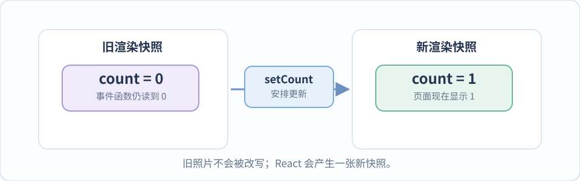

# 叁.2.1 React Hooks究竟是什么？

你有没有遇到过这样的需求：页面有个搜索框，输入关键词后请求服务器；用户不断打字，旧请求还没回来，新请求又发出去了。最后屏幕上显示的，居然是上一次搜索结果。

如果只会背 `useState`、`useEffect` 的定义，这种问题仍然解决不了。理解 Hooks，应该从**组件每次渲染究竟发生了什么**讲起。

## 01. 函数组件为什么能记住数据？

先看没有 Hook 的普通函数：

```javascript
function counter() {
  let count = 0;
  return () => ++count;
}
const next = counter();
console.log(next()); // 1
console.log(next()); // 2
console.log(counter()()); // 1，新建了一份状态
```

闭包能保留一次函数调用中的变量，可 React 函数组件并不是只执行一次。每次重新渲染，React 会再次调用组件函数。如果每次写 `let count = 0`，数值就会重新初始化。

React 在组件关联的内部存储中保留 Hook 状态，并按照 Hook 的调用位置把新旧渲染对应起来。所以这样写才能持续计数：

```jsx
import { useState } from 'react';

function Counter() {
  const [count, setCount] = useState(0);
  return (
    <button onClick={() => setCount(c => c + 1)}>
      已点击 {count} 次
    </button>
  );
}
```

点击按钮时，并不是把当前函数里的 `count` 变量直接改掉。调用 `setCount` 会安排一次更新；React 随后用**新一轮渲染拿到的新 count 值**生成界面。

这也解释了一个经常让新手困惑的现象：

```jsx
function Counter() {
  const [count, setCount] = useState(0);
  function handleClick() {
    setCount(count + 1);
    console.log(count); // 仍是这次渲染中的旧值
  }
  return <button onClick={handleClick}>{count}</button>;
}
```

为什么不是新值？因为一次渲染就像拍下一张照片：事件函数读到的 `count`，是**创建这个事件函数时那张照片里的值**。更新状态不会修改旧照片。




> **看图提示：** 状态更新不会改写旧闭包中的 count；新的一轮渲染才拿到更新后的值。

## 02. 闭包陷阱：连续加三次，为什么只加了一次？

```jsx
function addThreeWrong() {
  setCount(count + 1);
  setCount(count + 1);
  setCount(count + 1);
}

function addThreeRight() {
  setCount(c => c + 1);
  setCount(c => c + 1);
  setCount(c => c + 1);
}
```

假设当前 `count=0`，第一种写法三次都要求把结果设为 `1`，最后通常只增加一次。第二种传入的是**更新函数**，React 会依次把前一次处理后的结果传给下一次，因此增加三次。

这不是“批处理把某次更新吞了”，而是三条更新指令本身就不一样。

## 03. useEffect不是“生命周期函数改了个名字”

Effect 用来跟组件**外部系统同步**，例如网络连接、定时器、浏览器事件。计算购物车总价、过滤数组、拼接名字，通常在渲染期间直接计算就行，没必要借助 Effect 再触发第二轮更新。

例子：窗口宽度变化时显示新宽度。

```jsx
import { useEffect, useState } from 'react';

function WindowWidth() {
  const [width, setWidth] = useState(() => window.innerWidth);
  useEffect(() => {
    const onResize = () => setWidth(window.innerWidth);
    window.addEventListener('resize', onResize);
    return () => window.removeEventListener('resize', onResize);
  }, []);
  return <p>当前窗口宽度：{width}px</p>;
}
```

这里的重点其实是 `return`：组件卸载或 Effect 重新执行前，React 会调用清理函数。忘记清理会导致监听器重复、资源泄漏。上例假设浏览器客户端渲染；如果涉及服务端渲染，初始值应避免直接依赖不存在的 `window`。

开发模式的 Strict Mode 可能额外执行一次“建立→清理→建立”，目的是帮你找出没有正确清理的 Effect，不代表生产环境也会在每次挂载时双倍运行。

## 04. 一个真正有用的搜索框

这次把竞态问题一起处理掉。输入 `react` 后马上输入 `vue`：假如 `react` 的请求慢、`vue` 的请求快，不能让慢请求覆盖新结果。

```jsx
import { useEffect, useState } from 'react';

function UserSearch() {
  const [keyword, setKeyword] = useState('');
  const [users, setUsers] = useState([]);
  const [error, setError] = useState('');

  useEffect(() => {
    if (!keyword.trim()) {
      setUsers([]);
      setError('');
      return;
    }

    const controller = new AbortController();
    async function search() {
      try {
        const response = await fetch(
          '/api/users?q=' + encodeURIComponent(keyword),
          { signal: controller.signal }
        );
        if (!response.ok) throw new Error('HTTP ' + response.status);
        const data = await response.json();
        if (!controller.signal.aborted) {
          setUsers(data);
          setError('');
        }
      } catch (err) {
        if (err.name !== 'AbortError' && !controller.signal.aborted) {
          setError(err.message);
        }
      }
    }
    search();
    return () => controller.abort();
  }, [keyword]);

  return (
    <section>
      <input value={keyword} onChange={e => setKeyword(e.target.value)} />
      {error && <p role="alert">{error}</p>}
      <ul>{users.map(user => <li key={user.id}>{user.name}</li>)}</ul>
    </section>
  );
}
```

每次关键词变化，旧 Effect 先清理，旧请求被取消或至少不能再更新界面。真实项目还可加防抖、缓存、空状态、分页，并考虑使用成熟数据请求库。

## 05. 为什么 Hooks 不能写在 if 里面？

```jsx
// 错误示例
if (loggedIn) {
  const [name, setName] = useState('');
}
```

如果第一次渲染执行这个 Hook，第二次渲染没有执行，后续 Hook 的位置就错位了。React 需要稳定的调用顺序来匹配状态，所以 Hook 必须写在组件或自定义 Hook **顶层**，而不是条件、循环、普通函数里。

自定义 Hook 只是把相关状态逻辑抽成可复用函数，并不是自动共享状态：

```jsx
function useToggle(initial = false) {
  const [on, setOn] = useState(initial);
  const toggle = () => setOn(x => !x);
  return [on, toggle];
}
// 两个组件分别调用 useToggle，拿到各自独立的状态。
```

如果想跨组件共享，需使用状态提升、Context 或其他状态管理方案。

## 06. 面试追问：别只回答 API 名称

**问：useRef 与 useState 区别？** `useRef` 能在渲染之间保留可变值，修改 `ref.current` 本身不会触发重新渲染；`useState` 更新通常会触发重新渲染。DOM 节点引用、计时器 ID 常放在 ref 中。

**问：为什么依赖数组不能随便省略？** Effect 使用了某个响应式值，就必须考虑它变化时是否要重新同步。故意漏依赖很容易拿到陈旧闭包。别把关闭 ESLint 提示当成解决方案。

**问：useMemo 能解决所有性能问题吗？** 不能。它缓存计算结果，前提是依赖没有改变。缓存本身也有成本。先测量，再决定是否使用。

学习顺序建议是：渲染快照 → 状态更新队列 → Effect 的建立和清理 → 自定义 Hook → 性能与并发。把这条线理解透，Hooks 就不再像一套必须死记硬背的咒语。

## 参考资料

- [React：State as a Snapshot](https://react.dev/learn/state-as-a-snapshot)
- [React：Queueing a Series of State Updates](https://react.dev/learn/queueing-a-series-of-state-updates)
- [React：Synchronizing with Effects](https://react.dev/learn/synchronizing-with-effects)
