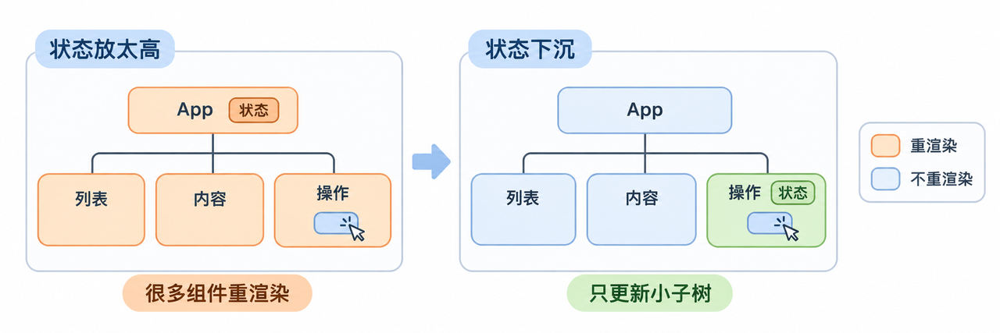

# 叁.2.2 React的性能优化技巧

页面卡顿，先别急着套 `memo`。比如 5000 行订单，输入一个字就卡一下，问题可能出在计算、DOM、布局或网络。**先定位，再优化。**

## 01. 渲染一次，到底发生了什么？

React 组件重新执行，不等于浏览器重新绘制全部 DOM。用 `console.count` 看组件渲染次数：

```jsx
function Item({ name }) {
  console.count('Item 渲染：' + name);
  return <li>{name}</li>;
}
function Page() {
  const [query, setQuery] = React.useState('');
  return (
    <>
      <input value={query} onChange={e => setQuery(e.target.value)} />
      <Item name="固定商品" />
    </>
  );
}
```

在没有额外优化的通常情况下，`Page` 状态更新会再次执行 `Item`。这本身不一定是问题。真正需要关注的是执行次数 × 每次执行成本。

## 02. 第一招：把状态放到真正需要它的地方

假设页面包含复杂图表、用户列表和一个搜索输入框。如果只有搜索框需要 `query`，就不要把每个键盘输入都放在最外层页面状态里。



```jsx
function SearchBox() {
  const [query, setQuery] = React.useState('');
  return <input value={query} onChange={e => setQuery(e.target.value)} />;
}
function Dashboard() {
  return (
    <>
      <HeavyChart />
      <SearchBox />
      <LargeTable />
    </>
  );
}
```

搜索框自身更新时，不需要因此重新渲染父组件。**调整状态归属，往往比给十几个组件包 memo 更划算**。当然，若其他组件必须使用查询条件，则需要提升状态，或通过合理的 Context / 外部 Store 共享。

## 03. 第二招：memo 为什么有时完全没用？

```jsx
const Chart = React.memo(function Chart({ options }) {
  return <ExpensiveChart options={options} />;
});
function Parent() {
  const [tick, setTick] = React.useState(0);
  const options = { theme: 'light' };
  return (
    <>
      <button onClick={() => setTick(x => x + 1)}>{tick}</button>
      <Chart options={options} />
    </>
  );
}
```

每次 `Parent` 运行，都新建了 `options` 对象。`React.memo` 默认按浅层比较属性，新旧 `options` 引用不一样，所以 `Chart` 仍会重新渲染。

如果 `options` 确实不依赖内部状态，可以移到组件外：

```jsx
const CHART_OPTIONS = { theme: 'light' };
// 父组件中：<Chart options={CHART_OPTIONS} />
```

如果确实依赖其他属性，才考虑 `useMemo`：

```jsx
const options = React.useMemo(() => ({ theme }), [theme]);
```

`useCallback` 类似，但缓存的是函数引用。别误会：**函数引用稳定，不代表函数内部运算更快**。如果组件本来就便宜，缓存可能增加维护负担而没有可见收益。

## 04. 第三招：5000 行表格，memo也救不了？

不一定。即使每行只渲染一次，一次性创建 5000 个 DOM 行也可能很慢。解决的方向是**虚拟列表**：视口只能看到 20 行，那就只渲染这 20 行附近的内容，滚动时再替换。

可以先用一段原生 JS 理解原理：

```javascript
function visibleRange(scrollTop, rowHeight, viewportHeight, total, overscan = 4) {
  const start = Math.max(0, Math.floor(scrollTop / rowHeight) - overscan);
  const end = Math.min(total, Math.ceil((scrollTop + viewportHeight) / rowHeight) + overscan);
  return { start, end };
}
console.log(visibleRange(1000, 50, 500, 5000));
// { start: 16, end: 34 }
```

这个计算只选出需要展示的 18 行；真正实现还要处理行高、焦点、可访问性和滚动定位，优先使用成熟的虚拟列表方案。

## 05. 第四招：把昂贵工作从输入交互中挪开

`useDeferredValue`、`startTransition` 可以调整更新优先级，但**不是防抖，也不会把同步计算移到另一个线程**。

筛选几十万条记录、复杂解析或图片处理，如果计算本身持续耗时，可能需要 Web Worker，而不只是 React API。

## 06. 性能优化的实战排查顺序

1. **先复现。** 固定数据规模、设备条件、操作步骤，别凭“我感觉卡”下结论。
2. **打开 React DevTools Profiler。** 观察哪些组件提交频繁、哪些渲染耗时，定位具体交互。
3. **打开 Chrome Performance。** 看长任务、脚本计算、布局、绘制与网络等待。React 的时间和浏览器的时间不是一回事。
4. **一次只改一处。** 例如把输入状态下沉，再对比优化前后同一操作。
5. **验证功能没有被优化坏。** 错误的 memo 比慢一点更麻烦，尤其是依赖被漏掉时。

举个判断：如果 Performance 显示大部分耗时都在图片解码和布局，继续加 `useCallback` 基本无效。你得优化图片、DOM 规模与 CSS。

## 07. 面试官进一步追问

**为什么给数组元素添加 key？** `key` 帮助 React 在兄弟节点间识别身份。排序和插入列表时，稳定 ID 比数组下标更可靠；用随机数当 key 会造成不必要的卸载、挂载与状态丢失。

**Context 会不会导致重渲染？** 消费某个 Context 的组件会响应它的 value 变化。拆分 Context、稳定 value 的引用、把高频状态局部化，通常比一股脑放进全局 Provider 更有效。

## 08. 2026 年再谈性能，别漏掉 React Compiler

React Compiler 1.0 于 2025 年 10 月发布，能在构建阶段自动处理一部分原本需要手写 `memo`、`useMemo`、`useCallback` 的优化。但**需要在项目中安装并启用**，升级 React 不等于自动开启。

检查构建配置、React DevTools 和实际性能数据。编译器要求代码符合相应规则，老项目可以逐步启用并跑回归测试。它也不会减少本来就需要展示的 DOM 数量，5000 行表格仍可能需要虚拟滚动。

参考：[React Compiler 1.0 官方公告](https://react.dev/blog/2025/10/07/react-compiler-1)、[React Compiler 入门](https://react.dev/learn/react-compiler)。

## 参考资料

- [React：memo](https://react.dev/reference/react/memo)
- [React：useDeferredValue](https://react.dev/reference/react/useDeferredValue)
- [Chrome DevTools：Performance](https://developer.chrome.com/docs/devtools/performance)
