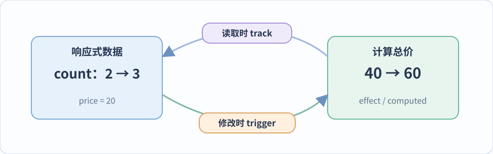

# 叁.3.1 Vue.js源码解读：数据响应式原理

Vue 里有个看起来很神奇的地方：你只写一句 `state.count++`，页面自己就跟着变了。可 Vue 又不是每隔几毫秒把所有变量检查一遍，它怎么知道谁改了、谁需要更新？

我一直觉得，搞懂这个问题，Vue 的很多 API 就都不那么难了。简单说，就是**谁读过数据，先记下来；数据一变，再通知需要它的地方**。这章我们干脆自己写个迷你版，省得只盯着源码里的函数名发愣。

## 01. 从普通变量开始：为什么不会自动更新？

```js-run
const state = { price: 10, count: 2 };
let total = state.price * state.count;
state.count = 3;
console.log(total); // 20，不会自动变成 30
```

想让 `total` 自动变，就需要知道“计算 total 的函数依赖了哪些数据”，并在数据变化时重新运行它。

## 02. 第一步：用 Proxy 监听读和写

```js-run
const raw = { price: 10, count: 2 };
const state = new Proxy(raw, {
  get(target, key, receiver) {
    console.log('读取属性：' + String(key));
    return Reflect.get(target, key, receiver);
  },
  set(target, key, value, receiver) {
    console.log('写入属性：' + String(key));
    return Reflect.set(target, key, value, receiver);
  }
});
console.log(state.price); // 先打印“读取属性：price”，再打印 10
state.count = 3;          // 打印“写入属性：count”
```

`Proxy` 相当于在对象外面装了一层感应门：你还是操作 `state.price`，但进出都能被拦截。注意上面**只会打印日志**，还不会自动更新结果。




> **看图提示：** `track` 记录“谁读过 count”，`trigger` 在 count 变化时通知依赖者；这里只展示核心关系。

## 03. 第二步：谁读过这个数据，就把谁记下来

只拦截读和写还不够。数据变了，应该通知谁？这才是响应式系统的关键。

下面用三个结构，自己维护一份“谁依赖了谁”的记录：

- `activeEffect`：当前正在执行的计算任务。
- `WeakMap`：以原对象为索引，记录每个属性对应哪些任务。
- `Set`：同一个任务依赖同一个属性多次，也只执行一次。

```js-run
const bucket = new WeakMap();
let activeEffect = null;

function track(target, key) {
  if (!activeEffect) return;
  let depsMap = bucket.get(target);
  if (!depsMap) {
    depsMap = new Map();
    bucket.set(target, depsMap);
  }
  let deps = depsMap.get(key);
  if (!deps) {
    deps = new Set();
    depsMap.set(key, deps);
  }
  deps.add(activeEffect);
}

function trigger(target, key) {
  const effects = bucket.get(target)?.get(key);
  if (!effects) return;
  for (const effect of [...effects]) effect();
}

function reactive(raw) {
  return new Proxy(raw, {
    get(target, key, receiver) {
      track(target, key);
      return Reflect.get(target, key, receiver);
    },
    set(target, key, value, receiver) {
      const oldValue = Reflect.get(target, key, receiver);
      const success = Reflect.set(target, key, value, receiver);
      if (success && !Object.is(oldValue, value)) trigger(target, key);
      return success;
    }
  });
}

function effect(fn) {
  const runner = () => {
    const previous = activeEffect;
    activeEffect = runner;
    try { fn(); } finally { activeEffect = previous; }
  };
  runner();
}

const state = reactive({ price: 10, count: 2, title: '书' });
effect(() => console.log('总价：' + (state.price * state.count)));
state.count = 3;         // 总价：30
state.title = 'JavaScript'; // 不会重新计算总价
```

为什么改 `title` 不会触发计算？因为上面的计算函数**根本没读取它**。这就是“依赖收集”的意义：按实际读取关系更新，而非修改任何字段都重算全部页面。

**重要说明：** 这是教学版，并非 Vue 源码的完整实现。它没有处理依赖清理、嵌套对象递归代理、数组长度、Map/Set、调度器、停止追踪等情况；条件分支切换后旧依赖也不会自动移除。

## 04. 第三步：为什么Vue不会每改一个值就更新一次DOM？

如果一行代码里连续改了好几次状态，Vue 难道要立刻把 DOM 改好几遍？那可太浪费了。

我们先看下面这段连续赋值，再说更新为什么可以合并：

```javascript
state.count = 3;
state.count = 4;
state.count = 5;
```

上面的教学版会重新计算三次。实际 Vue 会结合调度机制把组件更新排队、去重，在合适的时机批量刷新。这就是为什么修改数据后立刻读 DOM，有时仍是旧内容。

```vue
<script setup>
import { ref, nextTick } from 'vue';
const count = ref(0);
async function increase() {
  count.value++;
  await nextTick();
  // 此时已经等待 Vue 刷新 DOM
}
</script>

<template>
  <button @click="increase">{{ count }}</button>
</template>
```

`nextTick` 等待 Vue 对当前已安排更新进行刷新；它不负责等你的网络请求或动画结束。

## 05. reactive、ref、computed、watch到底怎么选？

```javascript
import { reactive, ref, computed, watch } from 'vue';

const cart = reactive({ price: 20, quantity: 2 });
const coupon = ref(5);
const total = computed(() => cart.price * cart.quantity - coupon.value);
watch(total, (newTotal, oldTotal) => {
  console.log('总价变化：', oldTotal, '→', newTotal);
});

cart.quantity = 3; // total.value 变成 55
```

- `reactive`：给对象建立响应式代理。
- `ref`：把一个值包装成有 `.value` 的响应式容器，基本类型尤其常用。
- `computed`：有依赖缓存的**派生值**。只读一次结果时不会每次无意义重算。
- `watch`：在值改变后**执行副作用**，比如调用接口、写本地存储。不要把所有计算都放到 watch 里。

## 06. 面试题：为什么解构 reactive 容易失去响应式？

```javascript
const state = reactive({ count: 0 });
let { count } = state;
state.count++;
console.log(count); // 0，解构得到的基本类型不会自动跟着变
```

想把属性分出去同时保持关联，可用 `toRefs`：

```javascript
import { reactive, toRefs } from 'vue';
const state = reactive({ count: 0 });
const { count } = toRefs(state);
state.count++;
console.log(count.value); // 1
```

最后别把 Vue 2 与 Vue 3 搞混：Vue 2 主要使用 `Object.defineProperty` 处理对象属性，数组等场景另有处理；Vue 3 主要使用 `Proxy` 实现对象响应式。两者的拦截能力和边界不同。

能自己解释“读取时收集依赖、修改时触发更新”，以后碰到 computed 不更新、解构丢响应式，才有地方下手。

## 参考资料

- [Vue：深入响应式系统](https://cn.vuejs.org/guide/extras/reactivity-in-depth.html)
- [Vue：计算属性](https://cn.vuejs.org/guide/essentials/computed.html)
