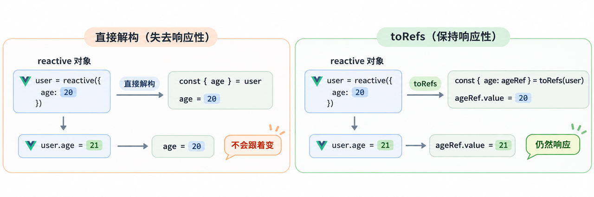

# 叁.3.2 Vue.js带来的一些新问题、解决办法探索

Vue 帮我们更新页面，但 `watch` 请求竞态、大表格卡顿、共享状态混乱，仍得自己解决。

## 01. 第一个坑：看起来是同一个对象，实际上不完全相同

```javascript
import { reactive } from 'vue';
const original = { name: '张三' };
const state = reactive(original);
console.log(state === original); // false
```

`reactive` 返回代理对象。混用原对象和代理对象，可能让引用比较、`Map` 键判断出错。

还有一个经典问题：解构后丢响应。

```javascript
import { reactive, toRefs } from 'vue';
const user = reactive({ name: '张三', age: 18 });
let { age } = user;
user.age = 19;
console.log(age); // 18

const refs = toRefs(user);
console.log(refs.age.value); // 19
```



需要按属性解构并保持响应式时，用 `toRefs` 或单独的 `ref`。

## 02. 第二个坑：watch里的请求会“倒着回来”

用户先搜“北”，再搜“北京”，旧请求最后返回，可能覆盖新结果：

```vue
<script setup>
import { ref, watch } from 'vue';

const keyword = ref('');
const results = ref([]);
const error = ref('');

watch(keyword, async (value, _, onCleanup) => {
  if (!value.trim()) {
    results.value = [];
    return;
  }

  const controller = new AbortController();
  onCleanup(() => controller.abort());

  try {
    const res = await fetch(
      '/api/search?q=' + encodeURIComponent(value),
      { signal: controller.signal }
    );
    if (!res.ok) throw new Error('HTTP ' + res.status);
    const data = await res.json();
    if (!controller.signal.aborted) results.value = data;
  } catch (err) {
    if (!controller.signal.aborted) error.value = err.message;
  }
});
</script>

<template>
  <input v-model="keyword" />
  <p v-if="error">{{ error }}</p>
  <div v-for="item in results" :key="item.id">{{ item.name }}</div>
</template>
```

`onCleanup` 需要在异步等待之前注册；下一次 watch 开始前，Vue 会清理旧操作。真实搜索框还可以防抖、限制请求频率并处理空结果。

## 03. 第三个坑：把能计算的值也放进 watch

购物车总价由价格和数量计算，没必要再用 `watch` 单独维护：

```javascript
// 绕远路：派生值又维护了一份状态
watch([price, quantity], () => {
  total.value = price.value * quantity.value;
});
```

改用 `computed`：

```javascript
const total = computed(() => price.value * quantity.value);
```

记住一个简单原则：**我要“算出什么”，选 computed；我要“发生了变化后去做事”，考虑 watch。**

## 04. 第四个坑：表格上万行，不是响应式就不卡

`reactive` 不会替你消除大量 DOM 的布局和绘制开销。页面一次渲染上万行，即使响应系统非常快，浏览器也可能因为节点过多而卡顿。

先做三件事：分页或虚拟列表、避免每行重复复杂计算、用稳定的 `key`。大型且很少修改的原始数据，可以按实际需要考虑 `shallowRef`、`markRaw`，但它们会改变深层响应行为，不能乱用。

```javascript
import { shallowRef, triggerRef } from 'vue';
const rows = shallowRef([{ id: 1, name: '甲' }]);
rows.value = [...rows.value, { id: 2, name: '乙' }]; // 替换引用，触发更新
rows.value[0].name = '改名'; // 深层改动本身不触发 shallowRef
triggerRef(rows); // 明确通知依赖者重新读取
```

## 05. 第五个坑：组件复用和业务复用混成一团

多个页面共用搜索逻辑，可以提取 `useUserSearch()`，集中管理请求、加载和错误状态。不要把无关业务硬塞进同一个 composable。

## 06. 面试追问和调试方法

**watch 与 watchEffect 有什么区别？** 前者明确声明监听来源，后者在同步执行期间自动收集用到的响应式依赖。异步 `await` 之后才读取的值，不应指望被 `watchEffect` 自动追踪。

**为什么改数据后读到旧 DOM？** Vue 会批量安排更新，用 `await nextTick()` 等待 DOM 更新时机。

**如何排查莫名其妙的更新？** 先用 Vue Devtools 看组件状态和更新，再把影响范围缩小到某个 `ref` / `computed` / `watch`，检查是否存在循环赋值和跨组件共享可变对象。

## 07. Vue 3.5 以后，Props 解构有个容易讲错的变化

前面说的是 **`reactive` 对象的基本类型属性**。Vue 3.5 的 `defineProps()` 解构另有编译器支持：


```vue
<script setup>
import { watch } from 'vue';

const { userId } = defineProps({
  userId: Number
});

// 要明确把它当作监听来源，传入 getter。
watch(() => userId, id => {
  console.log('用户 ID 变化：', id);
});
</script>

<template>
  <p>当前用户：{{ userId }}</p>
</template>
```

`watch` 要接收响应式来源或 getter；直接传 `userId` 只会得到当前值，因此这里要写 `() => userId`。

Vue 3.5 还提供了 `onWatcherCleanup()`，但**必须在回调的同步阶段注册，不能等 `await` 之后**。前面的 `onCleanup` 写法仍有效。

参考：[Vue：Props / Reactive Props Destructure](https://vuejs.org/guide/components/props.html)、[Vue：Watchers](https://vuejs.org/guide/essentials/watchers.html)。

## 参考资料

- [Vue：响应式基础](https://cn.vuejs.org/guide/essentials/reactivity-fundamentals.html)
- [Vue：侦听器](https://cn.vuejs.org/guide/essentials/watchers.html)
- [Vue：性能优化](https://cn.vuejs.org/guide/best-practices/performance.html)
