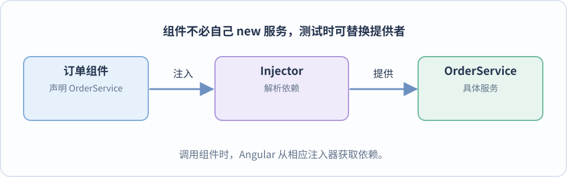

# 叁.4.1 你真的懂 Angular 吗？

不少前端朋友听到 Angular 就皱眉：听说很重，听说很难，听说只有大公司才用。我觉得这样评价有点偷懒。

假设你们公司有十几个前端团队，要一起维护财务、订单、人事系统，还得维护很多年。这时候，大家不能各自发明一套路由、表单和依赖注入规则。Angular 就是更愿意在一开始把这些规矩说清楚的那类框架。

规矩多，学习当然要花时间。但它能解决什么问题，也得放到真实项目里看。

## 01. 先分清 AngularJS 和 Angular

这两个名字差一个 JS，技术路线却差很多。

AngularJS 指 1.x 时代的框架。它大量使用 `$scope`、控制器和双向绑定，核心机制与脏检查有关。Angular 则是后来重新设计、主要使用 TypeScript 的组件化框架。

老项目里可能见到：

```html
<!-- AngularJS 1.x 示意：这里假定 ng-app 已正确初始化 -->
<div ng-controller="CounterController">
  <button ng-click="count = count + 1">{{ count }}</button>
</div>
```

```javascript
// AngularJS 1.x
app.controller('CounterController', function ($scope) {
  $scope.count = 0;
});
```

当模型变化后，AngularJS 在摘要周期（digest cycle）中检查观察到的表达式是否变化。这和现代 Angular 的组件、信号系统不是同一套机制。面试时不要把 `$scope` 当成现代 Angular 的核心 API。

## 02. 一个现代 Angular 组件长什么样？

用一个购物车计数器来看看。你只需要记住：`@Component` 告诉框架“这是一个组件”，`template` 描述界面，`signal` 保存可追踪的状态。

```typescript
import { Component, computed, signal } from '@angular/core';

@Component({
  selector: 'app-cart',
  standalone: true,
  template: `
    <p>单价：{{ price() }} 元</p>
    <p>数量：{{ quantity() }}</p>
    <p>总价：{{ total() }} 元</p>
    <button (click)="increase()">加一件</button>
  `
})
export class CartComponent {
  price = signal(25);
  quantity = signal(1);
  total = computed(() => this.price() * this.quantity());

  increase() {
    this.quantity.update(n => n + 1);
  }
}
```

用户点击按钮，数量从 1 变 2，总价从 25 变 50。`total` 不需要自己维护，也不用在事件里同时修改三个变量，它是由另外两个状态推导出来的。

对比 Vue：Vue 模板会自动解包 `ref`；在 Angular 的信号 API 中，读取 `signal` 通常写成 `quantity()`。这几个括号不是“调用接口”，而是读取信号值。

## 03. 依赖注入到底是解决什么麻烦？

依赖注入这个名字，听着挺吓人，其实就是把一件事讲清楚：订单组件要用支付服务，为什么非得自己 `new` 一个死死绑住？

如果组件只负责使用支付服务，具体实现从外面提供，测试、替换和协作都能省去不少麻烦。

下面先用纯 JavaScript 理解“依赖注入”：

```javascript
class OrderPage {
  constructor(paymentService) {
    this.paymentService = paymentService;
  }
  async pay(amount) {
    return this.paymentService.charge(amount);
  }
}

const fakeService = {
  async charge(amount) {
    return { success: true, amount };
  }
};
const page = new OrderPage(fakeService);
page.pay(100).then(console.log);
```

`OrderPage` 不关心到底是支付宝、信用卡还是测试桩。它只关心 `charge` 能不能用。这就是**依赖抽象，外部提供实现**。

Angular 把这一思路做成了框架级 DI（依赖注入）：

```typescript
import { Injectable, inject } from '@angular/core';
import { HttpClient } from '@angular/common/http';

@Injectable({ providedIn: 'root' })
export class OrderService {
  private http = inject(HttpClient);
  findAll() {
    return this.http.get('/api/orders');
  }
}
```

注意：这里只展示服务如何声明，应用还需配置 `provideHttpClient()` 等 HTTP 提供者。`providedIn: 'root'` 表示服务默认提供在应用根注入器中，不代表每个组件都创建一份。




> **看图提示：** 组件声明依赖，注入器根据提供者配置解析并提供服务；可以替换测试实现，减轻耦合。

## 04. 路由、表单、HTTP：一套工程要解决的事

现代 Angular 官方生态包含路由、表单、HTTP 客户端等方案。以表单验证为例，假如订单金额必须大于 0，就应该在**表单状态层**明确规则，而不应仅用 `input` 的外观控制。

```typescript
import { FormControl, Validators } from '@angular/forms';
const amount = new FormControl(0, {
  nonNullable: true,
  validators: [Validators.required, Validators.min(1)]
});
console.log(amount.valid); // false
amount.setValue(100);
console.log(amount.valid); // true
```

这类代码很适合复杂后台系统，因为规则可以测试，也能和 UI 分开。不过客户端校验永远不能替代服务端校验，用户可以绕过页面直接请求接口。

## 05. 为什么有人觉得 Angular 难？

为什么有人学 Angular 学得很吃力？我觉得原因不只在语法。TypeScript、依赖注入、组件装饰器、Signals、RxJS，几套概念一起上，对没做过大型系统的人确实不轻松。

但在多人协作时，统一的组织方式有好处：新人进入项目，不用先猜团队 A 的路由、团队 B 的数据请求和团队 C 的表单规范是怎么选的。

它的代价同样真实：规范更多、迁移成本更明显、部分场景需要理解更多框架机制。并不存在“Angular 一定比 React/Vue 慢”这样的通用结论。

## 06. 面试时容易被追问的三件事

**组件与服务如何分工？** 组件负责视图和交互；服务负责可复用业务访问逻辑等。不要把支付和计价规则堆在模板事件里。

**Signal 与 RxJS 是同一个东西吗？** 不是。Signal 适合表达当前可读取的响应式状态；RxJS Observable 更适合描述按时间不断到来的事件流，两者可以配合使用。

**为什么要分清 AngularJS？** 因为两个时代的组件模型与更新机制不同。回答旧项目的脏检查问题，不该拿现代 Signal 直接套用。

选框架没必要为了“完整”而完整。你的团队是否需要它提供的约定，能不能承担培训和升级成本，这才是实际问题。

## 参考资料

- [Angular 官方教程](https://angular.dev/tutorials/learn-angular)
- [Angular：Signals](https://angular.dev/guide/signals)
- [Angular：依赖注入](https://angular.dev/guide/di)
