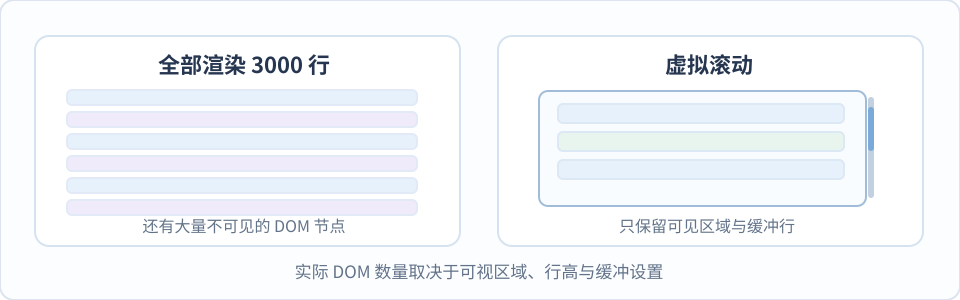

# 叁.4.2 Angular 性能优化要点

有朋友说 Angular 页面卡，那一定是 Angular 太重。我听着总觉得像汽车堵车，就先骂发动机。

假设一个后台页面放了三千条商品，库存、折扣、按钮全有。你只是点一下搜索框，页面却停半秒。真是 Angular 的锅吗？还是 DOM 太多、模板算太多、网络太慢？这些得一件件查，不能靠猜。

## 01. 先排除三个根本不是 Angular 的问题

1. **接口慢：** Network 面板显示接口耗时 2 秒。改变化检测策略不会让服务端接口突然变快。
2. **DOM 太多：** 3000 行同时进页面，浏览器布局、绘制很忙。考虑分页或虚拟滚动。
3. **模板计算太重：** 每次检查都跑一个对上千条数据排序的函数，CPU 直接被占满。

这三类问题分别要从网络、页面结构、代码计算处理，别用一个 `OnPush` 试图包治百病。

## 02. 不要在模板里反复做大计算

反例：

```typescript
// 以下方法假设在组件类里
getSortedProducts() {
  return [...this.products].sort((a, b) => a.price - b.price);
}
```

```html
<!-- 如果此方法在每次检查时都重新运行，排序会被重复执行 -->
<li *ngFor="let item of getSortedProducts()">{{ item.name }}</li>
```

如果 `products` 没变化，反复排序没有意义。使用 Signal 可以把派生结果放到 `computed` 中：

```typescript
import { computed, signal } from '@angular/core';

type Product = { id: number; name: string; price: number };
const products = signal<Product[]>([]);
const sortedProducts = computed(() =>
  [...products()].sort((a, b) => a.price - b.price)
);
```

依赖没有变化时，`computed` 可以复用缓存结果。这里必须先复制数组：直接对共享状态调用 `sort()` 会原地修改它，造成难追踪的副作用。

## 03. OnPush 到底优化了什么？

`OnPush` 经常被介绍成“加上就快”，我觉得这话说得太省事了。它改变的是组件在什么条件下需要被检查，并不能让一个写得很重的计算函数突然变轻。

```typescript
import { Component, ChangeDetectionStrategy, Input } from '@angular/core';

@Component({
  selector: 'app-product-row',
  standalone: true,
  changeDetection: ChangeDetectionStrategy.OnPush,
  template: '<div>{{ product.name }}：{{ product.price }} 元</div>'
})
export class ProductRowComponent {
  @Input({ required: true })
  product!: { name: string; price: number };
}
```

父组件传入新的输入值、该组件或子树中处理的事件、显式标记检查等情况，仍可触发检查。**OnPush 不是“永远不更新”，也不是“自动深度比较整个对象”。**

因此，不要原地改动对象后期待所有引用检查都能发现：

```javascript
// 不推荐依赖这类原地修改触发某些引用变化检测
product.price = 99;
// 更易追踪的方式：创建新引用
product = { ...product, price: 99 };
```

## 04. 列表为什么一定要稳定标识？

假设列表最开始是 A、B、C，后来前面插入 X。如果我们不给每一项稳定的身份，框架就难以准确复用对应的节点和状态。列表一复杂，不必要的重建和状态错乱就容易出现。

现代 Angular 的 `@for` 可以指定 `track`：

```html
@for (product of products(); track product.id) {
  <app-product-row [product]="product" />
} @empty {
  <p>暂无商品</p>
}
```

优先使用稳定的业务 ID。用下标跟踪会在插入、排序时产生身份错配的问题；随机 ID 更糟，会让每次刷新都像一批全新的元素。

## 05. 3000 行数据的正确处理顺序



> **看图提示：** 几千条数据不必同时变成几千个 DOM 行；虚拟滚动减少渲染节点，但仍需要按项目配置验证。

- 用户只看前 30 行？先做分页或虚拟滚动，减少实际 DOM 节点。
- 搜索时每个键盘输入都触发请求？按需求防抖，必要时取消过期请求。
- 页面启动时加载全部低频模块？检查路由层面的懒加载。
- 模板每次运行昂贵函数？改为缓存派生状态或纯计算方式。
- 某个子组件变化范围过大？评估 OnPush 与状态拆分。

其中**虚拟滚动**优化的是浏览器渲染规模；**懒加载**优化的是启动时资源负担；**OnPush** 优化的是检查工作。三者针对的问题不同。

## 06. 用什么工具验证优化？

先在相同设备、相同数据规模下记录：首次可交互时间、输入响应时间、JS 长任务和 DOM 节点数量。使用 Chrome Performance 和 Angular DevTools Profiler 观察具体消耗。

例如：优化前输入一次要 280ms，分页后变成 40ms，才算有依据。若优化后网络请求仍 2 秒，说明页面计算不是全部瓶颈。

## 07. 面试官会怎么挖坑？

**“OnPush 是否能保证组件不更新？”** 不能。事件、输入变化、Signal 等仍可能触发更新。

**“是不是把所有数据都改为 Signal 就会快？”** 不一定。Signal 帮助管理依赖，但不会替你消除网络等待、巨量 DOM、复杂排序或低效图像处理。

**“AngularJS 1.x 怎样优化？”** 那是另一套机制，重点可能是 watcher 数量、摘要周期、`ng-repeat` 和不必要的计算，别把现代 Angular 的建议直接照搬。

做性能优化，千万别把框架选项当魔法按钮。先看请求、DOM、脚本耗时，再决定到底要不要碰变化检测。

## 参考资料

- [Angular：Skipping component subtrees](https://angular.dev/best-practices/skipping-subtrees)
- [Angular：Performance](https://angular.dev/best-practices/runtime-performance)
