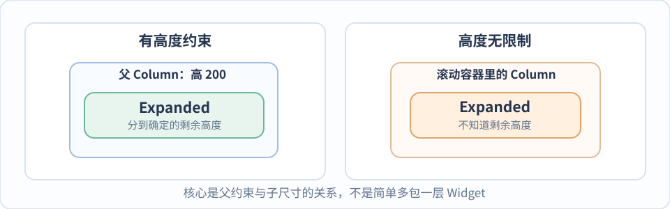

# 叁.5.1 Flutter给前端研发带来了什么变化？

前端工程师看 Flutter，最容易问一句：是不是把网页打包成手机 App？我觉得这个问题得先说清楚，不然越学越糊涂。

Flutter 通常用 Dart 写 Widget，由自己的渲染体系画界面。它和 Web 都讲组件化，但底层不是 HTML、CSS 那一套。你可以把它想成另一种积木，思路有些相通，积木和施工方法却得重新熟悉。

## 01. 假设要做一个商品详情页

Web 开发者可能这样写：

```html
<article>
  <h2>咖啡豆</h2>
  <p>价格：68元</p>
  <button>加入购物车</button>
</article>
```

Flutter 则通过 Widget 描述：

```dart
import 'package:flutter/material.dart';

class ProductCard extends StatelessWidget {
  const ProductCard({super.key});

  @override
  Widget build(BuildContext context) {
    return const Card(
      child: Padding(
        padding: EdgeInsets.all(16),
        child: Column(
          crossAxisAlignment: CrossAxisAlignment.start,
          children: [
            Text('咖啡豆', style: TextStyle(fontSize: 22)),
            Text('价格：68元'),
            ElevatedButton(
              onPressed: null,
              child: Text('加入购物车'),
            ),
          ],
        ),
      ),
    );
  }
}
```

上面的按钮是禁用状态（`onPressed: null`），只是为了专注展示组件结构。想让它真的加入购物车，需要给按钮提供回调并管理购物车状态。

这里没有 HTML 标签，也没有 CSS 样式表。`Column` 负责纵向排列，`Padding` 负责间距，`Text` 负责文字。你可以把它们理解为“有职责的布局和控件对象”。

## 02. 有状态的界面：点一下加一件

```dart
import 'package:flutter/material.dart';

class QuantitySelector extends StatefulWidget {
  const QuantitySelector({super.key});

  @override
  State<QuantitySelector> createState() => _QuantitySelectorState();
}

class _QuantitySelectorState extends State<QuantitySelector> {
  int count = 1;

  @override
  Widget build(BuildContext context) {
    return Row(
      children: [
        Text('数量：$count'),
        IconButton(
          icon: const Icon(Icons.add),
          onPressed: () {
            setState(() => count++);
          },
        ),
      ],
    );
  }
}
```

`setState` 的作用是告诉 Flutter：“这部分状态变了，需要重新安排构建界面。”千万别把它理解为“立刻把所有像素重新画一遍”。Widget 重建、布局和实际绘制是不同层次的工作。

## 03. Flutter、React Native、WebView有什么区别？

Flutter、React Native、WebView 经常被放在一起比较，我建议不要先看营销材料。先问清楚一件事：**界面究竟是谁画出来的？** 这个问题一想明白，很多差异就好理解了。

- **普通 Web / WebView：** 大部分 HTML、CSS 和浏览器渲染机制仍在工作。
- **React Native：** 用 React 的组件与状态思想描述 UI，再映射到原生平台界面能力（具体架构随版本发展）。
- **Flutter：** 应用主要通过自身 Widget 与渲染体系呈现界面，平台仍负责窗口、输入、系统服务等集成。

这并不意味着 Flutter 完全不依赖操作系统，也不意味着它在所有指标上天然更快。原生能力、渲染方式、应用体积、平台一致性和团队开发成本要放在一起考虑。

## 04. 前端工程师转Flutter，真正要补什么课？

**第一关：Dart。** 变量、函数、类、async/await 不陌生，但空安全、构造函数、泛型、`Future`、`Stream` 与 JS 仍有差异。

**第二关：布局。** Web 有块级排版、Flex、Grid 等；Flutter 需要理解约束从父组件向子组件传递、子组件选择尺寸、父组件安排位置这套布局规则。

**第三关：状态管理。** 小功能用 `StatefulWidget` 足够；复杂工程会遇到共享状态、页面切换和数据访问。不要急着把所有状态塞进一个巨型对象。

**第四关：平台能力。** 摄像头、定位、推送、后台任务、应用权限、打包发布等，并不会因为你会前端就自动掌握。

## 05. 一个典型的布局报错怎么理解？



> **看图提示：** `Expanded` 要分配剩余空间，必须先知道总高度；在无限高度的滚动布局中直接使用可能触发布局约束错误。

如果在没有有限高度约束的区域中，让一个可扩展子组件无限撑开，就可能出现布局约束错误。解决问题的顺序不是盲目往外包 `Expanded`，而是查清父组件给了什么约束、子组件想要多大。

面试里如果只能背“Flutter 一切皆 Widget”，通常不够；能解释**Widget 是配置描述、Element 维持树上的身份与关联、RenderObject 参与布局和绘制**，才算开始触及原理。

## 06. 什么时候值得用Flutter？

如果团队希望一套技术同时覆盖多个平台，愿意学 Dart，又很在意统一的界面体验，Flutter 值得认真试。可要是做搜索引擎收录很重要的网站，原来的 Web 技术可能更合适。别为了“跨平台”三个字折腾。

记住：技术选型看目标，不看谁的宣传片更流畅。

技术选型先问业务需要什么，再问团队会什么。不要看见别人做的演示动画漂亮，就把自己现成的项目推倒重来。

## 参考资料

- [Flutter：布局约束](https://docs.flutter.dev/ui/layout/constraints)
- [Flutter：状态管理](https://docs.flutter.dev/data-and-backend/state-mgmt/intro)
- [Flutter：架构概览](https://docs.flutter.dev/resources/architectural-overview)
