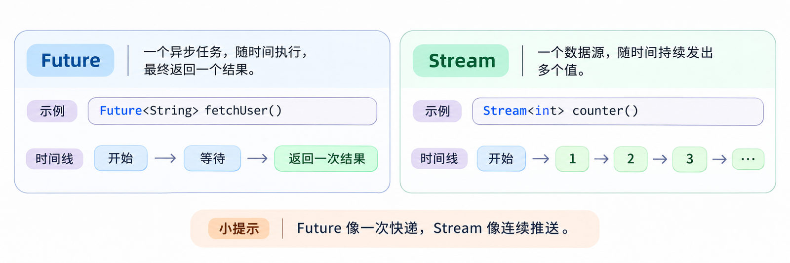

# 叁.5.2 Dart：为什么Flutter选择它？

你会 JavaScript、TypeScript，再学 Dart 其实不用从零开始。变量、函数、类、异步编程都很眼熟。但“眼熟”不等于“一样”：**Dart 的类型、空安全和异步模型，有几处值得专门学习。**

## 01. 用一段小程序认识Dart

```dart
void main() {
  final name = '张三';
  int score = 80;
  score += 10;
  print('$name 的分数是 $score'); // 张三 的分数是 90
}
```

`final` 表示变量赋值后不能重新指向其他值；`const` 用于编译期常量。JS 的 `const` 主要限制绑定重新赋值，两门语言的常量机制不能简单画等号。

## 02. 空安全到底有什么用？

JavaScript 里一不小心就会碰到：

```javascript
const user = null;
// console.log(user.name); // 运行时出错
console.log(user?.name ?? '匿名用户'); // 匿名用户
```

Dart 用类型区分“可能为 null”和“明确不为 null”：

```dart
String? nickname; // 允许 null
String displayName = nickname ?? '匿名用户';
print(displayName);

String title = '前端内参';
// title = null; // 在空安全代码中编译检查不通过
```

这里的问号 `String?` 是类型的一部分，代表“可能为空的字符串”。`!` 可以断言非空，但如果实际为 null，仍可能在运行时报错。**不要为了让编译器安静，到处加感叹号。**

## 03. 类和构造函数

```dart
class Product {
  final String name;
  final int price;

  const Product({required this.name, required this.price});

  int total(int quantity) => price * quantity;
}

void main() {
  const coffee = Product(name: '咖啡', price: 20);
  print(coffee.total(3)); // 60
}
```

`{required this.name, required this.price}` 表示具名参数。调用者必须写明参数名，对字段很多的业务对象通常更易读。

如果用 TypeScript 写近似结构：

```typescript
class Product {
  constructor(public name: string, public price: number) {}
  total(quantity: number) { return this.price * quantity; }
}
const coffee = new Product('咖啡', 20);
console.log(coffee.total(3)); // 60
```

差别在语法，也在编译与运行机制。不能把 Dart 当成“换了文件后缀的 TypeScript”。

## 04. Future是Promise吗？

可以类比，但不能认为实现完全相同。Dart 的 `Future` 表示将来完成或失败的异步结果：

```dart
Future<String> loadName() async {
  await Future.delayed(const Duration(milliseconds: 100));
  return '张三';
}

Future<void> main() async {
  print('开始');
  final name = await loadName();
  print(name);
  print('结束');
}
```

顺序是：开始 → 张三 → 结束。`await` 让当前异步函数等待结果，而不是冻结整个应用。

在 Flutter 中，经常有“请求网络 → 更新状态 → 重新显示界面”的流程。关键是异步返回时组件可能已经从界面消失了。对有状态组件，更新前要考虑 `mounted` 状态，不能把网络结果无条件塞回不存在的页面。

## 05. Stream适合解决什么问题？



> **看图提示：** Future 最终完成一次（返回值或错误）；Stream 可以持续发出多次事件。两者都能用于异步处理，但使用场景不同。


`Future` 更像“等一次结果”，`Stream` 更像“持续收到一批结果”，例如搜索建议、消息推送或传感器数据：

```dart
Stream<int> numbers() async* {
  for (var i = 1; i <= 3; i++) {
    await Future.delayed(const Duration(milliseconds: 50));
    yield i;
  }
}

Future<void> main() async {
  await for (final n in numbers()) {
    print(n); // 1、2、3
  }
}
```

注意 `Stream` 可能需要取消订阅，否则某些长期运行的数据源会继续消耗资源。

## 06. 容易混淆的三个点

- **`final` 与对象不可变**不是同一件事。final 列表变量不能重新赋值，但列表内容未必不能修改。
- **`Future` 不等于新线程。** Dart 有事件循环；需要独立并行计算时，要理解 isolate 等机制。
- **Dart 不是浏览器 JavaScript。** Dart 在不同平台有不同编译目标，不能假设在 Dart 环境里直接使用 `document.querySelector`。

## 07. 实战：从JS迁移到Dart，先抓这四点

1. 小练习：把购物车计价函数从 TypeScript 改为 Dart，专门练类型与具名参数。
2. 用 `Future` 做一次网络请求，处理成功、HTTP 失败和超时。
3. 用 `Stream` 模拟持续事件，练习订阅和取消。
4. 再把这些能力放进 Flutter Widget，观察数据变化如何驱动页面。

## 参考资料

- [Dart 语言概览](https://dart.dev/language)
- [Dart 异步编程](https://dart.dev/libraries/async/async-await)
