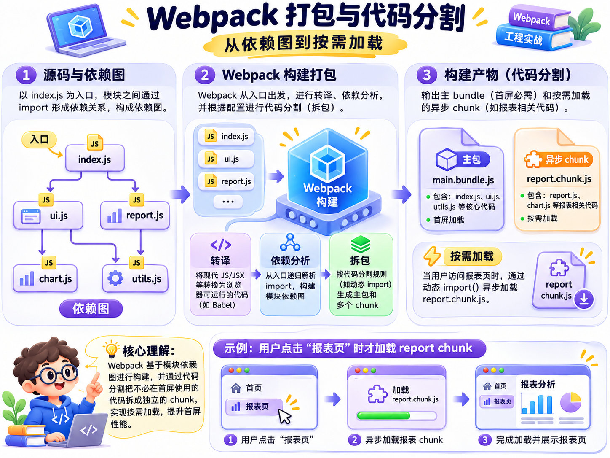

# 肆.1.1 深入理解Webpack打包

一个前端项目可能有上百个 JavaScript 文件，还有 CSS、图片、字体、TypeScript。开发时，我们希望文件拆得清楚；部署时，又希望浏览器下载得快、代码能兼容、资源路径不出错。

Webpack 做的，就是帮这些彼此矛盾的需求收拾残局。它不只是“把文件合并”。

## 01. 先回答：浏览器为什么不能直接运行开发工程？

现在浏览器早已支持原生 ES Modules，但实际工程还有几个问题：

- 浏览器不能直接执行 TypeScript 类型语法。
- Sass、Less 等需要转换成 CSS。
- 希望给产物加内容哈希，方便长期缓存。
- 希望自动拆包、压缩、抽离公共依赖并处理部分兼容性问题。

构建工具负责把**开发代码和静态资源**加工为能上线的一组文件。Webpack 会先从入口出发，分析依赖，逐步建立模块图，再根据配置生成产物。

## 02. 用一个最小项目观察构建过程

目录：

```text
demo/
  src/
    index.js
    math.js
  package.json
  webpack.config.js
```

```javascript
// src/math.js
export function sum(a, b) { return a + b; }
export function multiply(a, b) { return a * b; }
```

```javascript
// src/index.js
import { sum } from './math.js';
console.log('2 + 3 =', sum(2, 3));
```

安装 Webpack 与 CLI：

```bash
npm init -y
npm install -D webpack webpack-cli
npx webpack --mode production
```

如果需要明确入口与输出，可写：

```javascript
// webpack.config.js
const path = require('path');

module.exports = {
  mode: 'production',
  entry: './src/index.js',
  output: {
    path: path.resolve(__dirname, 'dist'),
    filename: 'app.[contenthash].js',
    clean: true
  }
};
```

构建后查看 `dist`：生产模式一般会压缩并优化代码。`contenthash` 让文件内容变化时文件名随之变化，有利于配合合理的 HTTP 缓存策略。

## 03. Loader 和 Plugin 到底区别在哪？

很多人只背一句“Loader 转换文件，Plugin 扩展构建过程”，其实可以举例证明。

假设你写了 TypeScript：

```typescript
const price: number = 20;
console.log(price * 3);
```

浏览器不能直接运行这里的类型注解。Webpack 要通过合适的 loader 或编译工具，把它转换为普通 JavaScript。

```javascript
module.exports = {
  module: {
    rules: [
      { test: /\.tsx?$/, use: 'ts-loader', exclude: /node_modules/ }
    ]
  },
  resolve: { extensions: ['.ts', '.tsx', '.js'] }
};
```

这段配置是**局部示意**，还需安装 `ts-loader` 与 `typescript` 并准备 `tsconfig.json`；若与上面的配置合用，应合并到同一个对象，不能写两份 `module.exports` 互相覆盖。

而 Plugin 更像“在加工流水线的关键节点插入功能”：例如生成 HTML 模板、提取 CSS、输出构建统计等。Plugin 不只是负责一种文件类型，它可以参与整个构建生命周期。




> **看图提示：** 动态 `import()` 可以形成代码拆分边界；是否生成独立 chunk 仍取决于配置与构建优化。

## 04. 动态导入为什么能少加载代码？

想象后台系统有一页“数据报表”，只有百分之五的用户会点开它。把报表图表库和首页一起下载，浪费不少流量。

```javascript
document.querySelector('#openReport').addEventListener('click', async () => {
  const module = await import('./report.js');
  module.renderReport();
});
```

Webpack 能以动态 `import()` 为边界，生成按需加载的 chunk。点击按钮时才请求对应代码，这叫**代码分割**。但要注意：拆得太碎也会增加请求与调度开销，网络环境与业务访问路径会影响最优方案。

## 05. Tree Shaking为什么有时不灵？

前面 `math.js` 导出了两个函数，入口只用了 `sum`。生产构建可能把没用的 `multiply` 去掉。

要具备优化条件，通常需要静态可分析的模块依赖，以及对副作用的正确处理。比如：

```javascript
// 这个模块只要被 import，就会修改全局变量
window.__loaded = true;
export const value = 1;
```

即使你没使用 `value`，工具也不能随便移除整个模块，否则全局行为改变。

因此 `package.json` 里的 `sideEffects` 声明不能盲目写成 `false`。特别是导入 CSS、polyfill 或有初始化副作用的模块时，错误声明可能造成线上功能缺失。

## 06. 为什么“打包小了”不代表网站一定快？

一个 200 KB 的压缩包，如果每次打开页面都需要执行几十万次运算，仍然可能卡顿。优化必须分阶段：

- **下载慢：** 查看资源体积、网络缓存、压缩和拆包。
- **解析执行慢：** 减少不必要依赖、推迟非关键脚本。
- **页面交互慢：** 检查长任务、DOM 规模和频繁布局。
- **构建慢：** 查看缓存策略、loader 开销、环境模式和依赖图。

不要把“打包速度”和“页面运行速度”当成一个指标。

## 07. 面试官的几个进阶问题

**Webpack 与 Vite 怎么选？** Vite 的开发服务器与生产构建思路和 Webpack 不同。先看项目生态、插件能力、构建目标与迁移成本，不能只看一篇跑分。

**为什么热更新能保留部分状态？** HMR 在运行中替换可接受更新的模块，具体哪些状态能保留取决于框架和模块边界，不是所有模块都能无损热替换。

**为什么生产环境要给资源带 hash？** 解决缓存更新与文件指纹对应的问题。它需要与服务端缓存头和 HTML 更新策略配合。

## 08. 动手实验

删掉 `dist`，分别执行开发模式与生产模式构建，观察文件名、压缩程度和产物差异。再在 `index.js` 增加动态 `import`，观察输出的 chunk 是否变化。**亲眼看到模块图变成文件，比背十遍定义有用。**

## 参考资料

- [Webpack：概念](https://webpack.js.org/concepts/)
- [Webpack：代码分割](https://webpack.js.org/guides/code-splitting/)
- [Webpack：Tree Shaking](https://webpack.js.org/guides/tree-shaking/)
