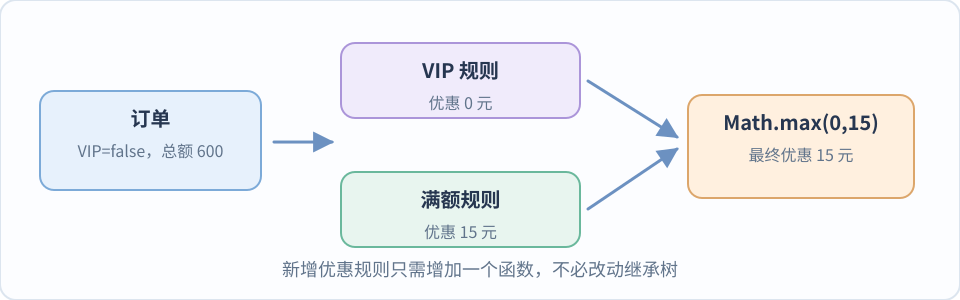

# 伍.1.2 面向对象编程的弊端是什么？

面向对象编程当然有价值：它让我们把数据与行为放到一起，组织复杂系统。但如果有人告诉你“任何项目都应该先设计一套庞大的类继承体系”，建议先看看他的项目有没有真的完成需求。

**面向对象最大的风险不是“有类”，而是过度抽象之后，改一件小事要牵动一大堆代码。**

## 01. 一个看起来很漂亮，实际很难改的继承树

假设一个电商系统有：

```text
User
 ├─ NormalUser
 ├─ VIPUser
 │   ├─ GoldVIPUser
 │   └─ DiamondVIPUser
 └─ EmployeeUser
```

某天产品要求“普通用户买满 500 元也可以享受运费减免”。规则不再只与“属于哪个子类”有关，而是跟订单金额也有关。

如果所有规则都锁死在用户子类里，你可能要到处增加条件，甚至重新设计继承关系。

## 02. 改成组合，规则反而简单



> **看图提示：** 原文订单不是 VIP，但金额 600：VIP 规则返回 0，大额订单规则返回 15，最终选最大优惠 15。

```javascript
function shippingDiscount(order, policies) {
  return policies.reduce(
    (discount, policy) => Math.max(discount, policy(order)),
    0
  );
}

const vipDiscount = order => order.user.vip ? 20 : 0;
const bigOrderDiscount = order => order.total >= 500 ? 15 : 0;

const order = { user: { vip: false }, total: 600 };
console.log(shippingDiscount(order, [vipDiscount, bigOrderDiscount])); // 15
```

现在运费优惠不依赖一棵复杂的继承树。新增“周末优惠”只需再提供一个规则函数。这里把多个优惠取**最大值**只是本例的业务规则，真实系统可能有互斥、叠加、封顶等限制，需要按产品要求处理。

这就引出一个重要原则：**组合优先于继承**通常能降低耦合，但不是说继承永远不该用。

## 03. 第二个坑：把可变状态藏得太深

```javascript
class Cart {
  constructor() { this.items = []; }
  add(item) { this.items.push(item); }
  getTotal() { return this.items.reduce((sum, x) => sum + x.price, 0); }
}
```

假设页面和多个模块都能直接访问 `cart.items`，有人随手执行 `cart.items.length = 0`，其他模块的统计结果立刻变了，却很难找到是谁修改的。

更好的办法是让修改路径明确：

```javascript
class Cart {
  #items = [];
  add(item) { this.#items.push(item); }
  clear() { this.#items = []; }
  total() { return this.#items.reduce((sum, x) => sum + x.price, 0); }
  list() { return [...this.#items]; }
}
```

注意 `list()` 只是浅拷贝。如果每个 `item` 本身可变，外部仍能修改嵌套对象；必要时需要进一步定义不可变边界。

## 04. 第三个坑：把简单事情硬变成抽象工厂

开发者只需要计算 `price * count`，却设计出 `PriceStrategyFactory`、`AbstractOrderCalculator`、`PaymentContext`、`BaseDiscountProvider` 四五层结构，维护的人自然会痛苦。

如果变化点还没出现，最清楚的代码可能就是：

```javascript
function total(price, count) {
  return price * count;
}
```

这不是“技术不够高级”，而是**复杂性要有对应的收益**。

## 05. 函数式编程能解决一切吗？

同样不能。纯函数很好测试，但有些业务天然有状态、生命周期和身份，例如 WebSocket 连接、DOM 组件、数据库事务。用对象组织这类资源，通常比把每个函数都塞进参数列表更自然。

选择思路应该是：业务有没有稳定的实体与行为？变化更可能来自数据、算法还是状态？团队能否容易理解、测试和修改？

## 06. 面试最值钱的回答

有人问“继承和组合哪个好”，不要只背“组合优于继承”。拿上面的运费规则说明：当未来新增的是**可组合的行为或策略**，使用函数或对象组合更灵活；当确实存在稳定的“是一种”关系，并且子类型遵守替换约定时，继承也有用。

这才是设计原则，不是口号。
