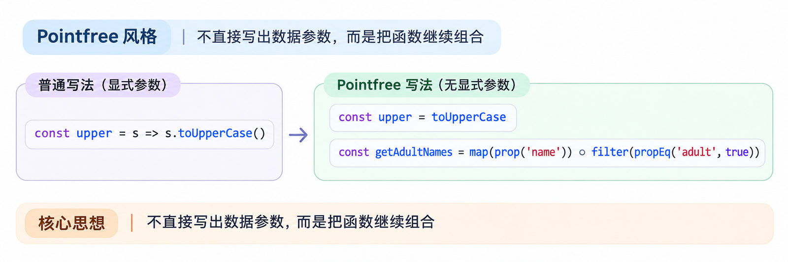

# 伍.2.3 Pointfree无参数风格编程

Pointfree 这词听着挺吓人，我第一次看这个名字，也会忍不住想：连参数都不写，函数还能干活？

其实它没有那么神秘。你要处理一组用户名，先过滤，再取名字，再转成大写。Pointfree 只是让我们先把这些步骤组合好，真正的数据进来时，按顺序处理。下面就拿这个小例子讲。

## 01. 先看一个不使用Pointfree的例子

假设后端返回用户数组，我们要取出所有成年用户的名字，并转换成大写：

```js-run
const users = [
  { name: 'alice', age: 20 },
  { name: 'bob', age: 16 },
  { name: 'carol', age: 30 }
];

function adultNames(users) {
  return users
    .filter(user => user.age >= 18)
    .map(user => user.name.toUpperCase());
}
console.log(adultNames(users)); // ['ALICE', 'CAROL']
```

这很清楚，也没有任何问题。函数接收一个叫 `users` 的参数，然后执行几步操作。

## 02. 把“处理数据”和“传入数据”分开



> **看图提示：** Pointfree 的重点是组合已有函数、减少无意义的参数转手；需要时仍应显式写参数，不能为了省几个字牺牲可读性。


先写一个很小的组合函数 `pipe`，让一个函数的输出作为下一个函数的输入：

```javascript
const pipe = (...functions) => value =>
  functions.reduce((result, fn) => fn(result), value);

const filterAdults = list => list.filter(user => user.age >= 18);
const pickNames = list => list.map(user => user.name);
const upperAll = list => list.map(name => name.toUpperCase());

const adultNames = pipe(filterAdults, pickNames, upperAll);
console.log(adultNames(users)); // ['ALICE', 'CAROL']
```

请仔细看 `adultNames`：它没有显式写 `users` 参数，却依然能被调用。因为 `pipe` 返回了一个接收数据的函数。我们提前准备好了处理流水线，真正的数组什么时候到来都可以。

**Pointfree不是没有参数，而是定义组合时省略了对数据参数的显式命名。**

## 03. 为什么有人喜欢这种写法？

为什么有人喜欢这种写法？我觉得原因很简单：你从左往右看，能直接看见“先过滤、再取名字、最后转大写”这条处理路线。每一步是一个小函数，也比较容易单独测试。

它还有复用价值：

```javascript
const activeUsers = list => list.filter(user => user.active);
const names = list => list.map(user => user.name);
const activeNames = pipe(activeUsers, names);
console.log(activeNames([
  { name: '小王', active: true },
  { name: '小李', active: false }
])); // ['小王']
```

`activeUsers`、`names` 这两个步骤可以在不同业务里组合，而不必每次复制完整处理函数。

## 04. Pointfree不是越短越好

看这句：

```javascript
const result = pipe(a, b, c, d, e, f, g);
```

如果没人知道 `a` 到 `g` 做什么，这段代码比原来的写法更难懂。过度使用高阶函数、柯里化、缩写，会让调试变困难。

尤其数据结构经常变化时，显式写出中间变量往往更清楚：

```javascript
function calculateFinalPrice(order) {
  const subtotal = order.items.reduce((sum, x) => sum + x.price * x.count, 0);
  const discount = order.member ? 0.9 : 1;
  return subtotal * discount;
}
```

这里保留 `subtotal`、`discount` 的名字，更容易解释业务规则。没必要为了消除参数名而把简单代码变成谜语。

## 05. 面试官追问：它和柯里化是什么关系？

柯里化（Currying）是把接收多个参数的函数转换为分阶段接收参数的函数；Pointfree 是一种表达风格。柯里化能帮助生成“先配置、后接收数据”的小函数，但两者不等价。

例如：

```javascript
const greaterThan = limit => number => number > limit;
const isAdult = greaterThan(17);
console.log(isAdult(20)); // true

const adults = users.filter(user => isAdult(user.age));
```

`greaterThan(17)` 提前固定阈值，形成可复用的判断函数。是否进一步写成 Pointfree，得看数据形状与可读性，而不是为了炫技。

## 06. 最容易踩的一个JavaScript坑

写得简洁当然舒服，但千万别把“没写参数”理解成“函数就不会收到别的参数”。JavaScript 有些 API 会悄悄传入额外参数，下面这个坑，很多人都踩过。

```js-run
console.log(['10', '11', '12'].map(parseInt));
// [10, NaN, 1]，不是 [10, 11, 12]
```

原因是 `Array.prototype.map` 会向回调传入 `value, index, array`，而 `parseInt` 的第二个参数是进制。把它作为回调直接传入，相当于把数组下标当成进制。

正确写法：

```js-run
console.log(['10', '11', '12'].map(x => parseInt(x, 10)));
// [10, 11, 12]
```

这提醒我们：Pointfree 必须考虑函数参数数量和语义。为了省一个参数名，结果算错了，才是真正的得不偿失。

如果不用 Pointfree 反而更容易看懂，就老老实实写参数。代码是给人维护的，又不是拿来比谁省两个字母。

## 参考资料

- [MDN：Array.map](https://developer.mozilla.org/zh-CN/docs/Web/JavaScript/Reference/Global_Objects/Array/map)
- [Thinking in Ramda: Pointfree Style](https://randycoulman.com/blog/2016/06/21/thinking-in-ramda-pointfree-style/)
