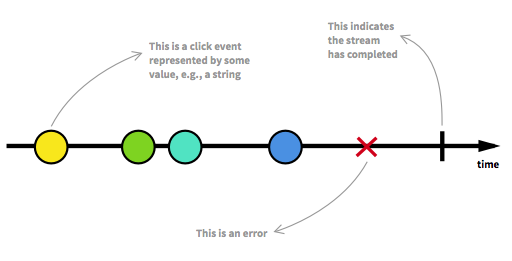

# 伍.3.1 什么是响应式编程？

你去餐馆点了菜，服务员不需要每隔三秒跑去厨房问：“这份菜好了没有？”更合理的办法是：**厨房做好菜时通知服务员，服务员再把菜送到你桌上。**

响应式编程的基本想法也类似：数据和事件变化时，把消息沿着事先建立好的处理流程传递下去，而不是让调用者不断主动检查。

## 01. 从普通按钮开始理解“事件流”

```html
<button id="click">点我</button>
```

```javascript
const button = document.querySelector('#click');
button.addEventListener('click', () => console.log('点击一次'));
```

每次点击都产生一个事件。如果用户连续点击五次，就形成五个**随着时间到来的值**。我们可以对它们做过滤：只响应第二、第四次。

```javascript
let count = 0;
button.addEventListener('click', () => {
  count++;
  if (count % 2 === 0) console.log('第' + count + '次点击');
});
```

这样写能用，但规则越来越多时，`count`、定时器和监听器就可能散落在不同函数里。响应式库希望帮我们把这些规则组织成可组合的步骤。

## 02. 画一条时间线，就明白了

```text
点击事件：  ——a——b—c————d—e——→ 时间
过滤偶数：  —————b—————d————→ 时间
```

这类图也叫“弹珠图”。书中以前使用过的示意图仍可以参考：



图上的每一颗弹珠代表一次数据出现；时间线右侧代表之后的事件；有些流还可能发出错误或结束信号。

## 03. 用RxJS把上面的规则写成流水线

```javascript
import { fromEvent, scan, filter } from 'rxjs';

const button = document.querySelector('#click');

const subscription = fromEvent(button, 'click').pipe(
  scan(count => count + 1, 0),
  filter(count => count % 2 === 0)
).subscribe(count => console.log('第' + count + '次点击'));

// 页面不再需要监听时：subscription.unsubscribe();
```

逐个解释：

- `fromEvent` 把浏览器点击事件变成可订阅的数据流。
- `scan` 记录累计点击次数，每次传给下一个步骤。
- `filter` 只让偶数次点击通过。
- `subscribe` 开始接收最后的结果。

好处并不是代码行数一定更少，而是**步骤之间的关系更明显，也容易重组**。

## 04. 为什么要强调“取消订阅”？

想象你打开一个聊天页面，订阅了不断出现的新消息。关闭页面后，如果订阅还在，消息处理函数仍可能继续执行。

因此对长期存在的事件源要考虑生命周期：组件什么时候创建订阅，什么时候取消，错误怎样处理，完成时如何清理资源。

不同库和不同 Observable 的资源管理方式不完全一样，不能把“调用了 subscribe 就永远需要手工 unsubscribe”当成绝对规则，但组件中的长期事件订阅通常应该有明确清理路径。

## 05. 响应式编程与Vue响应式系统是一回事吗？

两者有关，但关注点不同。

Vue 的 `ref`、`computed` 强调状态之间的依赖关系：数量一变，总价自动重算。RxJS Observable 更擅长表达**按时间到来的很多事件**，比如点击、搜索、WebSocket 消息。

用一个生活例子区分：购物车总价是“当前状态”；聊天消息是一串“持续到来的事件”。实际项目可能同时需要这两种模型。

## 06. 实战：搜索框为什么很适合事件流？

用户每输入一个字符，都会产生一个新事件。业务还要防抖、去重、取消过期请求、展示新结果。

如果分散使用多个计时器和标志位，代码会越来越难推理。RxJS 的 `debounceTime`、`distinctUntilChanged`、`switchMap` 等操作符能把这些规则连成流水线。

完整的搜索框例子见下一章 [RxJS](5.3.2.md)。这比在这里再堆一页 API 名称更值得动手做一遍。

## 07. 什么时候不需要响应式编程？

只需要计算两数之和、发一次简单请求、执行一次按钮回调时，原生 JavaScript 可能最清楚。不要为了一次函数调用，先引入一个复杂的流系统。

选用响应式工具的依据是：**是否存在很多随时间到来的事件、状态间依赖、取消和组合需求**。先看问题，再选工具。

## 参考资料

- [RxJS官方指南](https://rxjs.dev/guide/overview)
- [Vue：深入响应式系统](https://cn.vuejs.org/guide/extras/reactivity-in-depth.html)
