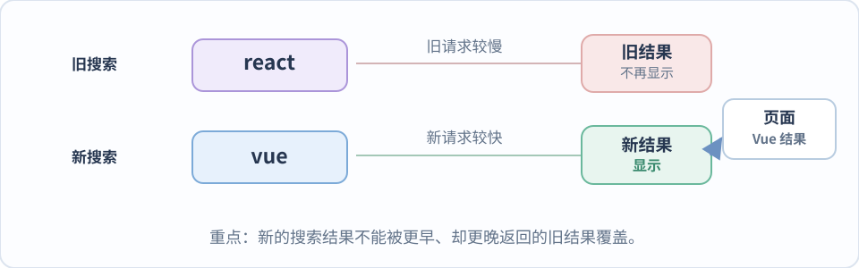

# 伍.3.2 RxJS：从搜索框理解响应式编程

搜索框这个东西，Demo 里看着挺简单：监听输入，调用接口，显示结果。

可我想问一句：用户一口气打了五个字，你准备发五次请求吗？旧请求如果最后才回来，你准备用旧结果覆盖新结果吗？用户离开页面后，那些监听还留着吗？这些麻烦才是 RxJS 真正能帮上忙的地方：

- 用户打字很快，不能每个字都发请求。
- 输入同样的词，不必反复请求。
- 旧请求还没回来，新请求已经发了，旧结果不能覆盖新结果。
- 用户离开页面后，要停止监听，避免资源泄漏。

这些要求如果分别用计时器、布尔变量、事件监听器拼起来，代码很容易变成一锅粥。RxJS 的办法是：**把按时间到来的事件看成一条流水线，让数据依次经过筛选、转换、取消等步骤。**

## 01. Observable是什么？

把它想象成自来水管。自来水可能源源不断地到来，你不必知道每一滴水什么时候产生；你只要打开阀门（订阅），就会收到数据。

```javascript
import { of, map, filter } from 'rxjs';

of(1, 2, 3, 4)
  .pipe(
    filter(n => n % 2 === 0),
    map(n => n * 10)
  )
  .subscribe(value => console.log(value));
// 20
// 40
```

`of` 创建一个依次发出 1、2、3、4 的 Observable。`filter` 只留偶数，`map` 乘以 10，最后 `subscribe` 开始接收值。

这里的 `map` 跟数组的 `map` 思想相近，但 Observable 的值可以随时间陆续到来，不要求全部值一次性放进数组。

## 02. Promise和Observable怎么区分？

Promise 和 Observable 到底差在哪里？我觉得先看它们要处理的事：查一次订单详情，通常等一个结果；搜索输入、滚动和消息推送，结果可能一条接一条。两种场景不同，工具也就不必硬选同一个。

```javascript
const promise = Promise.resolve('一次结果');
promise.then(console.log);

import { interval, take } from 'rxjs';
interval(100).pipe(take(3)).subscribe(console.log);
// 随时间输出：0、1、2
```

第二段也解释了为什么要 `take(3)`：如果持续定时发值、不再需要时又没有取消订阅，资源可能一直占用。




> **看图提示：** 新关键词到来后 `switchMap` 不再采用旧订阅结果；旧网络请求是否真的取消取决于底层实现。

## 03. 用四步做一个搜索框

假设 HTML 有一个输入框：

```html
<input id="keyword" placeholder="搜索用户" />
<ul id="results"></ul>
```

RxJS 版本：

```javascript
import {
  fromEvent, map, debounceTime, distinctUntilChanged,
  switchMap, from, catchError, of
} from 'rxjs';

const input = document.querySelector('#keyword');
const results = document.querySelector('#results');

const subscription = fromEvent(input, 'input').pipe(
  map(event => event.target.value.trim()),
  debounceTime(300),
  distinctUntilChanged(),
  switchMap(keyword => {
    if (!keyword) return of([]);
    return from(
      fetch('/api/users?q=' + encodeURIComponent(keyword))
        .then(res => {
          if (!res.ok) throw new Error('HTTP ' + res.status);
          return res.json();
        })
    ).pipe(
      catchError(error => {
        console.error('搜索失败', error);
        return of([]);
      })
    );
  })
).subscribe(users => {
  results.replaceChildren();
  for (const user of users) {
    const li = document.createElement('li');
    li.textContent = user.name;
    results.appendChild(li);
  }
});

// 页面销毁、模块不再使用时：subscription.unsubscribe();
```

这里故意使用 `textContent` 而不是把服务器返回的名字直接拼进 `innerHTML`，避免把不可信文本当 HTML 执行。

逐步拆解：

1. `fromEvent`：把每次键盘输入变成事件流。
2. `debounceTime(300)`：等用户停下来约 300 毫秒再处理，减少请求次数。
3. `distinctUntilChanged`：同样的关键词连续出现时跳过重复值。
4. `switchMap`：输入更新时取消订阅上一条内部流，最新搜索优先。

要特别注意：`switchMap` 取消的是对旧 Observable 的订阅。例子里的 `from(fetch Promise)` 并不保证网络请求本身被取消，但旧结果不会继续沿这条已取消的订阅链传递。若需要取消网络连接，可结合 `AbortController` 或使用支持取消的流包装。

## 04. switchMap、concatMap、mergeMap、exhaustMap到底怎么选？

这四个名字长得挺像，但行为可能完全相反。想象用户连续点了三次“提交”：到底要取消旧任务、排队、同时执行，还是忙着的时候直接忽略新点击？先把业务要求说清楚，再选操作符。

- **`switchMap`：** 新任务来了，放弃旧任务的结果。适合搜索建议、切换筛选条件。
- **`concatMap`：** 排队一个个执行，保证任务顺序。适合必须按顺序处理的操作。
- **`mergeMap`：** 可以并发执行多个任务。适合相互独立的数据读取。
- **`exhaustMap`：** 当前任务没结束，新触发先忽略。适合防止按钮重复提交。

示例：阻止一个请求未完成时反复提交。

```javascript
import { fromEvent, exhaustMap, from } from 'rxjs';

const submit = document.querySelector('#submit');
const subscription = fromEvent(submit, 'click').pipe(
  exhaustMap(() => from(fetch('/api/submit', { method: 'POST' })))
).subscribe(response => console.log(response.status));
```

这里的代码只演示触发时机，不包含后端重复提交保护。**防重复点击并不能代替服务端幂等性**，尤其支付和创建订单等操作。

## 05. 热流、冷流说人话

如果每个人订阅时，都要独立从头执行一份数据生产过程，通常称为冷 Observable；如果多人订阅的是同一份正在发生的事件或共享结果，更接近热流的语义。

比如每次调用 `from(fetch(...))` 之外的工厂函数都可能创建新请求；多个订阅者共享同一个缓存结果，则需要显式设计共享策略。

很多新手误以为“Observable 天然只请求一次”。不对。是否重复触发副作用取决于 Observable 是如何创建、订阅与共享的。

## 06. RxJS什么时候值得用？

搜索框、拖拽、实时聊天、复杂异步任务协调、多个事件源组合时，RxJS 的价值很明显。如果只是“点按钮请求一次详情”，原生 `async/await` 可能更简洁。

用 RxJS 最忌讳的，不是记不住操作符，而是**没有说清数据何时开始、何时停止、错误由谁处理**。答清楚这些，才算理解响应式编程。

RxJS 不是越复杂越高级。你得能说清楚什么时候订阅、什么时候取消、错误怎么处理，才算真正把这条“流水线”握在自己手里。

## 参考资料

- [RxJS 官方文档](https://rxjs.dev/guide/overview)
- [RxJS 操作符参考](https://rxjs.dev/guide/operators)
