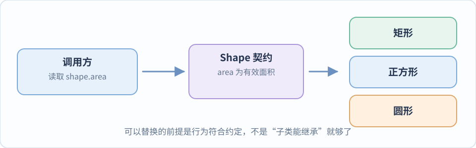

# 陆.1.4 里氏替换原则

## 01.什么是里氏替换原则？



写面向对象代码，很多朋友有个习惯：先看看能不能继承。父类已经有了，那子类直接 `extends` 一下，不就省事了吗？

省事倒是省事，可问题来了：**子类明明继承了父类，为什么换上子类，原来好好的代码却出错了？**

这就是里氏替换原则（Liskov Substitution Principle，简称 LSP）要解决的问题。

说人话：**如果程序原本能使用父类对象，那么在符合相同约定的情况下，换成子类对象，程序依然应该正常工作。**

注意，这里说的“正常工作”不是语法不报错，也不是方法名字一样，而是**行为符合原先的约定**。

## 02.继承了父类，就一定能替换父类吗？

还真不一定。举个例子：所有图形都有一个 `area`（面积）属性，我们约定它返回**有限的、非负的数字**。

```javascript
class Shape {
  get area() {
    return 0;
  }
}

class Rectangle extends Shape {
  constructor(width, height) {
    super();
    this.width = width;
    this.height = height;
  }

  get area() {
    return this.width * this.height;
  }
}

function totalArea(shapes) {
  return shapes.reduce((total, shape) => {
    const area = shape.area;
    if (!Number.isFinite(area) || area < 0) {
      throw new TypeError("图形面积必须是有限的非负数");
    }
    return total + area;
  }, 0);
}

console.log(totalArea([
  new Shape(),
  new Rectangle(2, 3)
])); // >> 6
```

这里 `Shape` **根本不是抽象类**，而且 `Rectangle` **重写了父类的 `area`**。有什么问题吗？没有。只要重写后的结果仍然满足约定，调用 `totalArea` 的代码根本不用关心它拿到的是谁。

现在再来一个子类：

```javascript
class BrokenShape extends Shape {
  get area() {
    return "我不想算";
  }
}

totalArea([new BrokenShape()]);
// >> TypeError: 图形面积必须是有限的非负数
```

你看，继承关系没毛病，方法也有，但返回值不符合约定，原来能工作的调用方就被它搞坏了。

**所以，LSP 管的是行为，不是父类能不能被实例化。** 父类写成抽象类，并不能自动保证子类不乱来；父类不是抽象类，也不意味着子类不能重写方法。

## 03.怎样判断有没有违反 LSP？

我建议记住三个问题，比死背定义好用：

1. **子类是不是偷偷提高了使用门槛？** 父类允许任何非空字符串作为参数，子类却只接受长度不超过3的字符串。这叫加强了前置条件，调用方可能突然出错。
2. **子类是不是降低了原本的保证？** 父类承诺返回有效面积，子类却返回字符串、`NaN`，甚至无故抛异常。原先的后置条件被破坏了。
3. **子类是不是破坏了对象一直应当保持的规则？** 比如余额不能为负数，子类却允许随便扣成负数。这叫破坏不变量。

这三个判断来自行为子类型的思路。真实工程里的行为契约还可能涉及异常、状态变化、资源释放等，不能只看返回值。

## 04.实际开发中该怎么用？

继承不是不能用，而是要先问：**这个子类真的能履行父类对外做出的承诺吗？**

能，就让它继承、重写。不能，别为了复用几行代码硬凑父子关系，拆成独立组件或者用组合也许更合适。

这条原则同样适用于 TypeScript 接口、适配器、插件系统。编译器能帮你检查类型，却不一定能替你判断业务行为是否违约。

**参考资料：**

* [Liskov 与 Wing：《A Behavioral Notion of Subtyping》（1994）](https://www.cs.cmu.edu/~wing/publications/LiskovWing94.pdf)
* [Cornell CS：模块设计与行为子类型](https://courses.cs.cornell.edu/cs2112/2022fa/lectures/mod_design/index.html)
