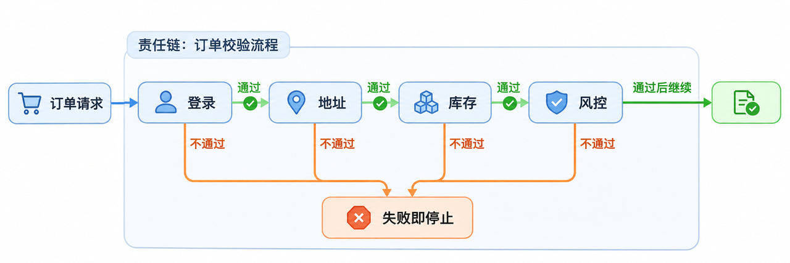

# 柒.1.10 职责链模式

订单发货前，得查登录、地址、库存，还可能要过风控。如果一股脑写进一个大函数，眼下倒是快；下个月规则改了，几个人抢着改同一坨代码，麻烦就来了。

职责链模式，说白了，就是**给这些检查安排好先后顺序，一关一关过**。哪关不通过，就在哪关停。可别小看顺序，业务里顺序错了，后果可能完全不同。



> **看图提示：** 任意一关失败立即返回错误；只有全部通过，订单才进入后续流程。顺序是业务规则的一部分。

## 01. 先写出最直观的检查链

```js-run
const checks = [
  order => order.loggedIn ? null : '请先登录',
  order => order.address ? null : '请填写收货地址',
  order => order.stock >= order.quantity ? null : '库存不足',
  order => order.riskFlag ? '订单需要人工审核' : null
];

function validateOrder(order) {
  for (const check of checks) {
    const error = check(order);
    if (error !== null) return { ok: false, error };
  }
  return { ok: true };
}

console.log(validateOrder({
  loggedIn: true, address: '上海', stock: 5, quantity: 2, riskFlag: false
})); // { ok: true }
console.log(validateOrder({
  loggedIn: true, address: '', stock: 5, quantity: 2, riskFlag: false
})); // { ok: false, error: '请填写收货地址' }
```

每个函数只负责一个判断。想多加“优惠券有效性”检查，只需要在链中加入一个函数，不必重写其他函数。

这里用 `null` 表示“通过，交给下一关”，返回字符串表示“拦截”。**协议必须事先约定清楚**，否则返回 `false`、`undefined`、空字符串容易产生歧义。

## 02. 改成“找到第一个能处理的部门”

职责链还有一种用法，不是让所有部门挨个盖章，而是**谁有本事处理，谁接下这件事**。

比如客服工单来了，先问是不是售后问题，不是就交给下一组。我们用这个例子把另一种职责链写出来。

```js-run
const handlers = [
  ticket => ticket.type === 'refund' ? '退款团队' : null,
  ticket => ticket.type === 'delivery' ? '物流团队' : null,
  ticket => ticket.type === 'technical' ? '技术支持' : null,
  () => '综合客服'
];

function assign(ticket) {
  for (const handler of handlers) {
    const team = handler(ticket);
    if (team !== null) return team;
  }
}
console.log(assign({ type: 'delivery' })); // 物流团队
console.log(assign({ type: 'other' })); // 综合客服
```

这里没有“失败”的概念，而是第一个能接住工单的处理者停止传递。你会发现**处理链和校验链一样，核心是统一接口 + 按顺序尝试**。

## 03. Express/Koa中间件也是一回事吗？

两者思想有关，但不要完全画等号。简单职责链通常是“向后传，直到有人处理”；Koa 的洋葱模型还允许“请求向里走，响应再向外走”：

```javascript
// Koa 风格伪框架示意
async function middlewareA(ctx, next) {
  console.log('A 进入');
  await next();
  console.log('A 离开');
}
async function middlewareB(ctx, next) {
  console.log('B 进入');
  await next();
  console.log('B 离开');
}
// 组合后执行顺序：A 进入 → B 进入 → B 离开 → A 离开
```

这就是为什么日志、鉴权、错误处理等中间件的放置顺序非常重要。

## 04. 线上业务里的三个细节

线上真用职责链时，我觉得有几件事千万别省略。最重要的就是顺序：风控、库存、扣款谁先谁后，不是想怎么排就怎么排。

**错误处理：** 某个处理者自己抛异常，链应该停止、重试还是记录后继续？必须有明确策略。

**异步：** 如果某一关需要查询数据库，每个处理者应统一返回 Promise，调用者用 `await` 依次执行；不能混合异步与同步逻辑后忘记等待。

```javascript
async function runAsyncChecks(order, handlers) {
  for (const handler of handlers) {
    const result = await handler(order);
    if (!result.ok) return result;
  }
  return { ok: true };
}
```

## 05. 什么时候不要用职责链？

流程只有两个稳定判断，简单的 `if` 更清楚。若需要**所有**处理者都执行、汇总全部错误，不应在命中第一个错误时立刻返回，而要改为收集结果的验证管线。

面试官最想听见的，是你知道“**谁负责往下传，什么时候停止，顺序能不能改变**”，而不只是会背模式英文名。

模式名字背不背得住不重要。你能说清哪一关负责什么、谁决定继续、什么时候停，这才叫会用职责链。

