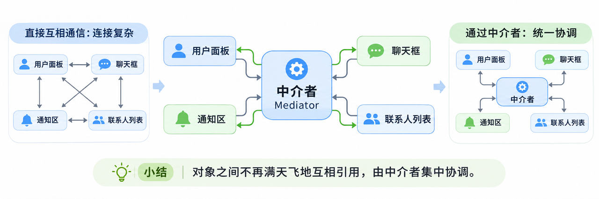

# 柒.1.11 中介者模式

你开发一个机票订购页面，有日期、出发地、到达地、乘客类型、舱位、优惠券几个模块。每改一次日期，要通知价格；每改一次乘客类型，要限制部分舱位；每改一次舱位，又影响优惠券。

如果每个模块都直接调用另外五个模块的方法，代码很快就像一团耳机线。中介者模式的办法是：**组件不必互相认识，把跨组件的协调交给一个中间人。**

## 01. 一个可以运行的订单表单例子

假设配送地址为海外时，不提供“次日达”。组件不必直接操作对方，只需要把用户选择报告给协调器：

```javascript
class CheckoutMediator {
  constructor() {
    this.country = 'CN';
    this.delivery = 'standard';
    this.coupon = null;
  }

  setCountry(country) {
    this.country = country;
    this.recalculate();
  }

  setDelivery(delivery) {
    this.delivery = delivery;
    this.recalculate();
  }

  setCoupon(coupon) {
    this.coupon = coupon;
    this.recalculate();
  }

  recalculate() {
    const allowed = this.country === 'CN'
      ? ['standard', 'express']
      : ['standard'];

    if (!allowed.includes(this.delivery)) {
      this.delivery = 'standard';
    }

    const shipping = this.delivery === 'express' ? 20 : 8;
    const discount = this.coupon === 'FREE_SHIP' ? shipping : 0;
    console.log({ allowed, delivery: this.delivery, payableShipping: shipping - discount });
  }
}

const checkout = new CheckoutMediator();
checkout.setDelivery('express'); // 国内：次日达，运费20
checkout.setCountry('US');       // 海外：自动回退普通配送，运费8
checkout.setCoupon('FREE_SHIP'); // 运费变0
```

这里只是演示**协调规则**。真实项目中，地址组件可以调用 `setCountry`，配送组件可以调用 `setDelivery`，价格组件订阅计算结果。它们不需要互相 import。

## 02. 中介者是不是全局变量？

不是。中介者是负责协调一组对象协作的角色，不要求整个程序只有一个。一个结算页面一个中介者、一个聊天室一个中介者，都很自然。

如果把用户、订单、库存、支付、消息、权限统统塞进同一个“全局中介者”，那只是把原本分散的混乱集中成一个超级大文件。

## 03. 再举一个例子：聊天室



> **看图提示：** 图中的中心节点统一协调参与者，不意味着业务必须使用单一全局对象；真实系统通常需要根据业务边界拆分协调者。

没有中介者，每个用户对象都要持有其他所有人的引用。加入一个聊天服务器作为协调者后：

```javascript
class ChatRoom {
  constructor() { this.users = new Map(); }
  join(name, receive) { this.users.set(name, receive); }
  send(from, to, message) {
    const receive = this.users.get(to);
    if (receive) receive(from + ': ' + message);
  }
}
const room = new ChatRoom();
room.join('小明', msg => console.log('小明收到', msg));
room.join('小红', msg => console.log('小红收到', msg));
room.send('小明', '小红', '你好！');
```

小明只需要知道接收人的名字，不需要保留“小红对象”的具体方法引用。协调者还可以添加权限校验、消息记录等规则，但真实服务器必须在服务端验证发送者身份，不能相信前端传来的名字。

## 04. 和发布订阅模式有什么区别？

发布订阅更像广播站：发布者说“发生了某事件”，谁订阅谁处理；中介者更像调度室：知道各参与方关系，决定**下一步由谁做、按什么规则做**。

有时候一个协调器内部会借助事件总线实现通知。这不矛盾，因为它们关注的问题层次不同。

## 05. 面试中真正需要说明的代价

集中协调虽然减少了组件之间的引用，但中介者自己可能越来越庞大。解决方法是按业务拆分、保持职责边界、给协调规则写单元测试。中介者适合“多人关系复杂”的场景；如果两个组件只传一个参数，直接传回调或 Props 就够了。
