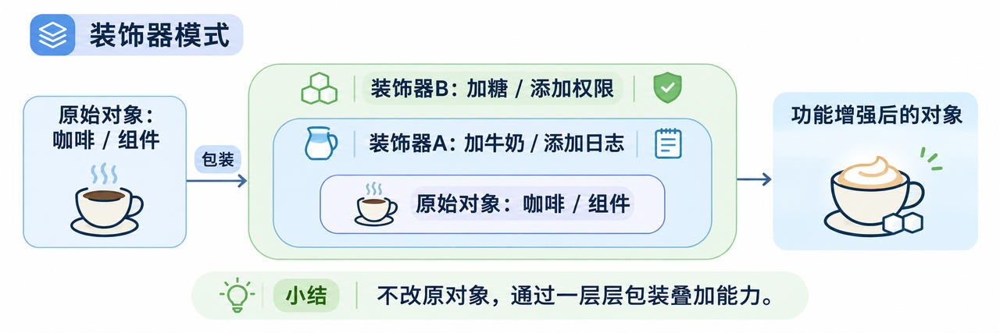

# 柒.1.12 装饰者模式

公司说以后所有接口都要统计耗时。你当然可以打开几十个函数，每个都加上日志。可过一个月又要统一加错误处理，怎么办，再改几十遍？

我觉得碰上这种事，就该想想能不能把公共工作抽到外面。装饰者模式便是这个思路：**原来的函数继续干自己的活，我们在外面给它多包一层能力**。

## 01. 最简单的函数装饰

```js-run
function withLogging(fn) {
  return function (...args) {
    console.log('开始调用，参数：', args);
    const result = fn.apply(this, args);
    console.log('调用结束');
    return result;
  };
}

function add(a, b) { return a + b; }
const loggedAdd = withLogging(add);
console.log(loggedAdd(2, 3)); // 记录参数、调用结束、5
```

`fn.apply(this, args)` 用来保持原来的调用者和参数。否则包装对象方法时，`this` 很可能丢失。

## 02. 真实一点：给异步函数统计耗时

```js-run
function withTiming(fn, name = fn.name || 'anonymous') {
  return async function (...args) {
    const start = performance.now();
    try {
      return await fn.apply(this, args);
    } finally {
      console.log(name + ' 耗时 ' + (performance.now() - start).toFixed(1) + 'ms');
    }
  };
}

async function loadUser(id) {
  return { id, name: '张三' };
}
const timedLoadUser = withTiming(loadUser);
timedLoadUser(123).then(console.log);
```

注意这里的 `finally`：即使请求失败，计时信息仍会被记录。`await` 能把 Promise 的失败当成异常处理，但包装函数的返回类型也因此变成 Promise；不要把同步 API 随便包成异步 API。

## 03. 装饰者还可以层层叠加



> **看图提示：** 每一层包装保留原有功能，并额外添加日志、校验或配料等能力；图中的咖啡是生活类比。

例如某个操作除了计时，还需要检查是否登录：

```js-run
function requireLogin(fn) {
  return function (...args) {
    if (!this?.loggedIn) throw new Error('请先登录');
    return fn.apply(this, args);
  };
}

const service = {
  loggedIn: true,
  getUser(id) { return { id }; }
};
service.getUser = requireLogin(service.getUser);
console.log(service.getUser(1)); // { id: 1 }
service.loggedIn = false;
// service.getUser(1); // 抛出“请先登录”
```

你没有改 `getUser` 原始实现，却额外加了访问条件。这里仅演示结构，真正的权限判断必须放在可信的服务端，不能用前端对象状态决定用户是否有权限。

## 04. 装饰者和代理模式有什么区别？

装饰者和代理看起来都像“包一层”，那它们有什么区别？我觉得别看代码外形，先看目的。

你是想给原函数增加日志、计时这类本事，还是想替它控制访问、延迟加载？先问这个，反而比较容易分清。

- **装饰者：** 在保持核心功能的基础上增加职责，如日志、计时。
- **代理：** 代表另一个对象控制访问，例如延迟加载、远程代理、访问控制。

有些实际代码同时具有两种性质，设计模式是帮助沟通的工具，不是必须贴唯一标签的考试。

## 05. 三个坑足够让你线上排查一天

**函数身份变了。** `withLogging(fn) !== fn`，事件监听解绑时若传入原始函数引用，可能解绑失败。

**调用语义变了。** 包装原本同步返回结果的函数，如果加了 `async`，调用者会得到 Promise，导致兼容问题。

**缓存和重试不是随便加。** 对扣款请求添加自动重试可能造成重复扣款；先设计幂等机制，再考虑重试装饰。

## 06. 面试追问：@decorator 语法就是设计模式吗？

还有个容易混淆的地方：JavaScript 或 TypeScript 里写了 `@decorator`，是不是就一定用了装饰者模式？当然不能这样简单画等号。

语法是一回事，设计意图又是一回事。没用那套语法，也照样可以把装饰者模式写得很漂亮。

真正值得记住的是：**把横切逻辑从重复的业务函数里抽出来，靠组合而不是改动原函数增强行为。**

我不希望大家为了用装饰者模式，就把本来很简单的函数包得像洋葱。确实有重复的公共逻辑时再用，才值得。

