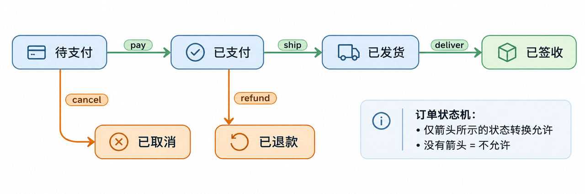

# 柒.1.13 状态模式

电商订单的状态，大家都熟悉：待支付、已支付、已发货、已签收、已取消。问题来了，用户点“取消订单”，到底什么时候能取消？

有些项目到处散着 `if (status === ...)`，今天多了一个退款状态，明天又多一个超时关闭，改漏一处就可能出事故。我觉得状态模式真正有用的地方，是把**当前状态允许做什么、动作之后变成什么**先说明白。

## 01. 先做一张状态转移表

| 当前状态 | 允许的动作 | 动作后的状态 |
| --- | --- | --- |
| 待支付 pending | pay | 已支付 paid |
| 待支付 pending | cancel | 已取消 cancelled |
| 已支付 paid | ship | 已发货 shipped |
| 已支付 paid | refund | 已退款 refunded |
| 已发货 shipped | deliver | 已签收 delivered |

没有列出的动作，就代表当前不允许。比如“已取消”状态没有发货动作。




> **看图提示：** 订单允许哪些操作应由明确的状态转移表决定，并由服务端再次验证。

## 02. 用一段代码把错误挡住

```js-run
const transitions = {
  pending: { pay: 'paid', cancel: 'cancelled' },
  paid: { ship: 'shipped', refund: 'refunded' },
  shipped: { deliver: 'delivered' },
  delivered: {},
  cancelled: {},
  refunded: {}
};

class Order {
  constructor() { this.status = 'pending'; }
  dispatch(action) {
    const next = transitions[this.status][action];
    if (!next) throw new Error(this.status + ' 状态不允许 ' + action);
    this.status = next;
    return next;
  }
}

const order = new Order();
console.log(order.dispatch('pay')); // paid
console.log(order.dispatch('ship')); // shipped
// order.dispatch('cancel'); // 抛错：shipped 状态不允许 cancel
```

这份代码属于**表驱动的有限状态机**，可以把它看成状态模式的一种简单表达。更经典的状态模式，会把每一种状态封装为独立对象，让不同状态实现各自的行为。

## 03. 状态对象版本：按钮该怎样显示？

```js-run
const pageStates = {
  idle: {
    label: '开始下载',
    canStart: true
  },
  downloading: {
    label: '下载中，请稍候',
    canStart: false
  },
  done: {
    label: '重新下载',
    canStart: true
  },
  error: {
    label: '重试下载',
    canStart: true
  }
};

function renderButton(state) {
  const config = pageStates[state];
  if (!config) throw new Error('未知状态');
  return config.label + '，是否可点击：' + config.canStart;
}
console.log(renderButton('downloading'));
// 下载中，请稍候，是否可点击：false
```

这里的好处是把文案和可用性约束放在一起。否则页面各处可能分别判断 `loading`、`finished`、`error`，出现一个按钮显示“重试”却仍然禁用的矛盾。

## 04. 状态模式和策略模式很像，怎么分？

状态和策略这两个模式，也经常被人混为一谈。看着都像是“有好几个对象，选一个来执行”，但我觉得关键得看**为什么要选它**。

策略是业务主动挑一种算法，状态则是系统走到某个阶段后，只允许做对应的动作。

**状态模式：** 我现在处于某个状态，事件发生后按规则转移。例如待支付订单收到 `pay` 事件后进入已支付。

从代码看，两者都可能通过不同对象调用不同方法。真正区别在于**选择依据和业务语义**，不是有没有用 `class`。

## 05. 线上系统还要解决并发

还有个不能回避的现实问题：前端状态写得再严密，两个请求也可能同时到服务器。一个请求取消订单，另一个请求发货，谁先谁后？

所以服务端必须自己检查状态和权限，必要时用事务或并发控制保证转移合法。千万别把前端界面上的状态当成最终裁判。

尤其支付、退款等动作还涉及外部系统，不能简单地先改 `status` 再假装一切成功。必须处理失败重试、补偿、幂等等问题。

面试时能把“前端交互状态”与“服务端权威状态”分开讲，远比只会背状态模式定义有说服力。

订单状态图画得漂亮，只算第一步。并发、失败重试、退款和补偿处理清楚，这套状态设计才算真正能上线。

