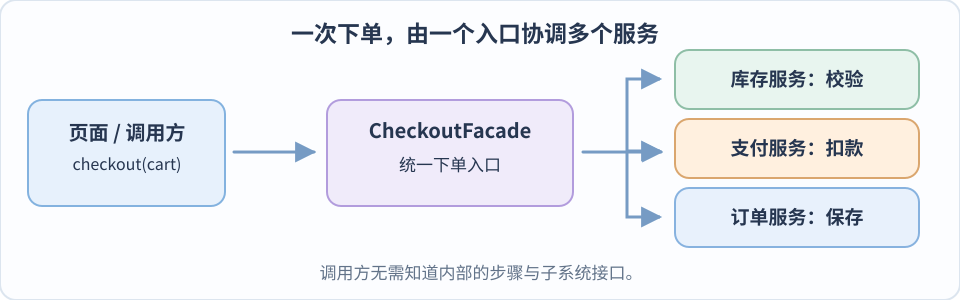

# 柒.1.15 门面模式（Facade）：把复杂的调用过程藏起来

假设用户在电商网站点击“提交订单”。前端只想做一件事：**下单**。可真正完成下单，背后往往要查库存、扣款、保存订单。

如果页面分别调用三个服务，那么它必须知道先调用谁、传什么参数、遇到失败怎么办。业务流程一旦变化，每个调用方可能都要跟着改。

门面模式就是在这些复杂服务的前面，加一个**简单、稳定的入口**。

## 01. 一个入口，内部完成多步操作



> **看图提示：** 调用方只认识 `CheckoutFacade`；真正执行时，由门面对象去调用库存、支付和订单服务。

对外：

```javascript
const result = await checkout.checkout(cart);
```

对内：门面对象替调用方完成多个步骤。

你可以把它想成餐厅的服务员：顾客只需要点餐，不必自己跑到厨房、收银台、仓库挨个交代。

## 02. 写一个能运行的最小例子

以下代码可保存为 `facade.mjs`，用 `node facade.mjs` 运行：

```javascript
const inventory = {
  async checkAndPrice(cart) {
    if (cart.length === 0) throw new Error('购物车不能为空');
    return { total: cart.length * 20, items: cart };
  }
};

const payment = {
  async pay(amount) {
    return { paymentId: 'pay-' + amount, amount };
  }
};

const orders = {
  async save({ items, paymentId }) {
    return { orderId: 'order-1', items, paymentId };
  }
};

class CheckoutFacade {
  constructor(inventory, payment, orders) {
    this.inventory = inventory;
    this.payment = payment;
    this.orders = orders;
  }

  async checkout(cart) {
    const quote = await this.inventory.checkAndPrice(cart);
    const receipt = await this.payment.pay(quote.total);
    return this.orders.save({
      items: quote.items,
      paymentId: receipt.paymentId
    });
  }
}

const checkout = new CheckoutFacade(inventory, payment, orders);
console.log(await checkout.checkout([{ id: 'book-1' }]));
```

观察代码：调用方只需要执行 `checkout.checkout(cart)`，并不需要自己调用 `checkAndPrice`、`pay` 和 `save`。

以后加上优惠券、库存预留、审计日志，可以在不改变外部入口的前提下调整内部编排。**这就是门面模式的价值。**

上面只是教学代码。生产环境的下单流程还需要处理**幂等、库存预留、扣款失败、退款补偿、权限与事务边界**等问题，不能把三次简单调用当成可靠交易。

## 03. 它和适配器、中介者有什么区别？

三个模式都可能出现“中间包一层”，但目的并不一样：

| 模式 | 重点解决什么问题 |
| --- | --- |
| **门面 Facade** | 一堆复杂操作，对外简化成少量入口。 |
| **适配器 Adapter** | 原有接口不符合调用方预期，转换成需要的接口。 |
| **中介者 Mediator** | 多个参与对象交互太复杂，集中协调它们之间的关系。 |

在这个例子里，门面是为了让页面不必了解整个下单流程；它并不要求修改库存或支付服务的原有接口。

## 04. 什么时候值得用？什么时候没必要？

**值得用：** 一个业务动作要依次调用多个模块；许多调用方重复编排同样的步骤；希望在内部替换服务时维持外部 API 稳定。

**没必要：** 只调用一个普通函数，没有编排成本，额外包一层反而让阅读代码变困难。

门面也可能变成“万能上帝类”。当 `CheckoutFacade` 开始同时负责用户、订单、物流、报表等所有事务时，应按照业务边界拆成更小的门面，而不是无限堆方法。

## 05. 面试追问

**门面一定是一个 class 吗？** 不是。只要对外提供简洁入口并封装内部协作，普通函数或模块也可以发挥同样作用。

**门面必须隐藏所有子系统吗？** 不必。需要高级能力的调用方仍可直接使用底层接口；门面只是提供方便的常用途径。

**门面是不是等于微服务网关？** 不等于。网关可能具备路由、认证、限流等跨服务功能，门面更强调简化对复杂子系统的调用；两者可以在某些架构中组合使用。

## 延伸阅读

- [Refactoring.Guru：Facade](https://refactoring.guru/design-patterns/facade)
- [本书：适配器模式](7.1.14.md)
- [本书：中介者模式](7.1.11.md)
