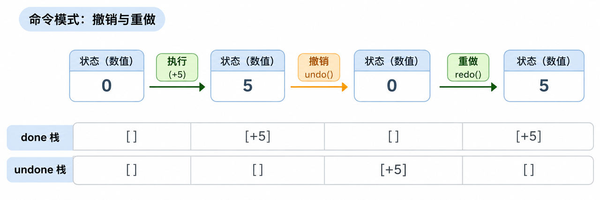

# 柒.1.6 命令模式

你做了一个在线文档编辑器。用户点击“加粗”，文字变粗了；点击“撤销”，又恢复；再点击“重做”，重新加粗。

如果每个按钮都只是一段直接修改 DOM 的代码，要补撤销、重做、快捷键和操作历史，就会越来越乱。命令模式的办法很直接：**把“做一件事”包装成一个能保存、能执行的对象。**

## 01. 从一个计数器理解命令

先看最简单的业务：把数字加五，再把这次操作撤销掉。

```javascript
const counter = { value: 0 };

function addCommand(target, amount) {
  return {
    execute() { target.value += amount; },
    undo() { target.value -= amount; }
  };
}

const command = addCommand(counter, 5);
command.execute();
console.log(counter.value); // 5
command.undo();
console.log(counter.value); // 0
```

按钮不再关心怎么加减，它只需要 `command.execute()`。撤销按钮也不需要自己猜过去发生了什么，只需找到最近执行的命令并执行 `undo()`。




> **看图提示：** 撤销是执行命令定义的逆操作；真实外部副作用如付款不能简单“反向调用”撤回。

## 02. 实战：加上“撤销”和“重做”历史

```javascript
class CommandHistory {
  constructor() {
    this.done = [];
    this.undone = [];
  }
  execute(command) {
    command.execute();
    this.done.push(command);
    this.undone.length = 0; // 新操作后，旧的重做路径失效
  }
  undo() {
    const command = this.done.pop();
    if (!command) return false;
    command.undo();
    this.undone.push(command);
    return true;
  }
  redo() {
    const command = this.undone.pop();
    if (!command) return false;
    command.execute();
    this.done.push(command);
    return true;
  }
}

const counter = { value: 0 };
const history = new CommandHistory();
history.execute(addCommand(counter, 5));
history.execute(addCommand(counter, 2));
history.undo();
console.log(counter.value); // 5
history.redo();
console.log(counter.value); // 7
```

这里的 `addCommand` 就是第一节定义的工厂函数。两个例子放在同一文件运行时，可只保留一次 `counter` 声明，避免重复声明 `const`。

看起来只是多了几十行，但现在鼠标按钮、键盘快捷键、工具栏菜单都能调用同一个 `history.execute(command)`。这就是“操作”和“发起操作的界面”解耦。

## 03. 第二个例子：批量操作

假设需要一次修改三个选中元素的颜色。可以把三个子命令组合成一个大命令：

```javascript
function batchCommand(commands) {
  return {
    execute() {
      for (const command of commands) command.execute();
    },
    undo() {
      for (const command of [...commands].reverse()) command.undo();
    }
  };
}
```

为什么撤销要倒序？因为先做 A、再做 B，恢复时通常要先撤销 B，再撤销 A。这是“操作栈”的基本规律。

不过这份教学代码没有事务性：如果第二个命令执行失败，前一个命令不会自动回滚。真正的编辑器需要处理异常、部分成功和命令是否可重复执行。

## 04. 命令模式与回调函数有何区别？

```javascript
button.onclick = saveDocument;
```

这已经把按钮和保存函数分开了。如果只有一个按钮、一次保存，使用普通回调更直接。

命令模式值得用的地方在于**操作本身需要被管理**：排队、撤销、审计、重放、记录参数、跨入口调用。这些需求不存在时，硬套一个 `Command` 类只是增加代码。

## 05. “撤销付款”能照搬吗？

不能。计数器加五后减五很简单，转账、发邮件、数据库写入就不是这么回事了。

比如已经发出去的邮件，不可能执行一次 `undo()` 就让对方收件箱里的邮件消失。支付系统的“退款”也并非“反向运行扣款”，而是另一条独立业务操作，要有权限、日志和幂等保障。

面试官问“怎么实现撤销”，先判断操作是否可逆，再决定是保存旧状态、记录反向操作，还是使用补偿交易。这比背命令模式定义重要得多。
