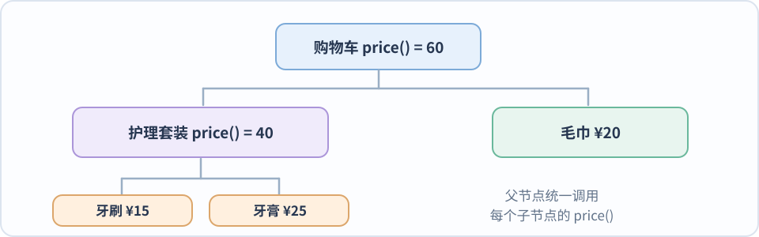

# 柒.1.7 组合模式

购物车里有一支牙刷，也有一套“牙刷加牙膏”的组合商品。结算时到底怎么算价钱？每碰到一种套装，就专门写一套判断吗？

组合模式的办法让我觉得很舒服：**单品也好，套装也好，先约定都能回答“多少钱”**。至于套装里面又套了什么，交给它自己计算。

## 01. 为什么一层层判断会越写越乱？

没有统一接口时，你可能这样写：

```javascript
function getPrice(item) {
  if (item.type === 'product') return item.price;
  if (item.type === 'bundle') {
    return item.items.reduce((sum, child) => sum + getPrice(child), 0);
  }
  throw new Error('未知商品类型');
}
```

这段代码未必错。但随着新增“满减套装”“赠品套装”“会员专享套装”，`getPrice` 会越来越了解每个内部类型。

组合模式的办法是：让单品和套装自己实现相同的方法 `price()`。

## 02. 从零实现单品和套装

```javascript
class Product {
  constructor(name, price) {
    this.name = name;
    this.amount = price;
  }
  price() { return this.amount; }
}

class Bundle {
  constructor(name) {
    this.name = name;
    this.children = [];
  }
  add(item) {
    this.children.push(item);
    return this;
  }
  price() {
    return this.children.reduce((sum, child) => sum + child.price(), 0);
  }
}

const careSet = new Bundle('护理套装')
  .add(new Product('牙刷', 15))
  .add(new Product('牙膏', 25));

const cart = new Bundle('购物车')
  .add(careSet)
  .add(new Product('毛巾', 20));

console.log(cart.price()); // 60
```




> **看图提示：** 购物车 price() 递归求和：护理套装含牙刷 15 元、牙膏 25 元，另有毛巾 20 元，总价 60 元。

`cart.price()` 并不知道里头是商品还是套装。它只知道“每个孩子都有 `price()`”。这种**对树节点使用统一接口**的能力，就是组合模式的重点。

## 03. 换一个场景：权限树

买东西的例子看懂了，再想想管理后台里的权限菜单。上面是“订单管理”，下面又有查看、审批、退款。这样的结构本来就是一棵树，用同样的思想处理，往往比满屏判断省事。

```javascript
const menu = {
  name: '订单管理',
  children: [
    { name: '查看订单', permission: 'order:read' },
    { name: '退款审批', permission: 'refund:approve' }
  ]
};

function flattenPermissions(node) {
  const own = node.permission ? [node.permission] : [];
  return own.concat(
    ...(node.children ?? []).map(flattenPermissions)
  );
}
console.log(flattenPermissions(menu));
// ['order:read', 'refund:approve']
```

这是另一种树形递归实现，没有用类，但思想一致：**父节点持有子节点，操作会沿树向下组合**。在这里，返回权限集合就像上一个例子计算总价。

注意：页面权限树只影响界面显示，真正的权限校验必须在服务端执行。

## 04. 组合模式有哪些坑？

**第一，环。** 如果把 `cart` 又塞回 `careSet`，树变成环，`price()` 递归可能永远停不下来。工程上应禁止把祖先节点加为孩子，或者设置访问过的节点集合。

**第二，重复引用。** 同一个商品对象被加到两个套装，计算总价时会出现两次。这是不是错误，要看业务是“允许同款商品出现两份”还是“必须唯一”。

**第三，接口不能乱统一。** 单品没有孩子，强行要求单品也实现 `add()`，只会出现一堆“不能调用”的方法。统一的应是业务中确实共用的能力，比如 `price()`、`render()`。

## 05. 面试怎么答？

有人问组合模式是什么，我不建议上来就背“部分与整体的一致性”。把单品和套装画在纸上，说明为什么能调用同一个 `price()`，对方一听就懂。

再补充递归环、对象重复引用这些边界，比只背定义更有说服力。不过也别为了“接口统一”，强迫一个普通商品实现根本用不上的 `add()`。适合统一的能力才统一，这个分寸得有。

