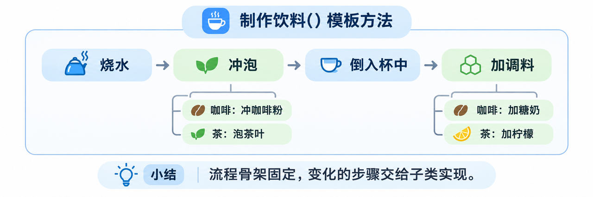

# 柒.1.8 模板方法模式

公司有三种报表：销售日报、客服日报、库存日报。它们的流程基本一样：**读取数据 → 验证数据 → 计算结果 → 输出报表**。唯一的区别是“怎么算”和“怎么显示”。

最笨的办法是复制三份完整代码，各改两行。今天给日报加了权限检查，忘记改库存报表，问题就来了。

模板方法模式要做的是：**相同的步骤只写一次，不同的步骤留给具体实现。**

## 01. 先把固定流程抽出来

```javascript
class Report {
  run(rows) {
    this.validate(rows);
    const result = this.calculate(rows);
    return this.format(result);
  }
  validate(rows) {
    if (!Array.isArray(rows)) throw new TypeError('需要数组');
  }
  calculate() {
    throw new Error('子类需要实现 calculate');
  }
  format(value) {
    return String(value);
  }
}

class SalesReport extends Report {
  calculate(rows) {
    return rows.reduce((sum, row) => sum + row.amount, 0);
  }
  format(total) {
    return '销售总额：' + total + ' 元';
  }
}

console.log(new SalesReport().run([{ amount: 100 }, { amount: 200 }]));
// 销售总额：300 元
```

`run()` 是“模板”，规定步骤与顺序；`calculate()`、`format()` 是变化点。日后要给所有报表统一添加日志或校验，只要修改基础流程。

## 02. 再新增一种报表，不必复制整套流程

```javascript
class TicketReport extends Report {
  calculate(rows) {
    return rows.filter(row => row.resolved).length;
  }
  format(count) {
    return '已解决工单：' + count + ' 件';
  }
}

console.log(new TicketReport().run([
  { resolved: true },
  { resolved: false },
  { resolved: true }
])); // 已解决工单：2 件
```

注意：这里使用继承，适合**流程稳定、差异有限**的情况。如果基础流程频繁改动，所有子类都可能受影响。

## 03. JavaScript 可以不用继承吗？

当然可以。JavaScript 支持把函数作为参数传递，我们也能把变化的部分“塞进”固定流程：

```javascript
function generateReport(rows, calculate, format) {
  if (!Array.isArray(rows)) throw new TypeError('需要数组');
  return format(calculate(rows));
}

const result = generateReport(
  [{ amount: 100 }, { amount: 200 }],
  rows => rows.reduce((sum, row) => sum + row.amount, 0),
  amount => '合计：' + amount + ' 元'
);
console.log(result); // 合计：300 元
```

这种组合方式与**策略模式**有些相似：把可替换的算法放在外面。模板方法强调固定流程和可扩展步骤；策略模式强调算法之间可以互换。实际工作中，两种思想可以结合使用。

## 04. 生活中的第二个例子：泡饮料



> **看图提示：** 图中固定的是饮料制作步骤，咖啡和茶在冲泡方式及配料上各自实现；业务中哪些步骤允许替换，要先明确。

泡茶和泡咖啡都有“烧水、放原料、冲泡、倒杯子”，区别是原料与具体处理。模板方法适合把共同步骤固定。

但不是所有业务都能固定顺序。例如付款流程可能需要权限校验、库存预留、支付确认与补偿机制，随意把某一步放进子类覆盖，就可能绕过重要校验。

**设计上的关键：** 哪些步骤是绝不能被跳过的业务约束？哪些才是允许变化的扩展点？如果不先明确这条界线，模板方法可能把错误也复用得很彻底。

## 05. 面试官会问的坑

**父类调用子类方法，算不算违反依赖倒置？** 不必按名字死扣。基类依赖的是它定义的抽象扩展点；重点看子类是否遵守约定，以及具体实现是否被不必要地耦合。

**什么时候不要用？** 只做两次简单操作、流程变化频繁、继承层级已经很深时，使用普通函数组合更直观。

## 参考资料

- [MDN：JavaScript 类](https://developer.mozilla.org/zh-CN/docs/Web/JavaScript/Reference/Classes)
