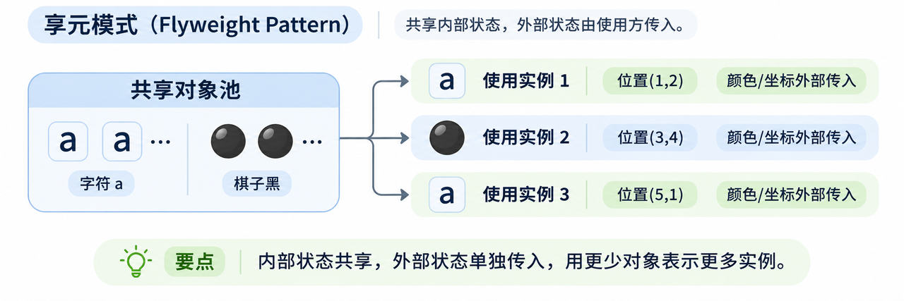

# 柒.1.9 享元模式

假设你做一个地图，要在页面上画十万棵树。每棵树有自己的位置，但同一种树的图标、颜色、纹理都一样。

如果把这些相同的资料复制十万份，那内存可真有点冤枉。享元模式说白了就是：**每棵树长在哪儿各自记录，树长什么样可以大家共用一份**。

## 01. 先找出哪些能共享

把树拆为两类信息：

- **内部状态：** 树种名称、默认颜色、纹理地址。这些对于同一树种可以共享。
- **外部状态：** 每棵树的坐标、缩放、朝向、是否选中。这些是每个实例自己的。

简单实现一个“树种工厂”：

```javascript
class TreeTypeFactory {
  constructor() {
    this.cache = new Map();
  }
  get(name, color, texture) {
    const key = JSON.stringify([name, color, texture]);
    if (!this.cache.has(key)) {
      this.cache.set(key, Object.freeze({ name, color, texture }));
    }
    return this.cache.get(key);
  }
}

const types = new TreeTypeFactory();
const oak = types.get('橡树', '绿', '/img/oak.png');
const tree1 = { type: oak, x: 20, y: 40 };
const tree2 = { type: types.get('橡树', '绿', '/img/oak.png'), x: 50, y: 70 };

console.log(tree1.type === tree2.type); // true，共享
console.log(tree1.x === tree2.x); // false，各自的坐标
```

这样十万棵树只需要维护少量树种描述。`Object.freeze` 是为了避免一个实例修改共享对象，影响全部实例；它只对该对象浅层属性生效。

## 02. 第二个例子：编辑器里的文字样式



> **看图提示：** 被复用的是字符字形、棋子类型等内部状态；位置、颜色等外部状态按具体使用场景传入，不能把所有变化信息都塞进共享对象。

一篇文章可能有几万个字，但全文只用几种字号和颜色。每个字符对象都放一份 `{ fontSize: 16, color: '#333', fontFamily: '...' }`，成本会重复。

我们可以共享样式描述：

```javascript
const stylePool = new Map();

function getStyle(size, color) {
  const key = size + ':' + color;
  if (!stylePool.has(key)) {
    stylePool.set(key, Object.freeze({ size, color }));
  }
  return stylePool.get(key);
}

const chars = [
  { char: '前', style: getStyle(16, 'black') },
  { char: '端', style: getStyle(16, 'black') },
  { char: '内', style: getStyle(24, 'red') }
];
console.log(chars[0].style === chars[1].style); // true
```

这里每个字符还是有自己的内容和位置，但重复的样式被抽到共享池里。现代编辑器真实结构更复杂，往往还会使用区间、样式运行段等优化；这个例子只是帮助理解共享思想。

## 03. 享元就是缓存吗？

不少人觉得享元不就是缓存吗？我觉得有点像，但别直接画等号。

缓存更关心避免重复读取或计算，享元关心的是很多对象能不能共享相同的内部状态。看下面的例子就容易分清楚。

## 04. 三个容易忽略的风险

不过，共享东西也会带来麻烦。大家共用一份资料，要是某个人随手改了它，会不会把其他人的显示一起改掉？

再加上缓存增长、过早优化这两个坑，享元不是见到重复对象就该用。

1. **共享状态被意外修改。** 全部按钮可能同时变色。因此应尽量共享不可变数据。
2. **缓存没有边界。** 如果每个用户都生成独一无二的 key，`Map` 会越存越多，反而占内存。
3. **过早优化。** 一个对象只有十几个字节，页面总共一百个对象，写一整套工厂完全不值。

## 05. 如何证明它真的省内存？

同样的数据量下，分别创建“每个实例都有完整样式对象”和“所有实例复用样式”的版本，在浏览器 DevTools 的 Memory 面板比较快照。注意开发者工具、垃圾回收时机和字符串驻留可能影响测试。

面试回答最好包含“**共享什么、哪些不能共享、如何测量**”三件事。只回答“减少对象创建”太浅。

要证明享元省了内存，就拿真实数据量去测。靠脑补一个“十万倍优化”的故事，可算不上工程结论。

