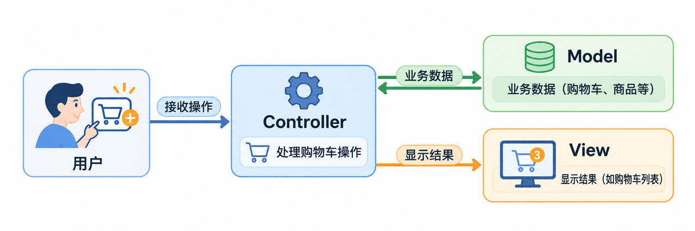

# 柒.2.1 MVC的前世今生

接手一个老前端项目，最怕打开 `index.js`，发现里面两千行代码什么都干：既监听按钮，又算商品价格，又发请求，还直接改 DOM。

产品经理只说把结算按钮挪个位置，你却半天不敢下手。因为不知道改这一行，会不会把别的地方弄坏。

MVC 这套思想就是为了把工作分开：该管数据的管数据，该画界面的画界面，负责协调的去协调。听起来简单，真正做项目可挺有用。

## 01. 没有分工的代码为什么危险？

先看一段模拟购物车的写法：

```javascript
document.querySelector('#buy').onclick = () => {
  const price = Number(document.querySelector('#price').value);
  const count = Number(document.querySelector('#count').value);
  const total = price * count;
  document.querySelector('#result').textContent = total + ' 元';
};
```

问题不在于这段代码只有几行，而在于三个职责绑在一起：

1. 从输入框里取用户输入。
2. 计算商品总价。
3. 把结果更新到页面。

假设明天要把同一套计价规则放到手机 App、后台管理页或 Node.js 服务里，就得复制代码或改造它。再加上优惠券、会员价、税费，事件函数会膨胀。




> **看图提示：** 这是为了理解分工而画的一种常见 MVC 流向，不代表所有 MVC 框架都按这个箭头顺序实现。

## 02. MVC到底怎么分工？

可以把它想象成餐馆：

- **Model（模型）：** 厨房，掌握菜品数据和制作规则。
- **View（视图）：** 餐桌上的菜和菜单，负责把内容展示给顾客。
- **Controller（控制器）：** 服务员，接收顾客的要求，安排厨房工作，再决定如何更新展示。

餐馆类比并不严格，因为不同 MVC 变体中 View 与 Model 的关系不同。重点是：**输入、业务规则和呈现不再绑死在一个函数里**。

## 03. 亲手拆一个最小MVC

```javascript
// Model：纯业务规则，不关心页面有几个按钮
const cartModel = {
  total(price, count) {
    if (!Number.isFinite(price) || price < 0) throw new Error('价格错误');
    if (!Number.isInteger(count) || count < 1) throw new Error('数量错误');
    return price * count;
  }
};

// View：只负责读取输入和显示结果
const cartView = {
  read() {
    return {
      price: Number(document.querySelector('#price').value),
      count: Number(document.querySelector('#count').value)
    };
  },
  show(message) {
    document.querySelector('#result').textContent = message;
  }
};

// Controller：将输入交给业务规则，再安排视图更新
const cartController = {
  submit() {
    try {
      const { price, count } = cartView.read();
      const result = cartModel.total(price, count);
      cartView.show('合计：' + result + ' 元');
    } catch (error) {
      cartView.show(error.message);
    }
  }
};

document.querySelector('#buy')
  .addEventListener('click', () => cartController.submit());
```

现在修改“满两件打九折”，主要修改 `cartModel.total`；把按钮改成下拉菜单，主要修改 View 与交互绑定。Model 甚至可以在没有 DOM 的环境中单独测试：

```javascript
console.assert(cartModel.total(20, 3) === 60);
```

## 04. 多了一堆代码，不是更复杂了吗？

有朋友看到这里可能会说：本来十几行就搞定的事，现在拆成几层，代码多了一倍，这不就是越改越复杂吗？

这话有道理。一个一次性小页面，硬套 MVC 确实可能不划算。可是系统长期维护、几个人共同开发时，明确分工的好处就显出来了。

MVC 的价值是在需求会增长时显现：当多个页面共享规则、多人协作、需要单元测试时，职责清晰往往比“文件最短”重要。

不过 MVC 也不是万能公式。若把全部业务规则塞进 Controller，Model 只剩数据库访问，可能变成“胖控制器”；如果 View 直接绕过 Controller 乱改模型，分层也会失效。

## 05. MVC、MVP、MVVM怎么理解？

它们都在解决 UI 与业务耦合问题，但安排交互的方式不同。

- **MVC：** Controller 协调用户输入，View 和 Model 的关系随具体框架实现而异。
- **MVP：** Presenter 更明确地处理展示逻辑，通过接口驱动一个相对被动的 View。
- **MVVM：** View 与 ViewModel 通过绑定或响应式机制同步，减少大量手写的“取值、更新控件”代码。

不能说“MVVM 是 MVC 的全面升级版”，也不能把某个框架的实现当成全部定义。它们是不同的组织思路。

## 06. 面试时怎么讲才算有深度？

如果我来面试一名工程师，我更想用一个实际需求考他：同一套订单价格规则，要同时给网页、移动端、服务端使用，你会把它放在哪儿？出了错怎么测？

能把这些职责讲清楚，比背三层结构图强得多。

能把职责、变化方向和测试边界说清楚，远比背“Model-View-Controller 三层架构”更有说服力。

MVC 不是什么万能的架构护身符。项目复杂到需要分工时，它有价值；一个小计算器只有一个按钮时，也不必为了三层架构生造一堆文件。

## 延伸阅读

- [MVP又是什么](7.2.2.md)
- [有了MVC、MVP，为什么还要MVVM](7.2.3.md)
