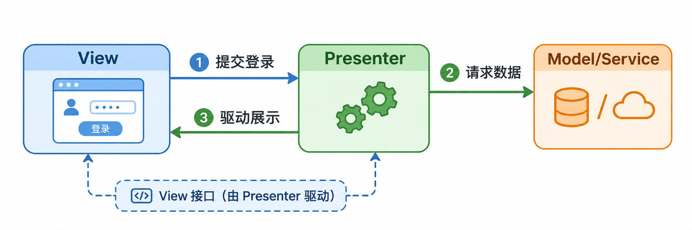

# 柒.2.2 MVP又是什么？

前面聊了 MVC，接着又冒出一个 MVP。名字差一个字母，这些模式真有必要分这么细吗？

先说好，这里的 MVP 不是创业圈常说的“最小可行产品”，而是 Model-View-Presenter。我觉得它想解决的问题很实际：**界面尽量少做判断，让 Presenter 负责决定该展示什么**。这样我们不打开浏览器，也能测试很多界面逻辑。

## 01. 想象一个登录页

需求很普通：用户输入账号和密码，点击登录。登录过程中按钮要禁用；登录成功后显示欢迎语；失败时显示错误信息。

如果把网络请求、错误判断、DOM 操作都写在按钮回调里，测试时要准备浏览器、网络和各种异步时机。

MVP 会把分工变得很明确：

- **Model：** 执行登录请求、处理业务数据。
- **View：** 提供读取输入、显示消息、切换加载状态的能力。
- **Presenter：** 决定何时登录、成功或失败后让 View 怎么显示。




> **看图提示：** Presenter 只通过 View 接口显示状态，因此单元测试可以用 fakeView 代替真实页面。

## 02. 用可运行的JavaScript演示

```javascript
class LoginPresenter {
  constructor(view, service) {
    this.view = view;
    this.service = service;
  }

  async submit(username, password) {
    this.view.setLoading(true);
    try {
      const user = await this.service.login(username, password);
      this.view.showMessage('欢迎你，' + user.name);
    } catch (error) {
      this.view.showMessage('登录失败：' + error.message);
    } finally {
      this.view.setLoading(false);
    }
  }
}

const fakeView = {
  setLoading(value) { console.log('加载中：', value); },
  showMessage(message) { console.log(message); }
};

const fakeService = {
  async login(username, password) {
    if (!username || !password) throw new Error('信息不完整');
    return { name: username };
  }
};

new LoginPresenter(fakeView, fakeService).submit('小王', '123456');
// 加载中：true → 欢迎你，小王 → 加载中：false
```

真实页面的 View 可以把 `setLoading` 映射到按钮 `disabled`，把 `showMessage` 映射到提示框。Presenter 不知道到底是 DOM、移动控件还是测试桩。

上面的假服务只做教学，绝不能把“有账号密码就登录成功”拿到真实项目使用。

## 03. 为什么它更容易测试？

假设登录接口失败了，页面应该显示一条错误提示。测试这件事，非得真的打开浏览器、连上服务器吗？

其实不必。给 Presenter 一个会报错的假服务，再给它一个记录调用的假 View，就能检查它有没有正确告诉界面“显示错误”。

```javascript
const messages = [];
const view = {
  setLoading() {},
  showMessage(text) { messages.push(text); }
};
const service = {
  async login() { throw new Error('网络超时'); }
};

(async () => {
  await new LoginPresenter(view, service).submit('test', '123');
  console.assert(messages[0] === '登录失败：网络超时');
})();
```

测试时真正验证的是 Presenter 的决策，而不是按钮像素颜色。对于复杂表单、仪表盘、桌面 UI，这种可测试性往往有价值。

## 04. MVP的代价是什么？

不过，什么事情都集中到 Presenter，也不是什么免费的午餐。页面有几十个控件，它可能得不停调用 `view.setXxx()`、`view.showYyy()`，最后写出一大堆搬运数据的代码。

这也是人们探索 MVVM 与响应式绑定的原因之一：是否能让某些“数据变化→界面更新”自动发生，减少 Presenter 手工发指令？

但别误会成 MVP 已经过时。若你非常强调 UI 行为可控、必须隔离平台相关代码，它依然是可以选择的设计方式。

## 05. 面试最容易答错的地方

**Presenter是不是Controller改了个名？** 不能这么说。两者在具体实现中可能长得相似，但 MVP 通常强调 Presenter 通过 View 接口驱动展示逻辑，并减少 View 直接做决策。

**Presenter里能不能写DOM操作？** 能写不代表值得写。若把 DOM 写进去，测试和复用收益就大幅降低。

**MVP一定要用class吗？** 不需要。普通函数接收 `view` 和 `service` 依赖，一样可以实现这种分工。

模式之间的区别，最好拿同一个登录页面去比较。问清谁负责判断、谁负责显示、谁比较容易测试，比背一串英文可靠。

## 延伸阅读

- [MVC的前世今生](7.2.1.md)
- [有了MVC、MVP，为什么还要MVVM](7.2.3.md)
