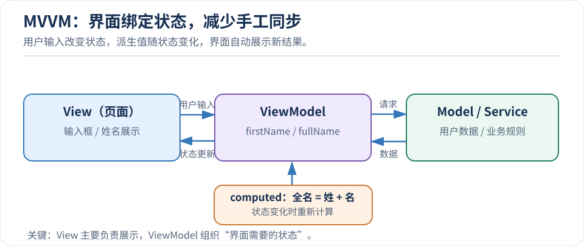

# 柒.2.3 有了MVC、MVP，为什么还要MVVM？

你做一个用户资料页：有昵称、头像、手机号、简介，还有“是否订阅消息”。数据一变化，就要在不同位置更新页面。

以前可能每改一个字段就写一次 `element.textContent = xxx`。十几个字段还好，字段一多，Presenter 或 Controller 就要写一堆“搬运数据”的代码。

MVVM 想解决的是：**把界面展示需要的数据和状态整理好，让界面与这份状态建立绑定，数据一改就自动更新对应位置。**

## 01. 三个角色说人话

- **Model：** 用户原始数据、接口访问和业务规则。
- **View：** 输入框、文字、列表等用户能看到的东西。
- **ViewModel：** 为界面整理好“当前昵称、是否正在加载、显示什么错误”等状态，并提供用户操作入口。

不同框架对这三个边界定义会有所不同，关键思想是：ViewModel 描述**界面需要什么状态**，View 不再负责到处查询和手动同步数据。




> **看图提示：** 箭头用于表达状态与用户输入的交互；MVVM 不要求所有实现都采用双向数据绑定。

## 02. Vue中的一个简单MVVM例子

```vue
<script setup>
import { ref, computed } from 'vue';

const firstName = ref('张');
const lastName = ref('三');
const fullName = computed(() => firstName.value + lastName.value);
const loading = ref(false);

async function save() {
  loading.value = true;
  try {
    await Promise.resolve(); // 这里模拟一次保存操作
  } finally {
    loading.value = false;
  }
}
</script>

<template>
  <label>姓：<input v-model="firstName" /></label>
  <label>名：<input v-model="lastName" /></label>
  <p>姓名：{{ fullName }}</p>
  <button :disabled="loading" @click="save">
    {{ loading ? '保存中...' : '保存' }}
  </button>
</template>
```

这里 `ref`、`computed` 和 `save` 可以看成 ViewModel 侧的展示状态与行为；模板负责界面。用户修改输入框，`fullName` 自动变化。无需手动写 `document.querySelector('p').textContent = ...`。

但不要以为 MVVM 就意味着“所有逻辑都该写在 Vue 组件里”。大型应用仍需提取服务与业务模型。

## 03. 为什么computed比到处调用updateUI更合适？

假设全名依赖名和姓。老办法是在两个输入框的 `input` 事件里都调用 `updateFullName()`。以后再加“显示名”字段，你又要找所有相关事件重新绑定。

用 `computed` 声明“全名依赖姓和名”，就把关系写进了数据模型。框架在变化时负责通知和刷新界面。

这叫**声明式**：描述“结果依赖谁”，而不是反复写“发生事件后请修改那个 DOM”。

## 04. MVVM会带来什么新问题？

自动绑定并不意味着复杂性消失，而是把一部分复杂性放到了响应式系统中。

比如多个组件共享可变对象时，谁改了状态可能不清楚；大量嵌套 watch 会让更新链难以追踪；过度双向绑定可能让输入与模型之间的关系变模糊。

因此，重要字段应明确数据流向；纯派生值优先使用计算属性；外部副作用才考虑 watch/Effect；状态管理应按业务边界组织。

## 05. MVVM和MVP哪个更先进？

不应这么问。MVP 让 Presenter 明确发出展示指令，容易把展示决策集中测试；MVVM 倾向于通过可观察状态与绑定减少这些命令式更新。

**区别更像分工方法，而非技术时代排名。** 复杂团队里甚至可能在不同层次同时使用它们的思想。

## 06. 面试追问

**MVVM一定需要双向绑定吗？** 不一定。很多 MVVM 实现同时使用单向数据流和可观察状态。双向绑定只是常见手段，不是定义的全部。

**ViewModel该不该直接访问数据库？** 通常不建议。它应通过服务或模型层与外部数据交互，让页面展示逻辑保持可测试。

**MVC、MVP、MVVM最终怎么选？** 根据框架生态、团队规模、测试策略和状态复杂度选。不要为了把图画成三层，给只有一个按钮的小页面造十五个文件。

## 延伸阅读

- [MVC的前世今生](7.2.1.md)
- [MVP又是什么](7.2.2.md)
